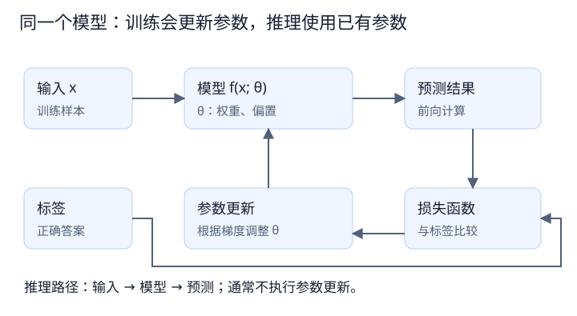

# 模型基础 01：模型、参数、训练与推理

- 日期：2026-10-14
- 阅读起点：有自动驾驶规划开发经验，模型相关知识从零开始。
- 本篇目标：理解模型在计算什么、参数是什么，以及训练和推理的区别。

## 1. 从你熟悉的程序开始

假设规划模块已经拿到了前方可通行宽度，可以写出一个判断：

```cpp
bool is_narrow_lane =
    available_width < vehicle_width + safety_margin;
```

这里有输入数据，也有工程师明确写出的规则。只要宽度估计、车辆尺寸和安全余量已经确定，程序就能按这个规则给出判断。

但如果输入是一张摄像头图片，事情就复杂了。图片本身没有一个叫 `available_width` 的字段。我们还要处理两侧边界、透视关系、遮挡、光照变化，以及墙、车辆、灌木等不同物体。

这时可以使用学习型模型：人先确定计算结构，再用数据调整结构里的参数，让模型建立输入与输出之间的关系。

| 比较项           | 显式规则程序         | 学习型模型                               |
| ---------------- | -------------------- | ---------------------------------------- |
| 如何表达判断方法 | 工程师明确编写规则   | 工程师选定结构，通过训练调整参数         |
| 人需要做什么     | 设计规则、实现和测试 | 定义任务、准备数据、选择结构、训练和验证 |
| 运行时做什么     | 按规则计算           | 按模型结构和参数计算                     |
| 如何改进         | 修改规则或配置       | 可能调整数据、结构、训练方法或参数       |

两种方法可以同时存在于一个系统中。例如，模型提供场景判断，规划模块再结合车辆状态和明确的约束决定如何行驶。

## 2. 模型是什么

在本篇讨论中，模型可以先理解为一个带有可调整参数的计算函数：

```text
输入 → 按规定流程进行计算 → 输出
```

输入和输出取决于任务。例如：

| 任务     | 输入示例 | 输出示例                   |
| -------- | -------- | -------------------------- |
| 图像分类 | 一张图片 | 各类别分数，进一步得到类别 |
| 目标检测 | 一张图片 | 目标位置和类别等信息       |
| 数值预测 | 一组数值 | 一个预测数值               |

这些例子只用于说明模型可以处理不同任务。具体模型接收什么格式、输出什么格式，需要看任务定义和代码。

对于图像分类，图片会被转换成数值数组。模型处理的是这些数值，经过多步计算产生输出。它不会自动获得“墙”“道路”这些人类概念的定义；它能学到什么，取决于计算结构、数据和训练过程。

## 3. 用最简单的公式理解参数

先看一个只有两个参数的模型：

```text
y = w × x + b
```

各个符号的含义是：

| 符号 | 含义               | 例子               |
| ---- | ------------------ | ------------------ |
| `x`  | 输入               | 本次输入为 3       |
| `y`  | 算出的输出         | 根据公式计算得到   |
| `w`  | 权重，是模型参数   | 可以取 2、4 等数值 |
| `b`  | 偏置，也是模型参数 | 可以取 1、0 等数值 |

这里的模型结构就是“先乘，再加”。参数则是乘多少、加多少。

固定输入 `x = 3`，比较不同参数：

| `w` | `b` | 计算过程    | 输出 `y` |
| --: | --: | ----------- | -------: |
|   2 |   1 | `2 × 3 + 1` |        7 |
|   4 |   1 | `4 × 3 + 1` |       13 |
|   2 |   0 | `2 × 3 + 0` |        6 |

计算结构相同，参数不同，同一个输入就可能产生不同结果。

这个公式是教学例子，不是实际窄道图片分类模型。先理解这个例子，有助于理解大型网络为什么需要训练参数。

<a id="parameters"></a>

## 4. 权重和偏置分别做什么

### 4.1 权重：调整输入的影响

在 `y = w × x + b` 中，如果保持 `b` 不变，输入每增加 1，输出就增加 `w`。

例如 `w = 2、b = 1`：

```text
x = 1 → y = 3
x = 2 → y = 5
x = 3 → y = 7
```

如果 `w` 是负数，输入增大时，输出会减小。如果 `w = 0`，这个公式的输出就不再随 `x` 变化。

所以这里的权重不只是“重要程度”的标签，它是直接参与乘法计算的数值。

### 4.2 偏置：调整整体偏移

保持 `w = 2`，比较两组公式：

```text
y = 2 × x
y = 2 × x + 1
```

对于任意相同的 `x`，第二组的结果总比第一组大 1。这个加上的数值就是偏置。

也可以观察 `x = 0` 的情况：

```text
y = w × 0 + b = b
```

在这个简单模型中，偏置决定了输入为 0 时的输出。后面学习神经网络层时，会再次遇到权重和偏置。

关联阅读：这里的单输入权重与偏置，可扩展为[02 第 1 节的向量与矩阵计算](02_激活函数.md#affine)。

关联阅读：在图片上，同一套权重还会跨空间位置复用，见[04 第 5 节：权重共享](04_卷积与特征图.md#sharing)。

<a id="structure"></a>

## 5. 结构、参数和配置要区分

初学时，“参数”这个词容易混用。函数调用的参数、模型里学习的参数，以及训练配置，都可能被口头称为参数，但作用不同。

| 类型                   | 例子                       | 谁决定或调整                         |
| ---------------------- | -------------------------- | ------------------------------------ |
| 模型结构               | 几个阶段、每层如何连接     | 通常由人选择或设计                   |
| 可学习的模型参数       | 权重、偏置                 | 由训练算法调整，部分参数也可能被冻结 |
| 训练配置，常称为超参数 | 学习率、批次大小、训练轮数 | 通常由人设置并通过实验比较           |
| 本次输入数据           | 一张图片、一批数值         | 来自数据集或运行环境                 |

例如，`y = w × x + b` 的结构已经确定。训练可以改变 `w`、`b`，但不会因为调整了它们就自动把公式改成另一套计算流程。

同样，神经网络中指定了某一层的通道数后，普通训练通常调整该层内部的权重数值，并不会自动决定换一种通道数。

关联阅读：区分模型参数和本次算出的特征值，可看[03 第 2 节：权重与特征的对照](03_特征与中间表示.md#weights)。

## 6. 训练：用数据调整模型参数

我们先讨论一种常见方式：监督学习。训练数据既有输入，也有与输入对应的正确答案；这个答案通常叫标签。

假设我们希望简单模型拟合下面的数据：

| 输入 `x` | 标签，即希望得到的输出 |
| -------: | ---------------------: |
|        1 |                      3 |
|        2 |                      5 |
|        3 |                      7 |

这些数据符合 `y = 2 × x + 1`，但训练程序不会直接从我们这句话里获得答案。它会从初始参数出发，用训练方法逐步调整。

例如，初始参数是 `w = 1、b = 0`。对于 `x = 3`：

```text
模型预测：1 × 3 + 0 = 3
正确答案：7
```

预测和答案之间存在差距。训练过程需要用一个数值衡量差距，再据此调整参数。

```text
取出输入和标签
    ↓
模型计算预测结果
    ↓
比较预测与标签，计算损失
    ↓
通过训练算法调整模型参数
    ↓
继续处理训练数据
```

损失、梯度和优化器会在后续分别解释。当前只需要理解：训练的目标是让参数更适合任务，具体更新不是靠人逐个手动猜数值。

训练也不保证获得完美结果。即使训练数据上的误差很小，面对新的数据仍可能判断错误，因此还需要验证。



图中 θ 统称模型参数。标签与预测用于计算损失，损失相关的梯度用于更新参数；推理通常只经过输入、模型和预测这条路径。

## 7. 推理：使用已有参数计算结果

假设训练后得到 `w = 2、b = 1`。现在给一个新输入 `x = 4`：

```text
y = 2 × 4 + 1 = 9
```

这就是一次推理：使用已有参数，根据输入计算输出。

| 比较项           | 训练                     | 推理               |
| ---------------- | ------------------------ | ------------------ |
| 主要目的         | 调整参数，使模型适合任务 | 使用模型得到结果   |
| 是否需要标签     | 本篇的监督训练需要       | 单纯生成预测不需要 |
| 是否更新参数     | 通常更新参与训练的参数   | 通常不更新参数     |
| 是否执行模型计算 | 是                       | 是                 |

训练也包含“把输入送进模型并得到输出”这个过程，通常称为前向计算。训练随后还会计算损失并更新参数。

如果推理之后拿正确答案来比较结果，那是在评估预测效果；比较本身不等于训练。是否训练，要看有没有执行相应的参数更新过程。

## 8. 联系规划开发经验

规划代价函数可能写成：

```text
总代价 = w1 × 平滑代价 + w2 × 障碍物代价 + w3 × 偏离参考线代价
```

调整权重会改变不同候选轨迹的评价，从而影响规划结果。这可以帮助理解“数值参数会影响计算结果”。

但类比有一个边界：规划中的这些代价项通常由工程师明确设计，具有可解释的含义；神经网络中的大量权重共同参与计算，通常无法逐个命名为“道路宽度权重”或“墙体权重”。

因此，可以借助规划经验理解参数的作用，但不要假设神经网络中的每个参数都对应一个明确业务规则。

## 9. 常见误解

### 模型自己会决定所有规则吗？

人仍需要定义任务、准备数据、选择计算结构和训练方法。训练是在这些条件下调整参数。

### 权重越大，模型就越好吗？

没有这种通用关系。参数数值需要配合输入和其他参数才能判断作用，模型效果要通过任务指标评估。

### 推理时遇到新图片，就会自动学会它吗？

通常不会。普通推理使用现有参数计算。学习新数据需要额外的训练或更新机制。

### 神经网络是不是把训练图片都保存下来，然后查找最像的一张？

普通神经网络的推理不是简单查表。它使用训练得到的参数计算，但也可能过度记住训练数据；后面会用“过拟合”解释这个问题。

## 10. 回顾题

1. 对 `y = w × x + b`，哪些是输入、输出和模型参数？
2. 同一个输入为什么会因参数变化得到不同结果？
3. 训练和推理都执行前向计算，它们的主要区别是什么？
4. 调整学习率和调整模型权重，是不是同一件事？

参考答案：

1. `x` 是输入，`y` 是输出，`w` 和 `b` 是模型参数。
2. 参数直接参与计算，它们变化会改变函数的输出。
3. 训练通常根据数据和损失更新参数，推理通常使用已有参数得到结果。
4. 不是。学习率是控制训练更新的配置；权重是模型计算中使用的可学习参数。

## 11. 学习进度与下一步

本篇已讨论模型结构、权重、偏置、训练和推理。监督学习、标签和损失在文中用于串起流程，其中损失的具体计算尚未展开。

学习节奏更新：读者已熟悉误差、代价函数等概念，后续无需逐一重复。下一篇转向神经网络特有的机制，见 [02：为什么神经网络需要激活函数](02_激活函数.md)。

## 与整体架构的联系

第 06 篇的 backbone、neck、head 属于结构划分；其中卷积和分类层的权重属于可学习参数。选择模块与训练权重是两个不同的设计层次。

参见 [06：整体架构与模块职责](06_整体架构与模块职责.md)，其中“从旧知识读懂 backbone 输出”给出联合示例。
