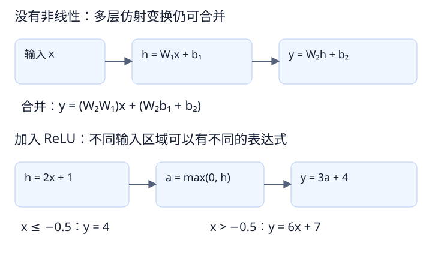
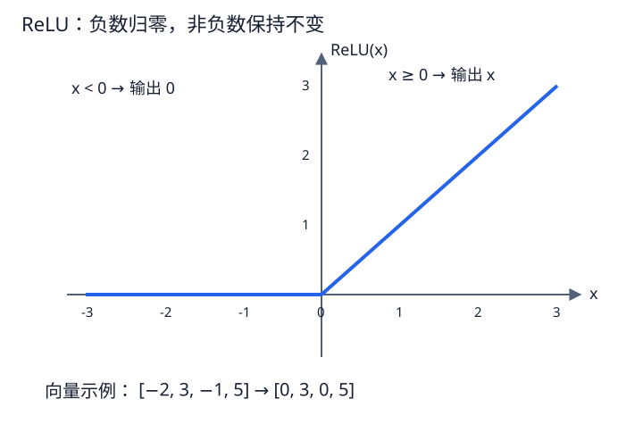

# 模型基础 02：为什么神经网络需要激活函数

- 日期：2026-10-14
- 阅读起点：熟悉工程开发、误差、代价函数和基本优化思路，开始学习神经网络特有的机制。
- 本篇目标：理解多层仿射变换的限制、激活函数的作用，以及它在网络中的位置。

<a id="affine"></a>

## 1. 先看一层在做什么

一种常见的神经网络层会计算：

```text
h = Wx + b
```

这里 x 是输入向量，W 是权重矩阵，b 是偏置向量，h 是输出向量。矩阵乘法把多个输入按不同权重组合起来，偏置再调整输出。

严格来说，加上偏置的计算叫仿射变换；没有偏置的 Wx 才是线性变换。讨论网络时，人们也常把包含偏置的层简称为“线性层”。理解推导时，需要知道这个区别。

例如，三个输入可以被组合成两个输出：

```text
h₁ = w₁₁x₁ + w₁₂x₂ + w₁₃x₃ + b₁
h₂ = w₂₁x₁ + w₂₂x₂ + w₂₃x₃ + b₂
```

输出有几个分量，由这一层的结构决定；每个分量怎样组合输入，则受参数影响。

关联阅读：式中的 W、b 是可学习参数；其基本含义见[01 第 4 节：权重和偏置](01_模型与参数.md#parameters)。

## 2. 为什么只增加层数还不够

假设连续执行两层，中间没有其他操作：

```text
h = W₁x + b₁
y = W₂h + b₂
```

将第一行代入第二行：

```text
y = W₂(W₁x + b₁) + b₂
  = (W₂W₁)x + (W₂b₁ + b₂)
```

令 W = W₂W₁、b = W₂b₁ + b₂，就得到 y = Wx + b。

也就是说，两层仍然等价于一次仿射变换。继续增加这种层，依然可以合并。它可能改变参数化方式和优化过程，但不会因此突破仿射函数这一表达范围；中间维度受限时，还可能限制合并后矩阵的秩。

一个标量例子更容易检查：

```text
第一层：h = 2x + 1
第二层：y = 3h + 4
合并后：y = 6x + 7
```

执行步骤变多了，最终函数仍然只有一条直线。



图中上半部分可合并成一次仿射变换；下半部分加入 ReLU 后，整体成为分段函数。

<a id="relu"></a>

## 3. 激活函数放在哪里

通常在这些变换之间加入非线性函数：

```text
h = ReLU(W₁x + b₁)
y = W₂h + b₂
```

ReLU 的定义是：

```text
ReLU(z) = max(0, z)
```

它通常逐元素执行，不把多个元素合在一起：

```text
输入：[-2, 3, -1, 5]
输出：[ 0, 3,  0, 5]
```

ReLU 本身不改变这组数据的形状，也没有需要学习的权重。不同激活函数不一定都具有这两个性质，但常见的 ReLU 和 SiLU 都是逐元素计算且没有可学习参数。

“激活”是函数名称，不表示启动某一层，也不表示切换训练模式。



曲线左侧为零，右侧等于输入本身。向量中的每一个元素独立经过同一函数。

关联阅读：把 ReLU 放进完整的特征计算，见[03 第 1 节：三个输入形成两个特征](03_特征与中间表示.md#features)。

## 4. 加入 ReLU 后，函数发生了什么变化

对前面的标量例子，在中间加上 ReLU：

```text
h = max(0, 2x + 1)
y = 3h + 4
```

分情况来看：

```text
x ≤ -0.5：h = 0，      y = 4
x > -0.5：h = 2x + 1，y = 6x + 7
```

这时整个函数不再是一条直线，而是由两段组成。不同输入区域采用不同的表达式，通常不能合并成单个 Wx + b。

| x | 2x + 1 | ReLU 后的 h | 最终 y |
|---:|---:|---:|---:|
| -2 | -3 | 0 | 4 |
| -1 | -1 | 0 | 4 |
| 0 | 1 | 1 | 7 |
| 1 | 3 | 3 | 13 |

由多个单元、多个层组合，可以形成更复杂的输入与输出关系。这里说明的是表达能力的来源，并不意味着层数越多，实际效果就一定越好。

## 5. ReLU 是分段线性的，为什么还叫非线性

每一段可以很简单，但整个函数不满足线性变换的性质。例如：

```text
ReLU(-1 + 1) = 0
ReLU(-1) + ReLU(1) = 1
```

两者不相等，所以 ReLU 不是线性函数。

“非线性”也不要求公式包含平方、指数或特别复杂的计算。像 max 这样简单的操作，就可以打破多层仿射变换直接合并的条件。

<a id="code"></a>

## 6. 联系模型代码

阅读代码时，可以先辨认这类结构：

```text
Linear → 激活函数 → Linear
```

图像网络中也经常看到类似模式：

```text
卷积 → 归一化 → 激活函数
```

卷积负责按结构组合输入，归一化负责另一类数值处理，激活函数在这里提供非线性。后续会分别讲卷积与归一化，当前不要把三者当成同一种操作。

在之前的项目配置里，act="SiLU" 指定了使用 SiLU 激活函数。这是项目配置的含义；具体创建过程需要看项目代码。

SiLU 的形式是：

```text
SiLU(z) = z × sigmoid(z)
sigmoid(z) = 1 / (1 + exp(-z))
```

它是平滑的非线性函数，负输入不一定被直接置零。这个公式用于留作查阅，聊天中尚未逐步展开其行为和选择依据。

关联阅读：卷积与激活是两步操作，见[04 第 3 节：卷积产生负值后是否置零](04_卷积与特征图.md#movement)。

## 7. 与规划优化经验的联系

你熟悉的优化问题中，代价项可以是非线性的。但模型中的激活函数作用于前向计算的中间结果，改变的是模型能够表达的函数形式。

因此，“损失函数是非线性的”和“模型有非线性激活”是两件事。即使给仿射模型配一个复杂损失，它的前向映射仍然受自身结构限制。

## 8. 当前掌握范围与下一步

已在聊天中解释：

- 连续仿射变换为什么可以合并。
- ReLU 的逐元素计算方式。
- 在层之间加入非线性的目的。
- act 配置与激活函数之间的关系。

本篇的分段计算和 SiLU 公式是扩展查阅内容，尚未逐项讨论。保存笔记不等于已经掌握所有扩展内容。

下一步：结合具体输入理解一个神经网络层如何将多个数值组合成新的表示，再进入卷积和特征图。

## 与整体架构的联系

第 06 篇所说的特征提取模块，内部通常包含卷积和激活函数。选择更深的骨干时，需要同时考虑计算组合和非线性，而不是仅统计层数。

参见 [06：整体架构与模块职责](06_整体架构与模块职责.md)，其中“从旧知识读懂 backbone 输出”给出联合示例。
