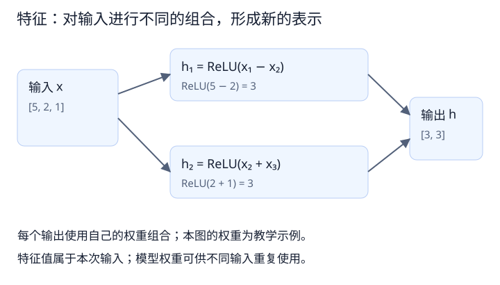

# 模型基础 03：特征、隐藏层与中间表示

- 更新日期：2026-10-20
- 先修内容：[激活函数](02_激活函数.md)。
- 目标：把“提取特征”还原为具体计算，区分特征值、模型参数和特征维度。

<a id="features"></a>

## 1. 特征是计算结果的一种表示

说模型“提取特征”，不一定表示从输入中原样挑出几项。它也可以通过加权组合和非线性计算，把输入转换成新的数值表示。



图中的输入为 `[5, 2, 1]`，两条计算分支分别为：

```text
h₁ = ReLU(x₁ − x₂) = 3
h₂ = ReLU(x₂ + x₃) = 3
输出 h = [3, 3]
```

第一条分支对第一个数超过第二个数的部分产生响应；第二条分支对第二和第三个数的和产生响应。这里有意选了容易解释的权重，实际网络的特征通常没有这么清楚的名称。

两个输出恰好都等于 3，不代表它们表达同一种关系。特征值的含义来自它的计算方式和所在位置，不能只看数值。

关联阅读：本例中的 ReLU 对加权和逐元素处理；回顾[02 第 3 节：激活函数的位置与计算](02_激活函数.md#relu)。

<a id="weights"></a>

## 2. 每个输出使用不同的权重组合

用完整形式表示：

```text
h₁ = ReLU(w₁₁x₁ + w₁₂x₂ + w₁₃x₃ + b₁)
h₂ = ReLU(w₂₁x₁ + w₂₂x₂ + w₂₃x₃ + b₂)
```

图里的第一套权重是 `[1, -1, 0]`，第二套是 `[0, 1, 1]`，偏置均为 0。真实训练中，这些权重通常通过训练算法调整。

| 对象 | 本例 | 作用 |
|---|---|---|
| 输入 | `[5, 2, 1]` | 本次处理的数据 |
| 权重 | `[1, -1, 0]` 等 | 规定怎样组合输入 |
| 偏置 | 0 | 调整组合后的偏移 |
| 特征 | `[3, 3]` | 本次输入经过该层后的中间结果 |

换一组输入，特征通常会改变；普通推理中的权重仍使用已经确定的数值。所以，不能把“本次算出了 128 个特征值”理解成“本次训练得到了 128 个参数”。

关联阅读：权重、输入与特征不能混为一谈；更完整的分类见[01 第 5 节：结构、参数和配置](01_模型与参数.md#structure)。

<a id="outputs"></a>

## 3. 为什么三个输入能变成 128 个输出

可以为每个输出设置一套不同权重。若使用一个全连接层，把 3 维输入映射成 128 维输出：

```text
输入 x：3 个数
权重 W：128 × 3 个数
偏置 b：128 个数
输出 h：128 个数
```

权重共有 `128 × 3 = 384` 个，加上偏置后共有 512 个可学习参数。若后面接一个普通 ReLU，它逐元素处理这 128 个输出，不增加可学习参数，也不改变输出维度。

这只是全连接层的例子。卷积层还有空间维度，其参数量与卷积核大小、输入通道数有关，不能直接套用这一计算。

输出维度增加，表示模型提供了更多种组合结果；它没有凭空获得新的传感器观测，也不保证这些结果互相独立或都有用。

关联阅读：把小向量的全连接参数量放大到图片输入，见[04 第 1 节：为什么需要约 1.57 亿个权重](04_卷积与特征图.md#dense)。

## 4. 隐藏层与层级表示

把这样的计算连续连接，就得到：

```text
原始输入 → 隐藏层 1 的表示 → 隐藏层 2 的表示 → 最终输出
```

隐藏层位于模型内部，其输出会被后续层使用。“隐藏”不代表不能查看，也不表示参数被冻结。调试时可以读取和分析这些中间输出。

后续层继续组合前一层的结果，形成不同层级的表示。图像网络中，人们常用边缘、纹理、局部形状等帮助解释某些特征响应，但这不是每个通道固定对应某一类物体的保证。

<a id="channels"></a>

## 5. 特征维度与通道

对于一个向量，可以用“维度”描述它有多少个分量。例如 `[3, 3]` 是一个二维向量。

图像网络会保留空间组织。例如，一张中间特征可以表示为：

```text
C × H × W
```

- `C`：通道数，即有多少张特征图。
- `H、W`：每张特征图的高和宽。

一张 `128 × 80 × 80` 的特征包含 128 张 `80 × 80` 的特征图，共 819,200 个数值。它不能简单理解成“只有 128 个数”，也不表示存在 128 个明确可命名的语义类别。

如果一次处理 B 张图片，常见布局为 `[B, C, H, W]`。不同框架或代码也可能采用其他布局，阅读时应确认维度约定。

关联阅读：三个输入通道怎样组合成多个输出通道，见[04 第 8 节：RGB 多通道卷积](04_卷积与特征图.md#rgb)。

关联阅读：通道数可以改变而不扩大空间感受野，见[05 第 9 节：1×1 卷积](05_感受野.md#pointwise)。

设计应用：C×H×W 特征怎样变成分类输入，以及空间平均后保留什么，见 [06 第 11 节：分类 head 的两种设计](06_整体架构与模块职责.md#classification-head)。

设计应用：多层特征融合前如何检查通道与空间维度，见 [06 第 13 节：单层输出与多层融合](06_整体架构与模块职责.md#multilevel-features)。

## 6. 阅读代码时怎样判断当前对象

看到变量或打印结果时，可以依次确认：

1. 它是模型参数，还是一次前向计算得到的输出？
2. 如果是输出，各维分别代表什么？
3. 当前只是记录形状规格，还是已经有实际数据？

例如，配置中的 `output_channels = 128` 是规格信息；实际运行产生的 `[B, 128, H, W]` 张量才包含本批输入对应的特征值。

## 7. 回顾与学习边界

本篇整理了聊天中已经讲过的特征变换，并补充了参数量、隐藏层和张量形状的查阅说明。补充内容尚未逐项展开。

回顾时可以用一句话自查：模型权重决定如何计算，特征是本次输入经过计算后得到的表示。下一篇进入卷积，解释图片上的局部组合与权重共享。

## 8. 回顾问答：颜色通道、特征用途与黑盒

### RGB 的三个通道是否就是三张特征图

从结构上看，RGB 图片包含三张 H×W 的二维数值图，通常称为颜色通道。红、绿、蓝的含义事先确定。卷积输出的每个通道通常称为一张特征图，其计算方式由学到的权重决定。部分资料也把原始输入称为输入特征图，应结合语境理解。

```text
RGB 输入：3×H×W → 卷积 → 中间特征：32×H′×W′
三个颜色通道               32 张特征图
```

### 隐藏层特征有什么用

上一层的特征就是下一层的输入。逐层变换让后续计算能够利用与任务相关的关系，最终形成分类判断。例如笔记中的 h₁、h₂ 可以继续被下一层组合为 z=a×h₁+b×h₂+c。

```text
图片 → 局部响应 → 更大范围的组合表示 → 窄道 / 非窄道判断
```

边缘、纹理、形状可帮助理解部分响应，但不能保证每个通道对应一个明确的语义名称，也不能保证每个特征都有用。

### 特征计算是否是黑盒

计算过程可以查看和复算：输入、权重、乘加、激活和中间输出都有明确数值。难点是解释大量计算组合后，每个特征究竟表达什么，以及它如何影响整体判断。所谓黑盒通常指内部表示和整体行为难以解释，不是数学运算不可见。

## 与整体架构的联系

第 06 篇的模块接口传递的是这里讲的中间表示。backbone 输出特征，head 使用特征完成分类；输出通道数描述表示的规模，并不等于类别数。

参见 [06：整体架构与模块职责](06_整体架构与模块职责.md)，其中“从旧知识读懂 backbone 输出”给出联合示例。

<a id="channel-intuition"></a>

## 9. 通道怎么理解：同一位置的不同数值分量

通道是数据组织中的一个维度。对一张图像或中间特征而言，每个通道是一张 H×W 数值表；同一个空间位置在各通道上各有一个数。

以 3×2×2 的 RGB 图片为例，数值仅作示意：

```text
R 通道       G 通道       B 通道
10  20       50  60       90  100
30  40       70  80      110  120
```

从左上角一个位置看，三个通道提供 [10,50,90]；从整个通道看，R 通道包含所有位置的红色分量。两种视角描述的是同一份数据。

RGB 三个通道的含义由图像格式确定。经过卷积后，通道通常不再分别表示红绿蓝，而是模型计算出的不同特征响应。每个输出通道对应一套过滤器；普通卷积 groups=1 时，每套过滤器读取全部输入通道，而不是只处理一个颜色。

```text
3 个 RGB 通道
    ↓ 32 套不同过滤器，各自读取三个输入通道
32 个输出特征通道
```

通道数由结构设置，权重由训练调整。32 个输出通道不是简单复制输入 32 次，也不等于 32 个类别。对某张图，不同通道的数值可能相同；它们是不同计算分量，不保证各自有明确名称或相互独立。

因此，128×80×80 可以同时读成“128 张 80×80 的特征图”，也可以读成“80×80 个空间位置，每个位置有 128 个特征数值”。

关联阅读：[04 第 8 节：三个输入通道如何形成一个输出通道](04_卷积与特征图.md#rgb)、[06 第 10 节：通道数、空间尺寸与感受野](06_整体架构与模块职责.md#backbone-output)。
