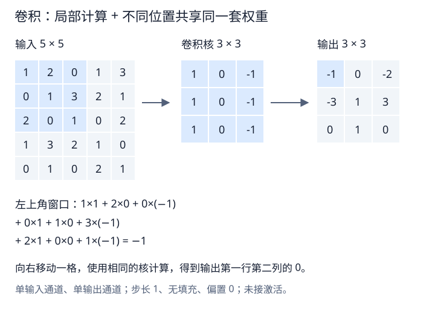
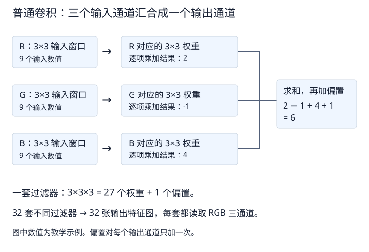
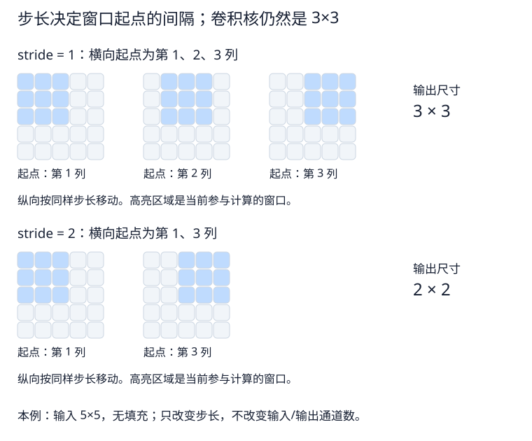
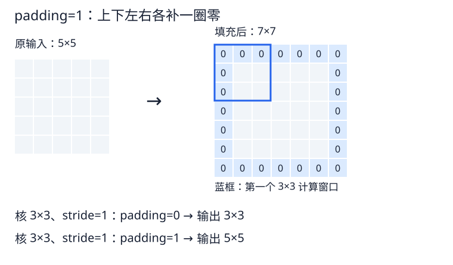

# 模型基础 04：卷积、局部连接与权重共享

- 更新日期：2026-10-20
- 先修内容：[特征与中间表示](03_特征与中间表示.md)。
- 目标：通过一个完整数值例子，理解卷积核如何在图像不同位置计算，产生特征图。

<a id="dense"></a>

## 1. 为什么图片上常用卷积

一张 `640 × 640` 的 RGB 图片包含：

```text
640 × 640 × 3 = 1,228,800 个数值
```

如果展开成向量，并让一个全连接层输出 128 个数，每个输出使用全部输入，就需要：

```text
1,228,800 × 128 = 157,286,400 个权重
```

### 为什么每个输出都需要一整套权重

展开只是把 640×640×3 个输入数值按固定顺序排列成向量，不会减少数值个数，也不会产生可学习权重。记输入长度为 N=1,228,800。

全连接层中，一个输出是全部输入的加权和：

```text
y₁ = w₁,₁×x₁ + w₁,₂×x₂ + … + w₁,N×xN + b₁
```

每个输入到这个输出的连接都有自己的可学习权重，因此仅 y₁ 就需要 N 个权重。y₂ 再用另一套 N 个权重，依次类推，128 个输出合计需要 128×N 个权重。不同连接的权重是独立参数，不要求数值一定不同。

缩小到三个输入、两个输出：

```text
同一份输入 [x₁, x₂, x₃]
  ├─ 权重 [a₁, a₂, a₃] → y₁ = a₁x₁+a₂x₂+a₃x₃+b₁
  └─ 权重 [c₁, c₂, c₃] → y₂ = c₁x₁+c₂x₂+c₃x₃+b₂

3 个输入 × 2 个输出 = 6 个权重，另有 2 个偏置。
```

放回原例：权重矩阵形状为 128×1,228,800，每一行负责一个输出，每一列对应一个输入。输入被多个输出复用，权重参数则为每条连接单独设置。模型训练时更新这些参数，普通推理中换图不会重新生成一套参数。

参数多源于全连接的这种连接方式，不是所有“从图片输出 128 个数”的模型都必须使用这么多参数。卷积的局部连接与空间权重共享，可以用更少的参数组织图像计算。

若再加上 128 个偏置，共有 157,286,528 个参数。仅按每个参数 4 字节计算，参数存储就约 600 MiB，尚未包含训练时的梯度、中间结果等。

图像还有明显的空间结构：相邻像素形成局部图案，相似图案可能出现在不同位置。卷积通过局部连接和权重共享利用这两个特点。

关联阅读：先回顾较小的 3→128 例子，见[03 第 3 节：输出数量与参数量](03_特征与中间表示.md#outputs)，再比较图片全连接的规模。

设计应用：将全连接参数量公式用于实际 head：16386 与 18 个参数的比较，见 [07 第 1 节：分类 head 的两种设计](07_分类Head与空间汇总.md#classification-head)。

## 2. 单通道卷积的完整示例



本图的约定：单输入通道、单输出通道，卷积核 `3 × 3`，步长为 1，不补边，偏置为 0，输出后尚未接激活函数。

左侧高亮的 `3 × 3` 区域与中间卷积核逐位置相乘，再把九个乘积相加。左上角输出为：

```text
  1×1 + 2×0 + 0×(-1)
+ 0×1 + 1×0 + 3×(-1)
+ 2×1 + 0×0 + 1×(-1)
= -1
```

把 `-1` 放在输出特征图的第一行第一列。这一次计算只得到一个位置上的一个数。

这里使用深度学习中常见的“卷积”约定，即直接对应相乘，不先翻转卷积核；从严格数学术语看，这种运算是互相关。当前先按图中的计算方式理解即可。

<a id="movement"></a>

## 3. 移动窗口后会发生什么

窗口向右移动一个位置，取到：

```text
2  0  1
1  3  2
0  1  0
```

仍然使用同一个卷积核：

```text
  2×1 + 0×0 + 1×(-1)
+ 1×1 + 3×0 + 2×(-1)
+ 0×1 + 1×0 + 0×(-1)
= 0
```

因此，输出第一行第二列为 0。重复移动并计算，得到图中完整输出：

```text
-1   0  -2
-3   1   3
 0   1   0
```

这些负值是合法的卷积输出。若后续接 ReLU，负值才会被置零；本图没有执行这一步。

关联阅读：卷积本身可以输出负值；后接 ReLU 时怎样处理，见[02 第 6 节：卷积与激活的分工](02_激活函数.md#code)及[第 3 节的逐元素计算](02_激活函数.md#relu)。

<a id="local"></a>

## 4. 局部连接具体指什么

图中每个输出只直接使用输入的一个 `3 × 3` 窗口，没有直接使用整张 `5 × 5` 输入。这个局部窗口就是此输出在这一层直接看到的区域。

下一层再组合相邻输出，可能间接依赖更大范围的原始输入。这个扩展就是后面笔记 05 讨论的“感受野”。因此，局部连接不表示深层输出永远只能使用原图中的一个很小区域。

关联阅读：下一层怎样间接使用更大范围的原始输入，已在[05 第 1 节：两层计算与感受野](05_感受野.md#receptive)展开。

<a id="sharing"></a>

## 5. 权重共享具体指什么

移动到不同位置时，九个权重保持相同。左上角计算和右下角计算使用同一套参数，这叫在空间位置上共享权重。

对于本图的单输入、单输出通道卷积：

- 卷积核有 9 个权重。
- 如果启用偏置，再有 1 个偏置参数，该偏置也在输出空间位置间共享。
- 输入图片变大时，通常需要计算更多位置，但不会因此给这个核增加权重。

模型结构确定后，核权重通常在推理时保持不变，在训练更新时改变。窗口移动本身不是学习过程。

关联阅读：共享的是权重和偏置，不是各位置的输入或输出值；参数含义见[01 第 4 节](01_模型与参数.md#parameters)。

## 6. 为什么输出是 3×3

输入一行有 5 个位置，窗口宽度为 3，不允许越出边界。窗口左边缘只有 3 个合法起点：第 1、2、3 列。纵向也是如此，因此输出为 `3 × 3`。

在无填充、步长为 1、无膨胀的当前例子里：

```text
输出高度 = 输入高度 − 核高度 + 1 = 5 − 3 + 1 = 3
输出宽度 = 输入宽度 − 核宽度 + 1 = 5 − 3 + 1 = 3
```

这里只解释当前设置。填充、步长和膨胀改变后，需要使用相应的尺寸公式；它们是后续主题。

## 7. 从一个核到特征图

核是可学习参数，特征图是本次输入的计算结果。图片变化时，输出特征图可能变化；普通推理中仍使用同一个已经训练好的核。

本图的核会比较窗口中左列与右列的数值之和，因而可以帮助说明局部变化响应。但这是为了教学而手动选的核，不代表所有训练出的卷积核都有明确、单一的解释。

还需要限定“一个核得到一张特征图”的语境：本篇只有一个输入通道。多输入通道时，一个输出通道对应的过滤器需要覆盖所有参与计算的输入通道，分别计算后求和。下面会用 RGB 图片讲清楚这一点。

<a id="rgb"></a>

## 8. 多输入通道：RGB 怎样得到一个输出通道

概念回顾：[03 第 9 节：通道怎么理解](03_特征与中间表示.md#channel-intuition)，先区分颜色分量与卷积后的特征通道。



RGB 图片有三个输入通道。普通卷积中，一个输出通道对应的过滤器同时覆盖所有输入通道。空间大小为 `3 × 3` 时，它有三片 `3 × 3` 权重，分别与 R、G、B 通道的局部窗口计算。

三个通道的计算结果相加，再加这个输出通道的一个偏置，得到一个位置的一个输出值。例如：

```text
R 通道计算结果 =  2
G 通道计算结果 = -1
B 通道计算结果 =  4
输出通道的偏置 =  1
最终结果 = 2 - 1 + 4 + 1 = 6
```

三个通道使用不同的权重；同一片权重在空间位置之间共享。偏置在每个输出位置加一次，而不是对三个输入通道各加一次。

一套这样的过滤器有 `3 × 3 × 3 = 27` 个权重，启用偏置时共 28 个参数。要输出 32 张特征图，就使用 32 套不同的过滤器，每套都读取全部三个输入通道。

```text
普通卷积的权重数量 = 输出通道数 × 输入通道数 × 核高度 × 核宽度
Conv(3, 32, kernel_size=3)：32 × 3 × 3 × 3 = 864 个权重
若启用偏置：再加 32 个参数，总计 896 个
```

这里说的空间 `3 × 3` 没有包含输入通道这个维度。有时口头把每一片二维权重、整个过滤器都叫卷积核，容易混淆；读代码时确认完整形状和输入/输出通道数即可。

上述参数量用于普通卷积，即 `groups=1`。分组卷积和深度卷积的通道连接方式不同，后续再讨论。

关联阅读：若对通道与 H、W 的区别不确定，先看[03 第 5 节：C×H×W 的含义](03_特征与中间表示.md#channels)。

<a id="stride"></a>

## 9. 步长 stride：窗口每次移动多远

- 本节更新日期：2026-10-19。
- 本节聚焦空间尺寸变化，不引入新的通道连接方式。



步长控制相邻计算窗口起点之间的间隔。`stride=1` 表示每次移动一个位置，`stride=2` 表示每次移动两个位置。常见的单个整数设置同时用于横向和纵向；也可以分别设置两个方向。

固定输入为 `5 × 5`、核为 `3 × 3`，不补边：

| 设置 | 横向合法起点，按 1 开始编号 | 纵向合法起点 | 输出空间尺寸 |
|---|---|---|---|
| stride=1 | 第 1、2、3 列 | 第 1、2、3 行 | 3×3 |
| stride=2 | 第 1、3 列 | 第 1、3 行 | 2×2 |

步长变大后，计算输出的位置变少，因此输出特征图可以变小。这就是带步长卷积能够执行下采样的原因。

注意，“移动两格”不表示卷积核只看隔一个的像素。每次仍然读取完整的 `3 × 3` 局部窗口，改变的是相邻窗口起点。它也不等于先按步长抽样输入、再进行普通卷积。

关联阅读：步长改变空间尺寸后，对单点信息范围的影响见[05 第 7 节：特征图变小、感受野变大](05_感受野.md#downsample)。

设计应用：下采样怎样影响间隙细节与整体关系表示的取舍，见 [06 第 11 节：从局部存在到空间关系](06_整体架构与模块职责.md#spatial-relations)。

设计应用：不同下采样层的特征怎样作为独立接口交给后续模块，见 [08 第 1 节：单层输出与多层融合](08_多层特征融合与Neck设计.md#multilevel-features)。

## 10. 步长与通道是两个独立维度

一个卷积层可以同时设置输出通道数和步长。前者控制有多少套过滤器；后者控制在多少个空间位置计算。

```text
输出通道数：决定输出有多少张特征图
stride：影响每张输出特征图的高和宽
```

所以，通道增加、空间尺寸缩小可以发生在同一个层里。更大的步长本身并不会自动增加通道数，也不改变已经确定的过滤器数量。

步长增大通常减少输出位置及相应乘加计算，但这也改变了空间采样方式，可能丢失细节。不能仅凭输出更小就断定任务效果更好。

## 11. 无填充时的尺寸计算：供回顾查阅

在无填充、无膨胀的条件下，单个方向的尺寸关系为：

```text
输出大小 = floor((输入大小 − 卷积核大小) / 步长) + 1
```

本例中：

```text
stride=1：floor((5 − 3) / 1) + 1 = 3
stride=2：floor((5 − 3) / 2) + 1 = 2
```

`floor` 表示向下取整，因为不能计算一个越出边界的不完整窗口。若输入为 6、核为 3、步长为 2，起点仍然只有第 1、第 3 个位置；第 5 个起点会越界，所以输出仍为 2。

这也说明，`stride=2` 不保证在所有配置下都让尺寸恰好减半。常见网络中经常接近或恰好减半，还与输入尺寸和填充设置有关。

## 12. 阶段回顾：多通道与步长

截至本次学习，已讨论单通道卷积、RGB 多通道汇合、多个输出通道，以及步长与空间尺寸的关系。本篇包含的参数量和尺寸公式也可作为查阅材料，不表示所有扩展细节都已经逐项展开。

回顾问题：

1. 一个普通卷积过滤器读取哪些输入通道？——全部输入通道。
2. 三通道输入为什么可以输出 32 通道？——使用 32 套不同过滤器。
3. stride=2 改变了什么？——窗口起点的间隔；每次仍按原核大小读取局部区域。
4. 为什么通道能增加、空间尺寸却减小？——两者由不同结构设置控制。

下面继续说明 padding 怎样与 kernel size、stride 一起决定输出尺寸。

## 13. Padding：给输入边缘补值



前面的 `5×5` 输入配 `3×3` 核，不补边、步长为 1 时，输出为 `3×3`。原因是窗口必须完整落在输入范围内，起点只能有三个位置。

如果上下左右各补一圈零，参与计算的区域变为 `7×7`。同样大小的核、同样步长，现在有五个横向起点和五个纵向起点，输出变为 `5×5`。

```text
输入：5×5
padding=1：四边各补一层，计算区域为 7×7
核：3×3，stride=1
输出：(7 − 3) + 1 = 5，即 5×5
```

图中蓝框是填充后第一个计算窗口，它同时读取部分零和部分原始输入。补零并非生成了新的真实观测，只是明确规定边界之外的计算值。

## 14. 为什么要填充

第一，填充可以控制输出空间尺寸。多层 `3×3` 卷积若始终不填充，即使步长为 1，尺寸也会每层缩小；合适的填充能避免这种持续收缩，便于组织网络结构和对齐分支输出。

第二，填充使窗口能够从原图边缘之外起步。比如把核中心放在原图左上角时，核的一部分超出图片；补零后可以对这个位置计算。边界处理会影响结果，补零不是唯一选择，其他方式还包括反射或重复边界值，本次先使用零填充。

填充不是自动把空间尺寸保持不变。能否保持，取决于核大小、步长、膨胀和各侧填充量的配合。

<a id="padding-design"></a>

## 15. 核大小、步长、填充一起决定输出尺寸

暂时不考虑膨胀，且单个方向的两侧都补 P 个位置：

```text
输出大小 = floor((输入大小 + 2P − 核大小) / stride) + 1
```

二维图像的高和宽分别计算。假设高度和宽度使用相同设置：

| 输入 | 核 | 步长 | 每侧填充 | 输出 |
|---|---|---|---|---|
| 5×5 | 3×3 | 1 | 0 | 3×3 |
| 5×5 | 3×3 | 1 | 1 | 5×5 |
| 5×5 | 3×3 | 2 | 1 | 3×3 |
| 640×640 | 3×3 | 2 | 1 | 320×320 |

最后一行可直接代入：

```text
floor((640 + 2×1 − 3) / 2) + 1
= floor(639 / 2) + 1
= 319 + 1
= 320
```

这解释了常见网络中的尺寸减半。输入换成 641，结果是 321，因此“步长为 2 就恰好除以 2”不是对所有输入都成立。

### 15.1 为什么输出公式这样计算

记原始输入长度为 I、核大小为 K、步长为 S、每侧对称填充为 P，输出长度为 O，暂不考虑膨胀。填充后的长度为 I+2P。窗口起点从 0 开始，最远不能超过 I+2P−K；每次移动 S，因此：

```text
O = floor((I + 2P − K) / S) + 1
```

floor 表示向下取整；最后的 +1 用于计入起点为 0 的第一次计算。高与宽分别套用公式，不把输入通道数代入。

### 15.2 根据目标尺寸选择 padding

padding 需要结合目标输出尺寸设计。步长 S=1、希望 O=I 时：

```text
I = (I + 2P − K) + 1
2P = K − 1
P = (K − 1) / 2
```

这里要求无膨胀、两侧对称填充；奇数 K 才能使 P 为整数。

| 卷积核 | 步长 | 每侧 padding | 输出尺寸 |
|---|---:|---:|---|
| 3×3 | 1 | 1 | 与输入相同 |
| 5×5 | 1 | 2 | 与输入相同 |
| 7×7 | 1 | 3 | 与输入相同 |

例如 5×5 输入、3×3 核、步长 1，要得到 5×5 输出，需每侧补 1：

```text
O = (5 + 2×1 − 3) + 1 = 5
```

直观看，3×3 核的中心距每条边为一格；四边补一格后，窗口中心可遍历原输入的每个位置。

### 15.3 文中为什么使用 K=3、S=2、P=1

这里的目标是下采样，不是保持尺寸。代入可得：

```text
O = floor((I + 2 − 3) / 2) + 1
  = floor((I − 1) / 2) + 1
  = ceil(I / 2)
```

ceil 表示向上取整。因此偶数输入恰好减半，奇数输入向上取半：640→320，641→321。三层相同设置得到 640→320→160→80。

关联应用：[06 第 10 节：backbone 的三层教学示例](06_整体架构与模块职责.md#backbone-output)。该示例的高宽变化由这里的公式得到，输出通道数则由各层单独配置。

### 15.4 步长大于 1 时，不能直接消掉取整符号

已知目标输出 O，仍采用无膨胀、每侧对称填充，合法的 P 应满足：

```text
S×(O−1) ≤ I + 2P − K < S×O

即：
S×(O−1) − I + K ≤ 2P < S×O − I + K
```

从这个范围中选非负整数 P，并用输出公式复核；可能没有解，也可能有多个解。偶数核若要在步长 1 时保持尺寸，往往需要不对称填充，此时使用两侧填充总量代替 2P。本节不展开膨胀卷积。

设计应用：在 neck 中用 stride=1、padding=1 的 3×3 卷积保持空间尺寸，见 [08 第 3 节：简化 neck 数据流](08_多层特征融合与Neck设计.md#neck-flow)。

## 16. 三个容易混淆的量

- 核大小：一次局部计算覆盖的空间范围。
- 步长：相邻窗口起点之间的间隔。
- 填充：边缘之外增加多少计算位置，以及使用什么值。

三者主要影响空间计算方式。输出通道数仍由过滤器数量控制；给边缘补一圈零，不会增加卷积核的权重数量，也不会自动增加输出通道。

还要区分“原始输入尺寸”和“填充后参与计算的尺寸”。说某层输入是 `640×640`、padding=1，通常仍将 640 作为输入尺寸，填充项由卷积操作负责处理，不应在公式中先加到 642 后又重复加一次填充。

## 17. 本次回顾与下一步

截至本节，已解释普通卷积中的多通道组合、步长和零填充。参数量、边界替代方式和尺寸公式作为回顾材料保留；膨胀与分组卷积尚未展开。

回顾时可以检查：为什么核为 3、步长为 1、每侧补 1 时尺寸保持不变？为什么输入 640、步长为 2、同样核与填充时输出是 320？这两种情况都来自窗口合法起点数量的变化。

下一步：感受野——一个深层特征位置，实际依赖原始图片中的多大区域？

### 为什么 5×5 输入得到 3×3 输出

限定条件：核为 3×3、stride=1、padding=0、无膨胀。先看输入的一行，窗口横向覆盖三个位置：

```text
输入列号：1 2 3 4 5
窗口一： [1 2 3]       → 第一个输出
窗口二：   [2 3 4]     → 第二个输出
窗口三：     [3 4 5]   → 第三个输出
```

不能从第 4 列开始，因为还需要第 6 列，而输入没有这一列。故横向只有三个合法起点；纵向同理，也只有三个合法起点。

```text
窗口左上角可选的输入位置（● 为合法起点）：
● ● ● · ·
● ● ● · ·
● ● ● · ·
· · · · ·
· · · · ·

每个 ● 对应一次完整的 3×3 窗口计算，产生一个输出数值。
3 种行起点 × 3 种列起点 = 9 个输出，排成 3×3。
```

因此在上述限定条件下，输出高和宽均为 5−3+1=3。核大小描述每次读取多少输入，输出尺寸描述可以在哪些位置计算，两者恰好都为 3×3，并非输出必须与核同样大小；例如 6×6 输入在相同设置下输出为 4×4。

此处计算的是单个输出通道的空间尺寸。普通单输入通道、单输出通道卷积中，每个窗口的九个输入分别乘以核的九个权重，求和并加偏置，得到一个数，而不是一块 3×3 输出。

### 边缘剩余区域放不下卷积核怎么办

普通卷积在没有填充时，只计算完整放得下窗口的位置；不会自动把核缩小或临时补值。以一个方向输入长度 6、核大小 3、步长 2、padding=0、无膨胀为例：

```text
输入位置：1 2 3 4 5 6
窗口一： [1 2 3]       起点1，合法
窗口二：     [3 4 5]   起点3，合法
下一次：         [5 6 ?] 起点5，越界，不计算
```

第 6 个位置没有被这里任何一个窗口覆盖。不是所有设置都会留下未使用的边缘：是否有遗漏取决于核、步长、输入尺寸与填充；窗口重叠也不意味着输入应被切成互不重叠的小块。

该方向输出长度为 floor((6−3)/2)+1=2。“向下取整”保证只保留合法窗口起点。二维的高、宽分别计算，因此 6×6 输入配 3×3 核、stride=2、padding=0，输出空间尺寸为 2×2。

若希望边缘参与计算，可显式设置 padding。例如上述设置改为每侧 padding=1，则输出长度为 floor((6+2−3)/2)+1=3，最后一个窗口会包含原输入的第 6 个位置和补充值。填充必须按层的配置执行，不是遇到剩余时自动补上。这里讨论普通卷积，不涉及某些池化操作的向上取整设置。

### 局部输入区域和卷积核是同一个东西吗

不是。局部输入区域（窗口）是当前参与计算的输入数据；卷积核是参与计算的可学习权重。单通道示例中两者形状都是 3×3，按对应位置相乘、求和，再加偏置，产生一个输出数值。

```text
局部输入窗口（数据）       卷积核（权重）
  1  2  0                   1  0 -1
  0  1  3          ×        1  0 -1
  2  0  1                   1  0 -1
            对应元素相乘、求和 → -1（偏置0）
```

“这个输出直接看到的区域”指左侧数据在输入中的范围。卷积核的空间大小决定窗口有多大，但核本身不是那块输入数据。移动时换的是输入窗口中的数据，同一套核权重在不同位置复用；换图片后输入也会变，普通推理中仍使用已训练好的核。

对原始图片上的第一层来说，窗口是图片中的一块；对后续层来说，窗口是上一层特征图中的一块。此处仅用单输入、单输出通道说明，多通道普通卷积还需要组合各输入通道的对应窗口。

## 与整体架构的联系

第 06 篇用通道数 C、高 H、宽 W 描述 backbone 的输出接口。这里的卷积、步长和填充决定这些尺寸如何变化；形状匹配是模块能够连接的基本条件。

参见 [06：整体架构与模块职责](06_整体架构与模块职责.md)，其中“从旧知识读懂 backbone 输出”给出联合示例。
