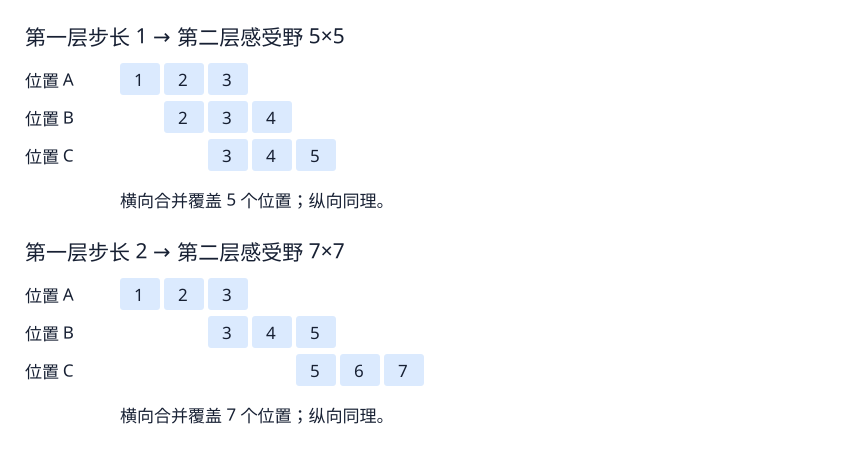

# 模型基础 05：感受野

- 更新日期：2026-10-21
- 先修内容：[卷积与特征图](04_卷积与特征图.md)。
- 目标：区分卷积核大小与感受野，理解层数和步长的影响。

<a id="receptive"></a>

## 1. 从原始位置图理解感受野

先用一个具体例子：单输入通道、单输出通道，连续两层 3×3 卷积，步长均为 1、不补边、无膨胀。原始输入为 5×5。以下每个 x 的下标都是“行号、列号”，表示位置，不是像素值。

```text
原始输入（5×5）：
x11 x12 x13 x14 x15
x21 x22 x23 x24 x25
x31 x32 x33 x34 x35
x41 x42 x43 x44 x45
x51 x52 x53 x54 x55
```

### 第一步：第一层窗口从左上角开始向右移动

每次取完整的 3×3 输入窗口，与同一套核权重对应乘加，再加偏置，产生一个输出数值。

| 第一次扫描中的输出 | 原图行范围 | 原图列范围 |
|---|---|---|
| A | 第1～3行 | 第1～3列 |
| B | 第1～3行 | 第2～4列 |
| C | 第1～3行 | 第3～5列 |

窗口从 A 到 B 再到 C 时，只向右移动，行范围没有变。下面的图先给出完整原始位置，再在同一份输入上分别标出 A、B、C 的窗口。先看上半部分（步长为 1）；下半部分的步长为 2 留到第 3 节。



### 第二步：窗口下移，完成第一层输出

算完 A、B、C 后，窗口左上角回到第1列、下移至第2行，向右扫描得到 D、E、F；再下移至第3行，得到 G、H、I。

```text
第一层输出（3×3）：
A B C   ← 窗口覆盖原图第1～3行
D E F   ← 窗口覆盖原图第2～4行
G H I   ← 窗口覆盖原图第3～5行
```

第一层每个输出都只直接读取原图的一块 3×3 区域，所以第一层单个位置的感受野为 3×3。A、B、C 的窗口合并仅为 3×5，还没有覆盖完整 5×5 原图。

### 第三步：第二层组合第一层的九个输出

第二层的 3×3 核读取第一层完整的 A～I 九个值，得到一个输出 Z：

```text
原始输入 5×5 → 第一层输出 3×3 → 第二层输出 1×1
                  A B C
                  D E F    →       Z
                  G H I
```

Z 直接读取的是 A～I，而 A～I 分别依赖原图不同的局部区域。这九个区域合并后覆盖原图的 5×5，因此 Z 在原图上的感受野为 5×5。这里的“依赖”表示结构上可能产生影响，不保证每个像素的实际影响都非零或一样大。

**感受野就是：选定某个输出位置，追溯到原始输入后，它能够依赖的区域范围。** 第一层 A 的感受野是 3×3；第二层 Z 的感受野是 5×5。二者的卷积核都仍是 3×3，但读取的层不同。

### Z 的 5×5 是“历史数据”吗

更准确地说，是追溯到同一次前向计算的原始输入后的范围，不是时间上的历史数据，也不是上一帧图片。Z 当前直接读取第一层的 3×3 个特征值 A～I；这些值各自已经由原图的局部像素计算得到，九个输入区域合并覆盖原图 5×5。因此 Z 的直接输入窗口为 3×3，而相对于原图的感受野为 5×5。

```text
同一张原图的5×5像素 → 第一层的3×3特征值 → Z
        间接依赖              直接读取
```

原图信息通过第一层计算影响 Z，不表示第一层保存了原图的完整副本，也不保证原图信息能够从这些特征值中完整恢复。此章谈感受野时，统一以原图为参考；若只问第二层直接读取上一层的多大窗口，答案仍是 3×3。

关联阅读：若不清楚第一层为什么每次只算出一个数，先回顾[04 第 4 节：局部连接](04_卷积与特征图.md#local)及其前面的卷积数值示例。

设计应用：单点覆盖范围与最终分类汇总全图的区别，以及空间排列的影响，见 [06 第 11 节：分类 head 的两种设计](06_整体架构与模块职责.md#classification-head)。

设计应用：感受野怎样限制单个位置能否同时利用两侧边界信息，见 [06 第 12 节：从局部存在到空间关系](06_整体架构与模块职责.md#spatial-relations)。

## 2. 两层步长为 1：为什么是 5×5

### 从原始位置图开始观察窗口移动

上图每个面板都画同一份原始输入，格内数字为“行号,列号”，不是像素值。蓝框才是当前的 3×3 输入窗口。按原图、A、B、C 的顺序看：输入不移动，窗口沿同一行向右移动。

第一层步长为 1 时：

| 第一层输出位置 | 读取原图的行 | 读取原图的列 |
|---|---|---|
| A（第1行第1列） | 第1～3行 | 第1～3列 |
| B（第1行第2列） | 第1～3行 | 第2～4列 |
| C（第1行第3列） | 第1～3行 | 第3～5列 |

从 A 到 B 再到 C，输入窗口的行范围不变，仅列范围向右移动。三次计算得到第一层输出的第一行 A、B、C。每次使用同一套卷积权重，但读取不同位置的输入数据。

### 从三个横向位置扩展到完整的二维感受野

仅 A、B、C 三个位置的输入范围合并为 3×5，还不是 5×5。第二层的 3×3 卷积实际读取第一层的九个位置：

```text
第一层特征图（3×3）：
A B C   ← 原图第1～3行参与计算
D E F   ← 原图第2～4行参与计算
G H I   ← 原图第3～5行参与计算

第二层一个窗口读取 A～I 九个位置 → 得到第二层一个输出
```

横向合并覆盖原图第1～5列，纵向合并覆盖第1～5行，所以第二层这个输出的感受野才是 5×5。

旧版把三个横向窗口分行错位展示，省略了原始二维位置图，容易被理解为对角移动。现已用四个独立面板替换，不再用错位排版表达移动。

| 层数 | 每层设置 | 在原图上的感受野 |
|---|---|---|
| 1 | 3×3，stride=1 | 3×3 |
| 2 | 3×3，stride=1 | 5×5 |
| 3 | 3×3，stride=1 | 7×7 |

每层只做局部计算，连续多层后也能利用较大范围的信息。这里的规律限定为表中的设置。

## 3. 第一层步长为 2：第二层为什么变成 7×7

设置为第一层 3×3、stride=2，第二层 3×3、stride=1。第一层同一行的相邻输出，其输入窗口向右移动 2 列，上图下半部分展示这一过程：

| 输出位置 | 读取原图的行 | 读取原图的列 |
|---|---|---|
| A | 第1～3行 | 第1～3列 |
| B | 第1～3行 | 第3～5列 |
| C | 第1～3行 | 第5～7列 |

三个横向窗口合并覆盖 3×7。第二层的完整 3×3 窗口还读取另外两行第一层输出，它们分别对应原图第3～5行、第5～7行。九个输入窗口合并后，第二层一个输出的感受野为 7×7。

第一层步长改变，并没有改变它自身一个位置读取的 3×3 范围；它改变的是相邻输出位置在原图上的间隔。后续层组合这些位置时，覆盖范围增长得更快。

| 第一层 | 第二层 | 第二层感受野 |
|---|---|---|
| 3×3，stride=1 | 3×3，stride=1 | 5×5 |
| 3×3，stride=2 | 3×3，stride=1 | 7×7 |

## 4. 对窄道判断有什么用

更深的特征位置有机会结合更大范围的左右边界和通道布局。下采样减少空间位置，通常降低后续计算量；同时，相邻位置在原图上的间隔增大，使后续卷积的感受野增长更快。

以上说的是理论感受野：结构上哪些输入位置可能影响该输出。它不保证区域内每个像素的实际影响一样大，也不保证模型已经学会正确利用这些信息。边缘位置还可能涉及 padding，不能把补零位置当作真实观测。

## 5. 回顾与下一步

已讨论：两层步长为 1 时的 5×5 感受野，以及第一层步长为 2 时的 7×7 感受野。

自查：为什么第一层步长变大，它自己的感受野不变，却会改变第二层的感受野？

下一步：结合实际网络中的连续卷积和下采样，逐层追踪空间尺寸与感受野。

## 6. 怎样直观理解感受野

选中特征图中的一个数，问：原图中哪些位置的像素变化，可能使这个数变化？结构上允许产生这种影响的范围，就是它的理论感受野。实际影响还取决于权重、激活和当前输入。

```text
原图中的局部区域 → 一层或多层计算 → 特征图中的一个数
```

特征图大小表示一共有多少个空间位置；感受野大小表示其中一个位置追溯到原图后覆盖多大范围。感受野是每个位置的属性，不是整张特征图的尺寸。

<a id="downsample"></a>

## 7. 特征图变小，感受野为什么反而变大

下面是教学用的连续卷积，不代表项目代码的实际配置。输入为 640×640，三层均使用 3×3 卷积、stride=2、padding=1，无膨胀。感受野选取远离边界的位置。

| 阶段 | 特征图空间尺寸 | 相邻位置在原图上的间隔 | 单个位置的感受野 |
|---|---|---|---|
| 原图 | 640×640 | 1 | 1×1 |
| 卷积 1 | 320×320 | 2 | 3×3 |
| 卷积 2 | 160×160 | 4 | 7×7 |
| 卷积 3 | 80×80 | 8 | 15×15 |

```text
空间位置数量：640×640 → 320×320 → 160×160 → 80×80
单点感受野：    1×1 →     3×3 →     7×7 → 15×15
```

每次步长为 2，窗口起点更稀疏，因此输出位置减少。后续层组合前一层的相邻位置，而它们在原图上间隔越来越远，因此单个输出位置能够依赖更大区域。这两个量描述不同事情，并不矛盾。

先看一个方向，追踪感受野宽度：第一层为 3；第二层读取三个第一层位置，其中心间隔为原图的 2 格，所以覆盖宽度为 3+2+2=7；第三层读取三个第二层位置，其中心间隔为原图的 4 格，所以覆盖宽度为 7+4+4=15。纵向相同。

注意，第三层自身的 stride=2 决定第三层相邻输出的间隔为 8；本层感受野增加多少，要看它读取的上一层位置间隔，也就是 4。通道数是另一个维度，以上表格只追踪空间尺寸。

这不意味着低分辨率特征保留了原图所有细节，也不意味着模型一定理解了整个感受野。它说明单个位置有机会综合更大范围的信息。

### 当前回顾与下一步

已补充感受野的直观定义，并用连续三层步长为 2 的例子，同时追踪空间尺寸、位置间隔和感受野。下一步：将这个例子整理成通用递推方法。

关联阅读：空间尺寸为何减小，回顾[04 第 9 节：步长与窗口起点](04_卷积与特征图.md#stride)；再将位置数量与单点感受野分开观察。

设计应用：为什么考虑结合较细空间信息与较大范围表示，见 [06 第 13 节：单层输出与多层融合](06_整体架构与模块职责.md#multilevel-features)。

## 8. 感受野的递推计算

先只看一个方向，限定为无膨胀的普通连续卷积。记录两个量：r 是一个位置在原图上的感受野宽度，j 是相邻位置的中心在原图坐标中的间隔。原图本身 r=1、j=1。

若当前层核大小为 k、步长为 s：

```text
新的感受野 r_new = r_old + (k − 1) × j_old
新的位置间隔 j_new = j_old × s
```

一个 k 大小的窗口读取 k 个上一层位置；从第一个位置到最后一个位置共有 k−1 个间隔，每个间隔在原图上长 j_old，所以在原有覆盖宽度之外，增加 (k−1)×j_old。对于这里讨论的连续卷积，公式给出理论感受野的跨度。

```text
当前层读取上一层的三个位置：
         A ── j_old ── B ── j_old ── C
合并覆盖的宽度 = r_old + 两个 j_old
```

r_old 是单个上一层位置自己的覆盖宽度；图中的横线仅表示相邻位置间隔。

仍以每层 k=3、s=2 的例子复算：

| 阶段 | 感受野宽度 r | 相邻位置间隔 j |
|---|---|---|
| 原图 | 1 | 1 |
| 第 1 层 | 1+2×1=3 | 1×2=2 |
| 第 2 层 | 3+2×2=7 | 2×2=4 |
| 第 3 层 | 7+2×4=15 | 4×2=8 |

最容易出错的是在计算当前层 r 时，提前用了更新后的 j。两条公式右侧都要使用上一层的值。当前层的步长决定本层输出的间隔，这个间隔会影响下一层的感受野增长。

对于方形卷积核和横纵相同的设置，r=15 对应 15×15；横纵设置不同时分别递推。padding 会影响输出尺寸、位置对齐和边界处真实像素的覆盖，但不出现在上述理论跨度递推式中。这里没有展开膨胀、分支融合或其他算子的情况。

### 当前回顾与下一步

已讨论感受野与位置间隔的递推方法。下一步：用 1×1 卷积检验理解，观察它如何组合通道，以及为什么不扩大空间感受野。

<a id="pointwise"></a>

## 9. 1×1 卷积：组合通道，不扩大空间感受野

以下讨论普通卷积（groups=1）、stride=1、padding=0。1×1 描述空间大小，不代表只读取一个数：若输入有三个通道，一个过滤器在同一空间位置读取三个通道值。

```text
同一位置的三个输入通道        一个输出通道在该位置的值
R=5 ── ×1 ──┐
G=2 ── ×2 ──┼── 求和，加偏置0 → 8
B=1 ── ×(-1)┘

5×1 + 2×2 − 1×1 = 8
```

这套过滤器有 1×1×3=3 个权重，而不是只有一个权重。在其他空间位置复用同一套权重，得到一整张输出特征图。使用多套过滤器，就得到多个输出通道。

```text
输入 3×H×W → 32 套 1×1 过滤器 → 输出 32×H×W
```

上述空间尺寸不变依赖 stride=1、padding=0；1×1 卷积也可以设置其他步长。

代入感受野公式：r_new=r_old+(1−1)×j_old=r_old。因此这一层不会扩大空间感受野。若输入特征的感受野已经是 15×15，经过本层后仍为 15×15，不会变回 1×1。它在已有的空间位置上重新组合通道中的信息。

在各通道具有相同空间对齐与感受野规格的普通连续卷积网络中，可以这样理解：3×3 组合邻近位置和通道；1×1 在同一位置组合通道。后者常用于调整通道数，例如将 128 个输入通道变为 32 个输出通道，也能配合激活函数进行特征变换。这里不保证每个输出都对应可命名的语义概念。

### 当前回顾与下一步

已讨论普通 1×1 卷积的通道组合和感受野。下一步：将 1×1 与 3×3 卷积串联，理解先调整通道数再做空间计算的作用。

关联阅读：理解“同一位置的多个通道”时，可回到[03 第 5 节：特征的空间组织](03_特征与中间表示.md#channels)；通道数量与空间覆盖范围是不同的量。

设计应用：1×1 卷积如何在逐元素相加前调整通道数，见 [06 第 14 节：对齐、相加与拼接](06_整体架构与模块职责.md#feature-fusion)。

设计应用：在 neck 中先用 1×1 卷积压缩通道，再上采样与融合，见 [06 第 15 节：简化 neck 数据流](06_整体架构与模块职责.md#neck-flow)。

## 10. 先调整通道，再做空间计算

以下为教学示例：普通卷积 groups=1，步长均为 1；1×1 层 padding=0，3×3 层 padding=1。输入为 128×H×W，目标输出为 64×H×W。

```text
方案 A：128×H×W ── 3×3 ────────────→ 64×H×W
方案 B：128×H×W ── 1×1 → 32×H×W ── 3×3 → 64×H×W
```

方案 B 的 1×1 卷积通过学习到的权重，在每个位置把 128 个通道组合为 32 个通道；它并不是简单保留前 32 个通道。后面的 3×3 卷积再从邻近位置组合这些较少的通道。

先忽略偏置、激活和归一化，只比较卷积权重数量：

| 方案 | 权重计算 | 权重总数 |
|---|---|---:|
| A | 64×128×3×3 | 73,728 |
| B 的 1×1 | 32×128×1×1 | 4,096 |
| B 的 3×3 | 64×32×3×3 | 18,432 |
| B 合计 | 4,096+18,432 | 22,528 |

方案 B 的卷积权重约为 A 的 31%。本例两层输出空间尺寸相同，因此卷积乘加次数也按相同比例减少；实际运行速度还受到硬件、访存和算子实现影响。

通道压缩可以降低后续较贵的 3×3 卷积的成本，但也限制中间表示的容量，可能损失有用信息。两种结构不保证产生相同结果、具有相同表达能力或达到相同准确率。若层间加入非线性，整体变换还会进一步不同。

感受野方面，假设输入位置的感受野宽度为 r、原图位置间隔为 j：方案 A 的输出跨度为 r+2j；方案 B 的 1×1 不改变 r 和 j，随后 3×3 得到的跨度同样是 r+2j。相同感受野只表示结构上的覆盖跨度相同，不表示计算内容或实际影响相同。

### 当前回顾与下一步

已讨论 1×1 降低通道数后接 3×3 的作用、权重数量与计算成本，以及通道压缩的取舍。下一步：结合具体网络中的模块，辨认通道变化、空间尺寸变化与感受野变化。

## 与整体架构的联系

第 06 篇把感受野用于结构判断：一个输出位置可能依赖的输入范围，与整张特征图的位置数量需要分别考虑。1×1 卷积调整通道的内容，也可用于理解模块之间的通道适配。

参见 [06：整体架构与模块职责](06_整体架构与模块职责.md)，其中“从旧知识读懂 backbone 输出”给出联合示例。
