# 06：整体架构与模块职责

更新日期：2026-10-29

阅读方式：每个独立概念或过程都配有紧邻正文的图示。先看图中的对象、箭头和形状，再读解释与限制；教学图中的矩阵、网格和模块不表示真实网络规模。

## 1. 本次学习范围

本篇保留整体模块职责、当前代码对照、backbone 输出与空间关系。分类 head 的具体取舍移至 [07](07_分类Head与空间汇总.md)，多层融合与 neck 的具体设计移至 [08](08_多层特征融合与Neck设计.md)。

当前阶段关注框架的选择与设计。本篇先说明 backbone、neck、head 的职责，以及为什么窄道二分类不一定需要独立 neck。具体结构如何选、如何做对照实验，留待后续继续讨论。

这里的“框架”指模型的结构与数据流。PyTorch 等开发框架是另一层概念；本篇讨论图片经过哪些模块，最终怎样得到分类结果。

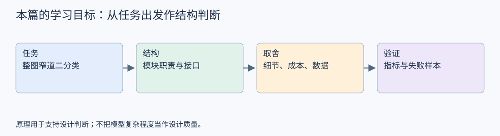

## 2. 先确定输出，再看结构

当前任务是输入机器人前方的一张图片，输出整张图片属于“窄道”还是“非窄道”。暂不要求输出障碍物框、道路边界或逐像素标签。

这个输出约定决定了分类 head 的职责。若以后任务改为定位通道或估计可通行区域，需要重新检查标签、输出形式和评价指标，不能只把分类分数改名使用。

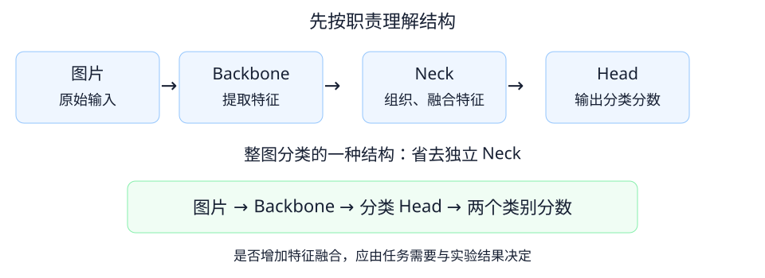

图中上半部分表示职责划分，下半部分展示一种省去独立 neck 的结构。它们是设计示意，不是已经验证效果的最终方案。

## 3. Backbone：把图片转换为特征

Backbone 通常译作骨干网络。它接收图片，经过多层计算，输出供后续任务使用的特征。可以把它理解为整个模型主要的特征提取部分。

例如输入为 3×640×640，某个骨干网络可能输出 256×20×20 的特征：256 个通道，每个通道有 20×20 个位置。这里只是帮助理解接口的假设尺寸，并非当前代码或某个具体模型的实际输出。

骨干也可以输出多层特征。较浅与较深的特征通常在空间分辨率和所综合的信息上有所不同，但不能给每个通道直接指定一个人类语义。

对窄道任务，我们希望特征有助于区分通道状态，而不是只记住某个地点的墙面颜色。骨干是否学到了有用的表示，需要通过独立数据与错误样本检查。

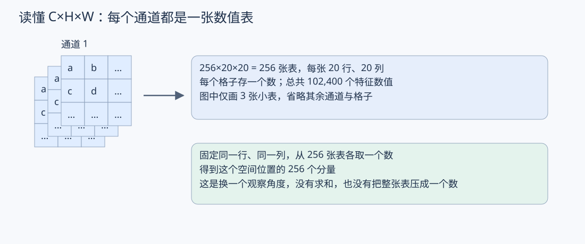

## 4. Neck：进一步组织、融合特征

Neck 位于 backbone 和 head 之间，常见用途是将不同层、不同分辨率的特征进行处理和融合，再交给 head。它通常也包含可学习的计算，不只是连接线。

为什么可能需要融合？较细的特征可能保留局部边界信息，较粗的特征可能综合更大范围的场景信息。融合模块尝试让后续任务同时利用这些信息。能否改善窄道分类，取决于数据和具体实现，不能由这个描述直接保证。

Neck 并非所有模型都必须单独设置。如果 backbone 的输出已经能够支持整图分类，head 可以直接接收它。加入 neck 会改变计算成本、参数量和训练行为，因此需要有明确的问题与验证依据。

此前学习的 YOLOv8PAFPN 属于这一职责位置；它的具体路径与接口要以对应项目实现为准。本次只定位职责，不展开内部结构。

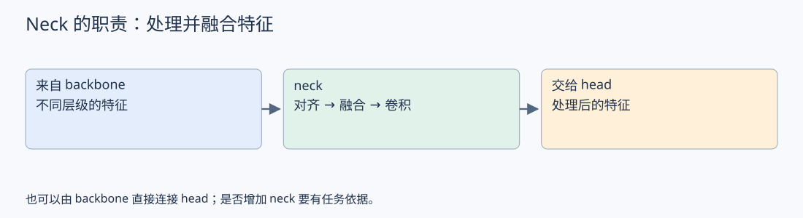

## 5. Head：把特征转换为任务输出

Head 接收特征，输出任务需要的结果。当前是二分类，因此最终需要能够区分两个类别的输出。

一种常见设计是“空间汇总 → 分类层”：先把每个通道的空间信息汇总，再输出两个原始类别分数。空间汇总并不直接判断窄道；后面的分类层仍需利用这些表示完成判断。两个分数也不是两个空间位置。

二分类也可设计成一个分数配合相应损失。本篇沿用当前训练代码的两个类别分数约定，不同时展开两种训练方案。原始分数不等于概率；转换后的数值也不自动成为经过校准的可靠置信度。

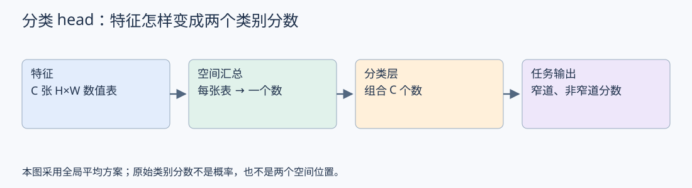

## 6. 对照当前代码

当前 src/train.py 的结构为：

```text
输入 [N,3,64,64]
  → Conv2d(3,8,核3,padding1)
  → ReLU
  → MaxPool2d(2)
  → 特征 [N,8,32,32]
  → Flatten
  → Linear(8192,类别数)
  → 类别分数 [N,类别数]
```

窄道二分类模式的类别数为 2。N 表示一批图片数量。

从职责上，可以将前面的卷积、激活和池化看作简单的特征提取部分，将 Flatten 和 Linear 看作分类输出部分。代码没有必须叫 backbone、head 的类，仍然可以按职责理解，也没有独立 neck。

注意：当前代码使用 Flatten，不是上一节提到的空间汇总方案。后续可以比较两种设计，但今天不修改训练结构，也不预先宣称哪种效果更好。

卷积基础与数值计算见 [04：卷积与特征图](04_卷积与特征图.md)，本篇继续关注模块组织与设计。

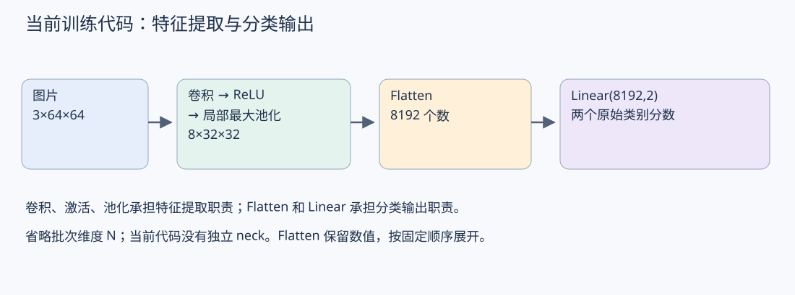

## 7. 本次的设计判断

评价一个结构时，先问：这个模块接收什么、输出什么、为任务解决什么问题？

对整图窄道分类，可以先建立 backbone 直接连接分类 head 的基线，再用实验判断独立 neck 是否有价值。这是一条验证思路，不代表当前简单网络已经满足实际效果要求，也不代表 neck 一定无用。

先把漏判和误判发生在什么样的场景里查清楚，才能进一步判断是特征表达、输入分辨率、标签定义或其他因素限制了效果。不能看到错误就直接归因于“少一个模块”。

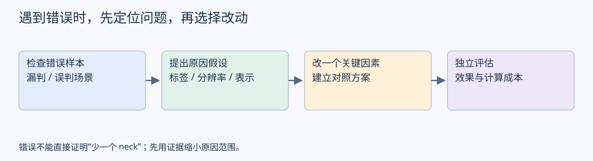

## 8. 后续学习方向

继续讨论 backbone 的选择：在已有任务约束下，怎样比较表示能力、推理成本与数据需求；先明确比较依据，再展开具体网络。

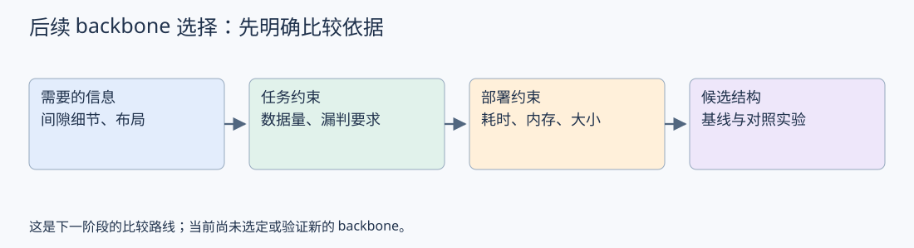

## 9. 与前五篇的学习路径

这篇是已有知识的应用层：先识别计算怎样发生，再判断这些计算怎样组织成模型。

| 已有知识                                   | 对整体设计的作用                         |
| ------------------------------------------ | ---------------------------------------- |
| [01：模型与参数](01_模型与参数.md)         | 区分模块结构、训练权重与训练配置         |
| [02：激活函数](02_激活函数.md)             | 理解特征提取模块中的非线性计算           |
| [03：特征与中间表示](03_特征与中间表示.md) | 理解模块之间传递的特征及通道含义         |
| [04：卷积与特征图](04_卷积与特征图.md)     | 计算空间尺寸、理解通道数量和接口         |
| [05：感受野](05_感受野.md)                 | 分析单个位置综合的信息范围及通道压缩取舍 |


<a id="backbone-output"></a>

## 10. 从旧知识读懂 backbone 输出

先问一个具体问题：backbone 输出 128×80×80，究竟向 head 提供了什么？

下面构造一个教学网络，省略批次维度。三层均为普通 3×3 卷积、stride=2、padding=1，并分别接激活函数；输出通道设置为 32、64、128。它不是当前训练代码，也不是对 YOLOv8 真实结构的复述。

```text
原图                第一层              第二层              第三层
3×640×640     →     32×320×320    →    64×160×160     →    128×80×80
每点感受野 1×1       3×3                7×7                 15×15
```

计算依据：[04 08 第 3 节：输出尺寸与 padding 的取值推导](04_卷积与特征图.md#padding-design)，包括保持尺寸的 P=(K−1)/2，以及本例 O=ceil(I/2) 的条件。


### 10.1 先读通道：连接笔记 03

概念回顾：[03 第 9 节：通道的两种观察方式](03_特征与中间表示.md#channel-intuition)，用 RGB 数值表说明“每通道一张表”与“每位置多个数”。

128 表示有 128 张 80×80 的特征表，每格一个数，共 819200 个特征数值。固定同一行、同一列，从各张表分别取一个数，得到该位置的 128 个分量。它们是对输入的不同计算表示，不是 128 个类别，也不能直接认定为 128 种有明确名称的物体。

每层通道数是人为配置的结构选择；各输出通道的权重通过训练调整。这也连接笔记 01：设计结构和学习参数需要区分。


### 10.2 再读空间：连接笔记 04

80×80 表示每个通道有 6400 个空间位置。输入 640 经过三次上述步长为 2 的卷积，空间尺寸为 320→160→80。输出总元素数为 128×80×80=819200，但元素总数不能直接衡量特征质量。

每个位置仍然包含对应于输入空间的信息。它不是原图某个像素的简单复制，而是经过多层局部计算得到的值。

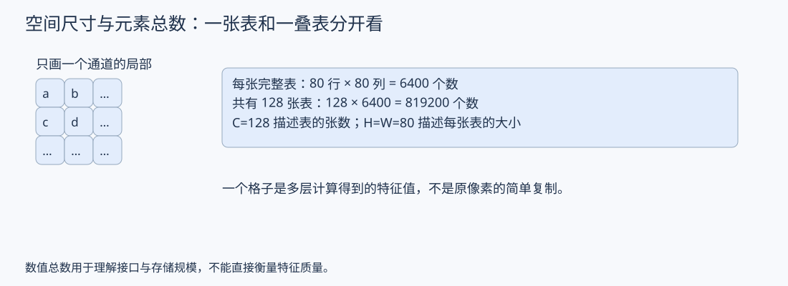

### 10.3 再读信息范围：连接笔记 05

对远离边界的位置，这个教学网络第三层一个位置的理论感受野是 15×15。计算为 r：1→3→7→15，位置间隔 j：1→2→4→8。

<a id="rf-layer-calculation"></a>

**感受野怎样逐层算出来？**

感受野不是给每层直接填入的独立参数。设计者选择卷积核、步长、层数等结构设置，再沿计算路径求出感受野。下面限定为本节的普通连续卷积，无膨胀；激活函数逐元素计算，不改变空间感受野。

先只看横向，记录两个量，单位都以原图像素为准：

- **r：一个位置的感受野宽度**，即它追溯到原图后覆盖多宽。
- **j：相邻位置在原图中的中心间隔**，不是卷积核的大小。

原图本身：一个像素只覆盖自己，所以 r=1；相邻像素间隔一格，所以 j=1。

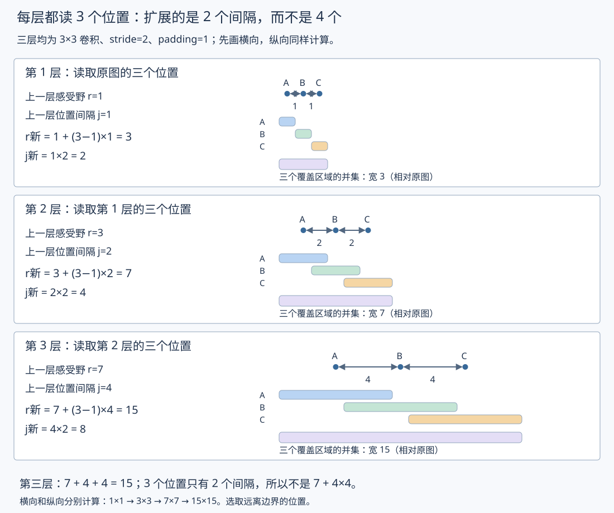

每层的核宽都是 3，读取上一层连续的 A、B、C 三个位置。A 到 B、B 到 C，总共只有 **3−1=2 个间隔**。因此：

```text
本层感受野 r新 = 上一层感受野 r旧 + (核宽−1) × 上一层位置间隔 j旧
本层位置间隔 j新 = 上一层位置间隔 j旧 × 本层步长
```

两条公式右侧都使用上一层的值。先算本层 r，再记录本层 j；更新后的 j 供下一层计算使用。

**第一层：从原图读取三个位置。**

原图 r=1、j=1，核宽 3、步长 2：

```text
r₁ = 1 + (3−1)×1 = 1+1+1 = 3
j₁ = 1×2 = 2
```

第一层一个位置的感受野为 3×3；第一层相邻位置在原图上的中心间隔为 2。当前层步长 2 不把当前单个窗口的 3×3 变成 5×5，它改变的是相邻输出的位置间隔。

**第二层：读取第一层的三个位置。**

第一层每个位置已经覆盖原图宽度 3，相邻位置间隔为 2：

```text
r₂ = 3 + (3−1)×2 = 3+2+2 = 7
j₂ = 2×2 = 4
```

第二层感受野为 7×7；第二层相邻位置在原图上的中心间隔为 4。

**第三层：读取第二层的三个位置。**

第二层每个位置已经覆盖原图宽度 7，相邻位置间隔为 4：

```text
r₃ = 7 + (3−1)×4 = 7+4+4 = 15
j₃ = 4×2 = 8
```

第三层感受野为 15×15；第三层相邻位置在原图上的中心间隔为 8。计算 r₃ 时使用的仍是上一层间隔 4，而不是本层刚得到的 8。

**为什么不是 7+4×4=23？**

从第二层到第三层，变为 4 的只是“上一层位置间隔”。另一个因子来自核宽 3，即 3−1=2，仍然是两个间隔，不能一起改成 4。这里沿横向、纵向分别计算，不把两个方向的间隔相乘。

| 阶段 | 本层感受野宽度 r 的计算 | 本层位置间隔 j 的计算 | 二维感受野 |
|---|---|---|---|
| 原图 | 初始 r=1 | 初始 j=1 | 1×1 |
| 第一层 | 1+(3−1)×1=3 | 1×2=2 | 3×3 |
| 第二层 | 3+(3−1)×2=7 | 2×2=4 | 7×7 |
| 第三层 | 7+(3−1)×4=15 | 4×2=8 | 15×15 |

本例每层 padding=1，影响空间尺寸、位置对齐与边界处真实像素覆盖，不改变上述理论跨度的递推式。理论覆盖不表示其中每个像素的实际影响一样大，也不保证网络充分利用了整个范围。

关联阅读：[05 第 8 节：感受野的递推计算](05_感受野.md#rf-recurrence)，对照通用公式与本节三层教学网络。


要区分：80×80 是整张特征图的尺寸，15×15 是单个位置追溯到输入的覆盖范围。128 个通道描述表示数量，并不把空间感受野自动扩大到整张原图。

如果 head 汇总全部 80×80 个位置，最终类别输出可以依赖整个画面的信息。但汇总如何保留空间关系、是否能有效组合两侧边界等线索，还要看具体 head 与实验结果。不能由 head 接收了整张特征图，就推断它一定理解了整体几何关系。

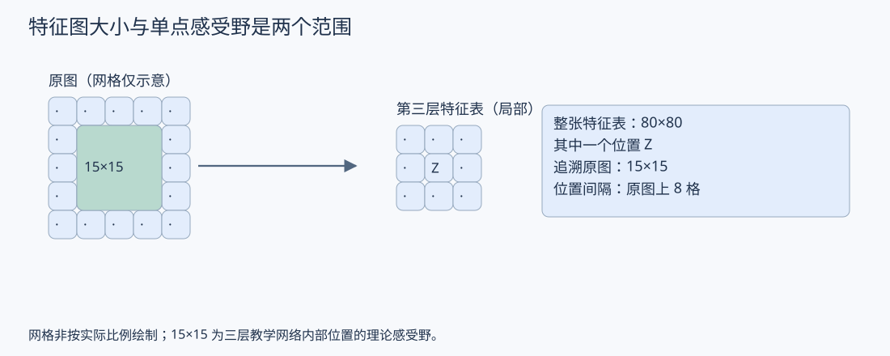

### 10.4 激活函数在其中做什么：连接笔记 02

卷积与激活函数交替，使后续表示能够形成更复杂的非线性组合。这里先把它放回实际数据流中理解，不重新展开推导。

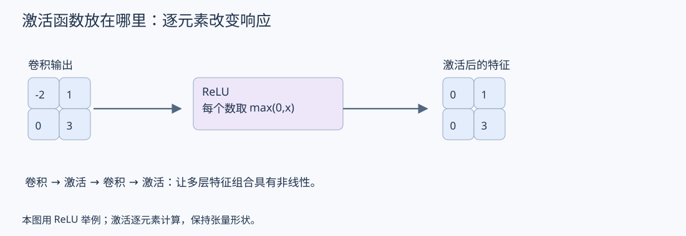

### 10.5 从尺寸描述走向设计判断

阅读 backbone 输出时，同时检查三个方面：

- 通道数：提供多少个特征通道，带来多少计算和表示容量。
- 空间尺寸：保留多少位置，对窄小间隙等细节可能有什么影响。
- 感受野：单个位置能够综合多大范围的信息。

这些量帮助提出设计假设，不能单独证明模型效果。增加通道不保证更好；减小空间尺寸可能降低后续计算，也可能损失任务所需的细节；更大理论感受野也不保证模型实际充分利用了对应区域。

本次先掌握如何读懂一个输出接口。后续再沿着“需要什么信息”的问题，讨论采用单层输出还是多层特征融合，以及如何验证。


<a id="spatial-relations"></a>

## 11. Backbone 需要提取什么：从局部存在到空间关系

### 11.1 先明确分类需要区分什么

延续 [07 第 1 节](07_分类Head与空间汇总.md#classification-head)：如果 head 对每个通道做全局平均，它接收的是各通道的平均响应。因此，要判断通道布局，前面的特征计算需要提供有用的关系表示，或选择能进一步处理空间关系的 head。

先固定一个简化例子：同一相机、相近视角，比较同一距离处左右障碍物之间的间隙。下面的文字和图示仅示意布局，不表示真实尺度。

```text
场景 A：左障碍物 |   较大间隙   | 右障碍物
场景 B：左障碍物 | 小间隙 | 右障碍物
```

两张图都可能出现左右障碍物，仅判断“有没有障碍物”不足以区分间隙。这不等于真实任务只需从图上数像素：透视、距离、遮挡和机器人尺寸都会影响可通行判断，任务与标签定义需要明确。

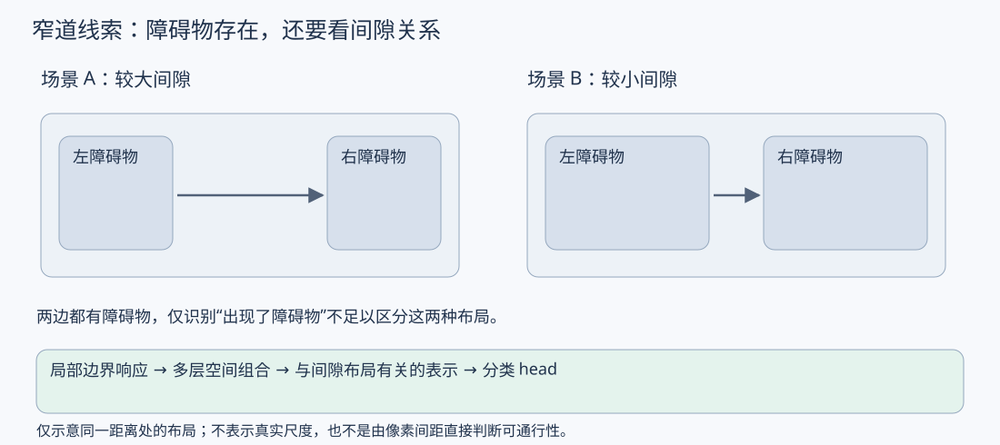

### 11.2 Backbone 的特征可以表达什么

较局部的计算可以对边界、纹理等模式产生响应。后续层继续组合这些响应，有机会形成与通道布局相关的表示。

```text
局部边界响应
      ↓ 多层空间组合
与边界相对位置、间隙布局有关的表示
      ↓ 分类 head
窄道 / 非窄道的分数
```

这里描述的是希望模型学到的能力，不表示某个通道必然就是“间隙宽度”，也不表示模型输出了以米为单位的测量。训练后是否依赖这些线索，需要用样本分析验证。

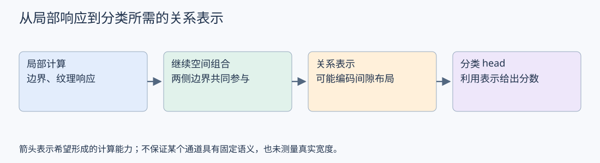

### 11.3 感受野为什么成为设计依据

假设某个位置的理论感受野只覆盖左侧边界附近，它的计算就无法直接依赖范围之外的右侧边界。后续空间组合扩大覆盖范围后，某个位置才可能同时利用两侧信息。

关联阅读：[05 第 1 节：直接输入窗口与原图感受野](05_感受野.md#receptive)。理论覆盖范围提供结构上的可能性，不保证训练后充分利用了这个范围。

也不要求每个 backbone 输出位置都看到两侧。若 head 会继续跨空间位置计算，它也能承担一部分信息组合；模块职责要沿整个计算路径分析。07 第 1 节的平均池化加 Linear 则不能恢复平均前已经丢失的通道内部排列。

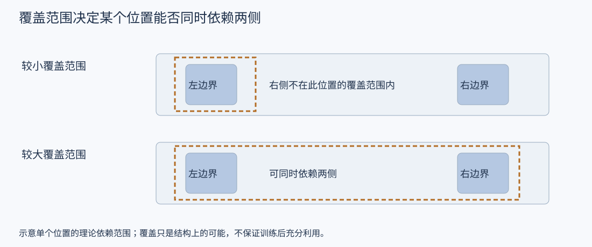

### 11.4 不能只追求更大感受野

扩大覆盖范围有助于形成上下文表示，但反复下采样也可能损失细小间隙。设计时需同时考虑空间细节和关系表示，而不是只增加层数或步长。

关联阅读：[04 第 9 节：步长与空间尺寸](04_卷积与特征图.md#stride)、[03 第 5 节：通道和空间组织](03_特征与中间表示.md#channels)。

因此，后续比较 backbone 时，可以先提出一个可检查的问题：它输出的特征是否既保留必要细节，又为分类提供足够的关系信息？若没有，需要根据错误样本判断应改变分辨率、空间组合方式、head 或其他因素。多层融合是可检验的候选设计之一，不能直接认定为答案。

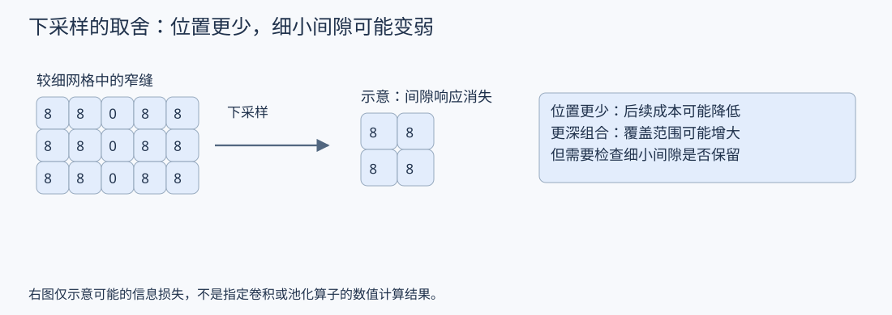

### 11.5 后续验证思路（尚未执行）

可以整理外观相似、间隙状态不同的样本组，在相近视角或距离条件下比较错误，同时检查模型是否被地点纹理、光照等线索影响。这个检查用于发现问题，不替代独立测试集。

下一步：在需要细节和上下文的前提下，理解为什么有的结构只使用最后一层特征，有的结构融合多个层级，再判断 neck 的作用。

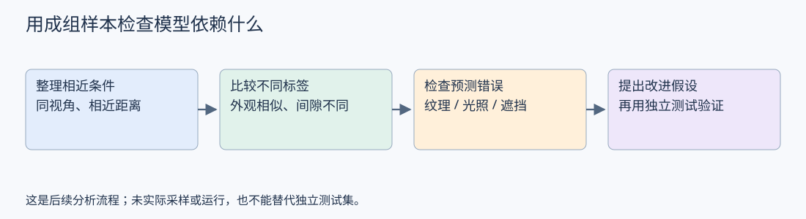


## 专题阅读与旧章节跳转

按主题继续阅读；以下保留旧章节锚点，方便已有链接和历史会话跳转。

<a id="classification-head"></a>

- 分类 head：展开与空间平均 → [07 第 1 节](07_分类Head与空间汇总.md#classification-head)。

<a id="multilevel-features"></a>

- 最后一层输出与多层特征 → [08 第 1 节](08_多层特征融合与Neck设计.md#multilevel-features)。

<a id="feature-fusion"></a>

- 上采样、相加与拼接 → [08 第 2 节](08_多层特征融合与Neck设计.md#feature-fusion)。

<a id="neck-flow"></a>

- 简化 neck 的完整数据流 → [08 第 3 节](08_多层特征融合与Neck设计.md#neck-flow)。

<a id="neck-add-vs-concat"></a>

- 相同输入下的相加与拼接 → [08 第 4 节](08_多层特征融合与Neck设计.md#neck-add-vs-concat)。

