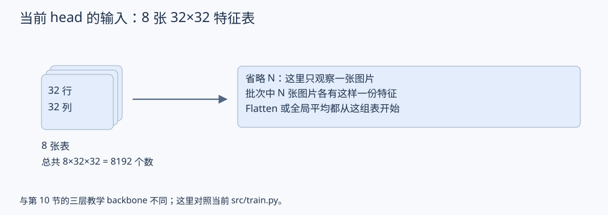
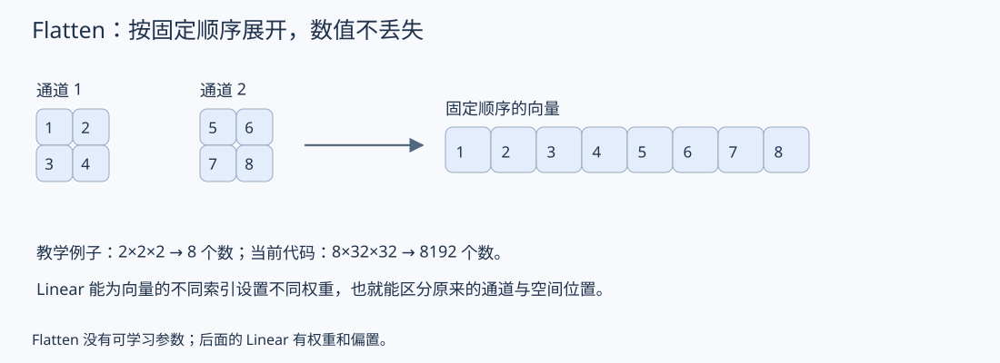
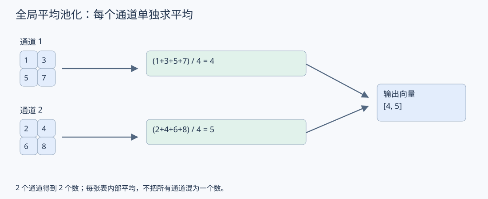
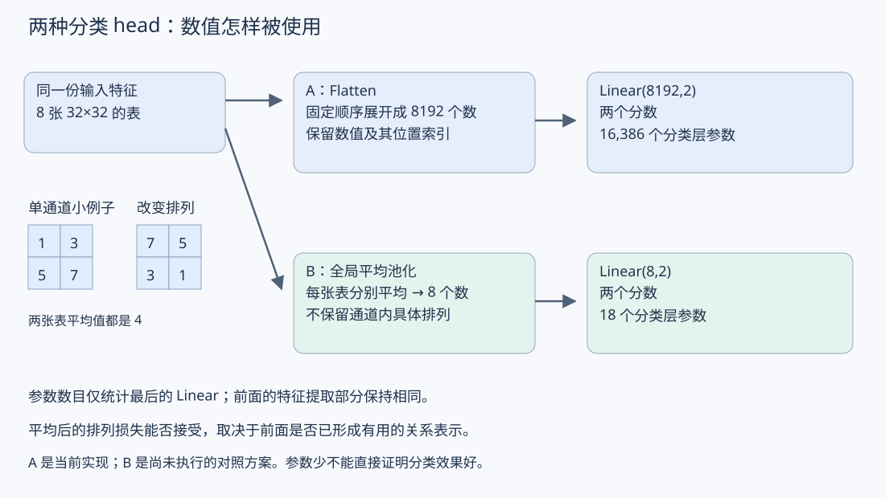
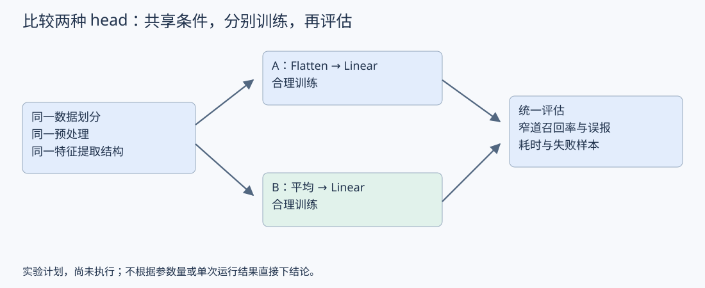

# 07：分类 Head 与空间汇总

更新日期：2026-10-29

本篇从第 06 篇拆出，集中比较分类 head 的空间处理方式。先修：[06：整体架构与模块职责](06_整体架构与模块职责.md#backbone-output)。图与文字配套阅读；当前实现与未执行的对照方案分别标明。

<a id="classification-head"></a>

## 1. 分类 head：展开与空间平均的取舍

### 1.1 从当前代码的特征开始

当前 src/train.py 在卷积、ReLU 和 MaxPool2d 后得到 [N,8,32,32]，其中 N 是批次大小。以下省略 N，只看一张图片：8 个通道，每个通道 32×32 个位置。

这与第 10 节的 128×80×80 教学网络不同。这里直接对照当前代码，窄道二分类输出两个原始分数。



### 1.2 方案 A：展开后分类（当前实现）

```text
8 张 32×32 特征图
        ↓ Flatten：按固定顺序排成向量
8192 个数
        ↓ Linear(8192,2)
两个类别分数
```

Flatten 不学习参数，也没有丢掉这些数值。固定的排列顺序使全连接层能为不同通道、不同空间位置设置不同权重。例如，同一个通道在画面中心和角落的值，可以以不同权重参与分类。

分类层权重为 8192×2=16384，加两个偏置，共 16386 个可学习参数。这个数字只统计最后的 Linear，不含前面的卷积。

关联阅读：[03 第 5 节：通道和空间维度](03_特征与中间表示.md#channels)、[04 第 1 节：全连接权重数量](04_卷积与特征图.md#dense)。



### 1.3 方案 B：先做全局平均池化，再分类（对照方案）

全局平均池化在每个通道内部，将全部空间位置的数值取平均。8 个通道分别求平均，保留 8 个数，不把所有通道混成一个数。

```text
8 张 32×32 特征图
        ↓ 每张图分别求平均
8 个数
        ↓ Linear(8,2)
两个类别分数
```

平均池化本身没有可学习参数。最后 Linear 的权重为 8×2=16，加两个偏置，共 18 个参数。前面的特征提取部分假设保持相同。

用一个通道的 2×2 小例子说明：

```text
1  3
5  7   → 平均值 (1+3+5+7)/4 = 4
```

把它换成下面的排列，平均值也为 4：

```text
7  5
3  1   → 平均值仍为 4
```

这说明平均操作不保留该通道内部的具体空间排列。这里对比的是直接送入池化的两份特征图，不代表任意打乱原图后，前面网络仍会生成同样特征。

注意全局平均池化与当前的 MaxPool2d(2) 不同。当前局部最大池化在小窗口中取最大值，仍保留 32×32 的空间组织；全局平均池化则把每个通道的整个空间维度压缩成一个数。



### 1.4 怎样联系窄道任务作判断

两种设计都能产生两个分数，但利用特征的方式不同。

| 设计             | 分类层可以利用什么         | 需要考虑的代价                                |
| ---------------- | -------------------------- | --------------------------------------------- |
| Flatten→Linear   | 为不同空间位置设置不同权重 | 分类层参数随 H×W 增长；需警惕对固定位置的依赖 |
| 全局平均 →Linear | 每个通道的整体平均响应     | 明确的空间排列在平均后消失                    |

窄道任务可能关心两侧边界与中间间隙的关系。如果这些关系已经在前面网络中编码成有用通道，平均后仍可能支持分类。如果关键区别只存在于特征图的位置排列中，平均会丢掉这些区别。不能仅凭参数少就判断更好，也不能仅凭使用全部位置就判断 Flatten 更好。

关联阅读：[05：单点感受野与逐层信息组合](05_感受野.md#receptive)。分类输出汇总全图，与特征提取部分是否已形成充分的空间关系表示，是两个需要区分的问题。



### 1.5 如何验证

这是后续实验思路，尚未执行：固定数据划分、预处理、特征提取部分及训练评估流程，比较两种 head。关注窄道召回率、误报、推理耗时和失败样本；两种方案都应获得合理训练，而不是只根据单次结果下结论。

本次只补充设计解释，没有修改训练代码。下一步可回到 backbone：它需要形成什么表示，才能支持这样的分类 head？



