# 07：分类 Head 与空间汇总

更新日期：2026-11-10

本篇从第 06 篇拆出，集中比较分类 head 的空间处理方式。先修：[06：整体架构与模块职责](06_整体架构与模块职责.md#backbone-output)。图与文字配套阅读；当前实现与未执行的对照方案分别标明。

<a id="classification-head"></a>

## 1. 分类 head：展开与空间平均的取舍

### 1.1 从本地教学代码的特征开始

当前 src/train.py 在卷积、ReLU 和 MaxPool2d 后得到 [N,8,32,32]，其中 N 是批次大小。以下省略 N，只看一张图片：8 个通道，每个通道 32×32 个位置。

这与第 10 节的 128×80×80 教学网络不同。这里直接对照当前代码，窄道二分类输出两个原始分数。

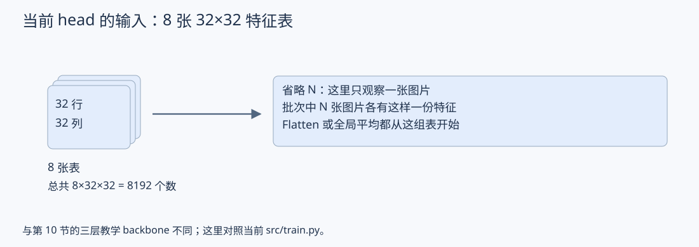

### 1.2 方案 A：展开后分类（本地教学实现）

```text
8 张 32×32 特征图
        ↓ Flatten：按固定顺序排成向量
8192 个数
        ↓ Linear(8192,2)
两个类别分数
```

Flatten 不学习参数，也没有丢掉这些数值。固定的排列顺序使全连接层能为不同通道、不同空间位置设置不同权重。例如，同一个通道在画面中心和角落的值，可以以不同权重参与分类。

分类层权重为 8192×2=16384，加两个偏置，共 16386 个可学习参数。这个数字只统计最后的 Linear，不含前面的卷积。

关联阅读：[03 第 5 节：通道和空间维度](03_特征与中间表示.md#channels)、[04 第 1 节：全连接权重数量](04_卷积与特征图.md#dense)。

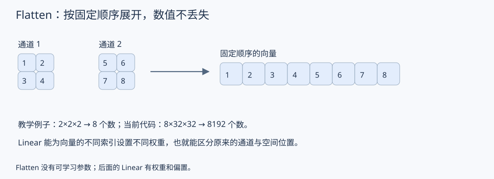

### 1.3 方案 B：先做全局平均池化，再分类（对照方案）

全局平均池化在每个通道内部，将全部空间位置的数值取平均。8 个通道分别求平均，保留 8 个数，不把所有通道混成一个数。

```text
8 张 32×32 特征图
        ↓ 每张图分别求平均
8 个数
        ↓ Linear(8,2)
两个类别分数
```

平均池化本身没有可学习参数。最后 Linear 的权重为 8×2=16，加两个偏置，共 18 个参数。前面的特征提取部分假设保持相同。

用一个通道的 2×2 小例子说明：

```text
1  3
5  7   → 平均值 (1+3+5+7)/4 = 4
```

把它换成下面的排列，平均值也为 4：

```text
7  5
3  1   → 平均值仍为 4
```

这说明平均操作不保留该通道内部的具体空间排列。这里对比的是直接送入池化的两份特征图，不代表任意打乱原图后，前面网络仍会生成同样特征。

注意全局平均池化与当前的 MaxPool2d(2) 不同。当前局部最大池化在小窗口中取最大值，仍保留 32×32 的空间组织；全局平均池化则把每个通道的整个空间维度压缩成一个数。

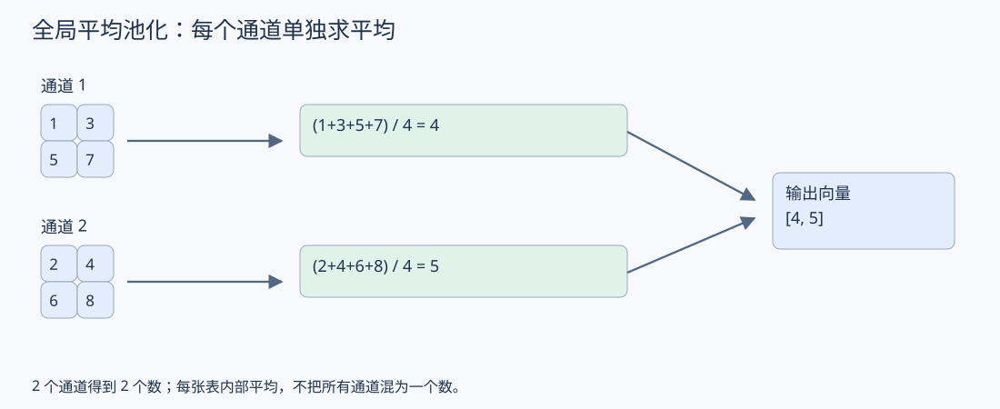

### 1.4 怎样联系窄道任务作判断

两种设计都能产生两个分数，但利用特征的方式不同。

| 设计             | 分类层可以利用什么         | 需要考虑的代价                                |
| ---------------- | -------------------------- | --------------------------------------------- |
| Flatten→Linear   | 为不同空间位置设置不同权重 | 分类层参数随 H×W 增长；需警惕对固定位置的依赖 |
| 全局平均 →Linear | 每个通道的整体平均响应     | 明确的空间排列在平均后消失                    |

窄道任务可能关心两侧边界与中间间隙的关系。如果这些关系已经在前面网络中编码成有用通道，平均后仍可能支持分类。如果关键区别只存在于特征图的位置排列中，平均会丢掉这些区别。不能仅凭参数少就判断更好，也不能仅凭使用全部位置就判断 Flatten 更好。

关联阅读：[05：单点感受野与逐层信息组合](05_感受野.md#receptive)。分类输出汇总全图，与特征提取部分是否已形成充分的空间关系表示，是两个需要区分的问题。

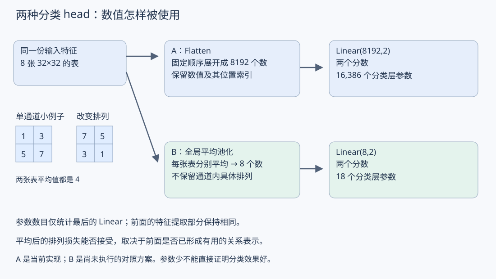

基线应用：[09 第 2 节](09_窄道分类基线与方案验证.md#baseline-structure) 以全局平均池化作为候选起点，并明确空间关系能否保留的验证假设。

### 1.5 如何验证

这是后续实验思路，尚未执行：固定数据划分、预处理、特征提取部分及训练评估流程，比较两种 head。关注窄道召回率、误报、推理耗时和失败样本；两种方案都应获得合理训练，而不是只根据单次结果下结论。

本次只补充设计解释，没有修改训练代码。下一步可回到 backbone：它需要形成什么表示，才能支持这样的分类 head？

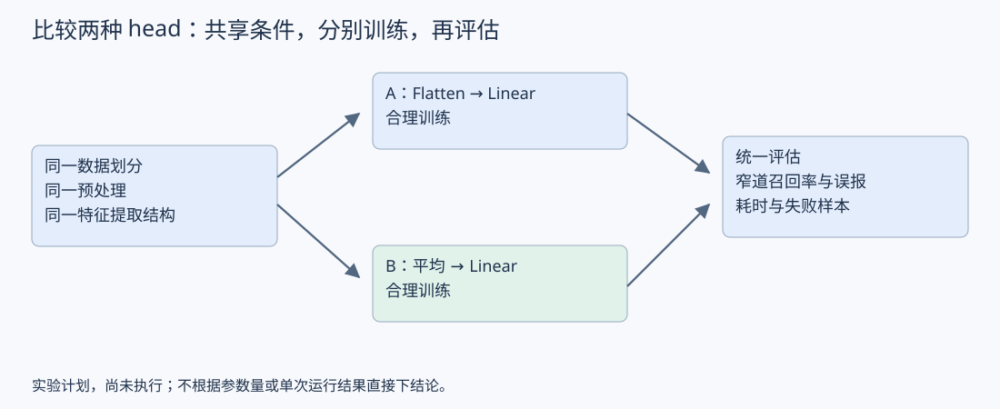


<a id="current-narrow-head"></a>

## 2. 当前实际项目：NarrowLaneBinaryHead

依据用户 2026-11-10 提供的类实现与 DINOv3 配置。特征来源及冻结范围见 [06 第 6.2 节](06_整体架构与模块职责.md)。本节与前述本地简单 CNN 示例区分。

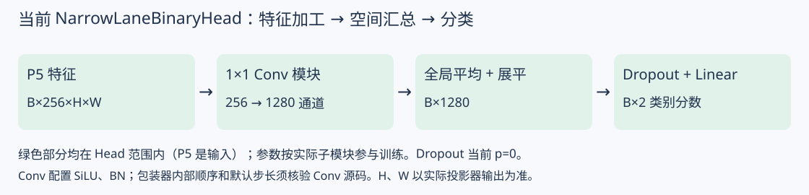

### 2.1 先看完整前向路径

forward 从 inputs[self.input_stage_keys[-1]] 读取最后一级特征，当前配置说明为 P5；输入通道按投影器配置为 256。随后 conv_layer=Conv(256,1280,1,act="SiLU",norm="BN") 加工特征，AdaptiveAvgPool2d(1) 将每个通道汇总为一个数，flatten(1) 得到 [B,1280]，再经 Dropout(p=0) 和 Linear(1280,2) 得到 [B,2] 原始类别分数。H、W 尚未从投影器实现或运行结果核实；Conv 包装器的具体顺序、默认参数也尚未核验。

只读取最后一级是 head 的输入选择；不能据此推断投影器内部的跨层融合方式。源码未展示 MultiScaleProjector 的实现，不沿用旧 PAFPN 的融合结论。

### 2.2 设计决策与后续顺序

这个 head 同时负责特征加工、空间汇总和分类，不只包含最后的 Linear。共享模块冻结时，head 的可训练参数仍可形成新的任务相关表示。后续每次只讨论一个选择：为何只用 P5；1×1 模块为何扩展 256→1280；空间平均保留与丢失什么；如何选择宽度、归一化和 Dropout；如何以窄道召回率、误报及成本验证。

本次只讲整体前向路径，以上各项不标记为已掌握。现有源码核对结果：get_loss 直接对 logits 与标签计算 cross_entropy，再乘 loss_weight；val 使用 softmax 后 argmax，scores 是所预测类别的概率值，不总是窄道概率；export_onnx 只输出 logits。标签处理兼容 gt_labels 与 labels，并检查单样本标签数、批次长度、整数性与类别范围。未执行模型或实验。

### 2.3 为什么只读取 P5

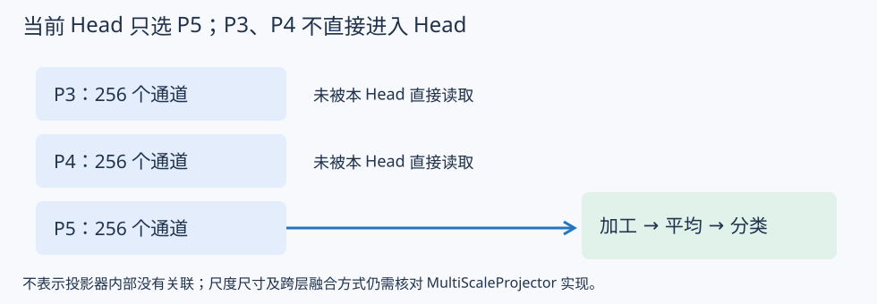

源码 classification_feature = inputs[self.input_stage_keys[-1]] 只读取输入键列表的最后一项。结合当前配置及类注释，这一路为 P5；P3、P4 不直接进入这个 head。它们是否以及怎样影响 P5，需读取 MultiScaleProjector，不能直接沿用旧 YOLOv8PAFPN 的结论。

“只选 P5”是设计者写入代码的输入选择，不是训练自动从三个尺度里挑选。仅从这份源码，不能确定作者为什么选它，也不能证明它比其他选择更好。可以把它作为一个较简单的比较起点：head 只需处理一份输入，不需要额外设计跨尺度对齐与融合。若 P5 是较粗尺度，其空间位置更少，当前这类逐位置加工和汇总通常也较省计算；实际尺寸须核验输出。

它的任务假设是：P5 中保留的信息足够支持窄道二分类。对依赖细小间隙或边界布局的样本，这一假设可能不成立；但也不能只凭尺度较粗就断言丢失了必要信息。参数冻结不影响我们比较 head 的输入选择。

后续可在相同数据划分、预处理和训练评估条件下，先比较只用 P5、只用 P4 的单尺度 head，再判断是否有理由设计多尺度输入。通道均为 256 时可保留相同的 head 配置，但空间尺寸、计算量和数值分布可能不同，仍需分别训练。优先观察窄道漏判、非窄道误报和失败样本，兼顾成本；这是实验计划，尚未实施。多尺度融合基础见 [08 第 1 节](08_多层特征融合与Neck设计.md#multilevel-features)。

### 2.4 为什么将 256 通道扩展到 1280

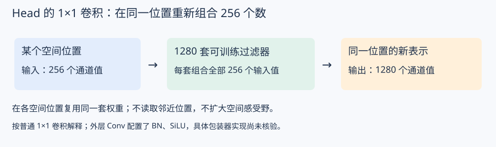

当前配置 mid_channels=1280，源码创建 Conv(self.input_channels[-1],mid_channels,1,act="SiLU",norm="BN")。按普通 1×1 卷积理解，在每个位置读取 256 个通道值，以 1280 套不同权重形成 1280 个新值；每套包含 256 个权重，卷积核权重共 256×1280=327680，不计偏置与归一化参数。它不是复制原通道，也不是凭空增加输入信息。通道组合基础见 [05 第 9 节](05_感受野.md#pointwise)。

在冻结特征来源的条件下，这个可训练模块为 head 提供加工已有表示的能力。配置中的 SiLU 提供非线性变换，使 head 可以在空间平均之前形成新的响应。具体 BN、激活的执行顺序及默认卷积设置需核验 torchcv.modeling.layers.Conv 源码；这里不把包装器视为已确认的内部实现。

1×1 卷积不直接读取邻近空间位置，因此这一步本身不扩大空间感受野；它不能通过扩展通道恢复输入中已经完全丢失的信息。这里讨论的是卷积本身，不把训练态 BN 的统计依赖混作卷积感受野。

1280 是人为选择的中间宽度，不能由二分类或 256 输入通道唯一推导，也没有现有实验说明必须为 1280。可将 256、512、1280 等作为候选，固定其余条件比较效果、过拟合及成本；尚未执行对照。增加宽度增加参数量及逐位置计算量，不保证更高准确率。下一步讨论全局平均池化怎样使用这 1280 个通道。

### 2.5 怎样选择 head 的中间宽度


不能仅从输入通道数或类别数推导最优宽度。可以保持当前结构，仅将 mid_channels 设为 256、512、1280，分别重新训练 head；冻结共享模块，保持数据划分、增强、损失、训练预算与评估规则可比。先用当前 1280 结果作已有基线，再比较较窄候选。单次结果接近时，用不同随机种子复核，避免将训练波动当成结构收益；验证集用于选型，独立测试集留作最终评估。对照候选尚未实际训练。

如果较宽 head 同时改善训练和独立验证表现，说明增加容量可能有帮助；如果训练表现改善而验证不改善或变差，则没有证据支持增加宽度，需检查过拟合。若训练和验证都差，应先排查训练是否收敛、学习率、标签与数据问题；只有排除这些因素后，才将表示或 head 能力不足作为候选原因，不能直接归因为宽度不足。若不同宽度都在相同的细小间隙或布局样本上失败，需考虑输入尺度与空间处理方式，宽度并非唯一改动方向。

窄道任务不能仅按总体准确率选宽度。可在统一的预测规则下比较窄道召回率与非窄道误报率；有业务误报约束时，可用验证集选择各自阈值，在相同误报水平比较召回，阈值选择与最终测试分开。比较参数量与实测推理成本，在效果满足需求且差异不稳定时优先考虑成本较低的候选。该流程用于判断结构是否值得保留，不保证某个宽度最优。

### 2.6 当前 head 的全局平均池化

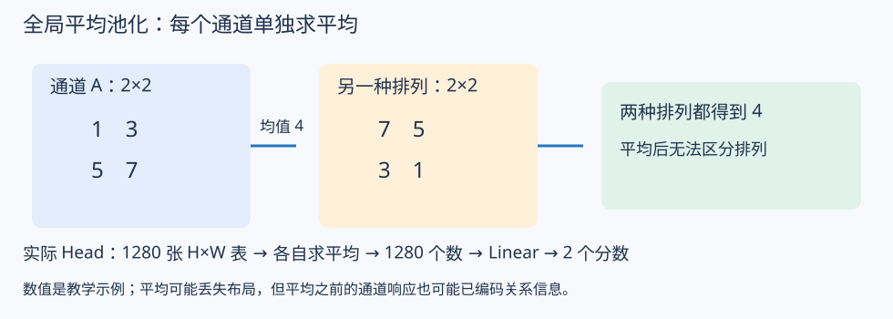

代码 self.pool=nn.AdaptiveAvgPool2d(1) 将每张 H×W 特征表的所有空间数值求平均，输出 [B,1280,1,1]；flatten(1) 仅改变组织形状，得到 [B,1280]，不是把所有通道再平均成一个数。该池化和展平本身没有可训练参数。

例如一个通道为 [[1,3],[5,7]]，平均为 (1+3+5+7)/4=4；另一种排列 [[7,5],[3,1]] 也得到 4。平均保留每通道的整体平均响应，不能从这个平均值恢复原先的位置排列。因此后续 Linear 不能直接对该通道左侧和右侧的原始响应分别赋权。若平均前的特征已经编码了空间关系，其平均仍可能支持分类，不能断言使用平均就一定无法判断窄道。

当前 1×1 卷积自身不组合相邻位置的信息；同位置输入通道可能已经包含 DINOv3 与投影器产生的上下文，不能把它们视为只有局部像素的响应。如果失败样本显示平均汇总不合适，可比较保留分区信息的汇总方式或增加空间处理；尚未设计或验证替代方案。当前先理解池化输入、计算与输出，下一步再看 Linear 如何形成两个分数。

### 2.7 全局平均池化与局部池化


“普通池化”不是严格的独立类型，这里指常见的局部池化，如核大小 2×2、步长 2 的 MaxPool2d 或 AvgPool2d。要区分两个维度：局部/全局说明覆盖范围，平均/最大说明汇总规则。局部池化将各个小窗口分别汇总，通常缩小特征图但仍保留粗粒度空间排列；全局平均将每个通道全部空间位置汇总为一个数。

输入 [B,C,4,4] 时，2×2、stride=2、无填充的局部池化输出 [B,C,2,2]；全局平均输出 [B,C,1,1]。二者通常都逐通道执行，不混合不同通道。局部平均取窗口均值，局部最大取窗口最大值；也可以有全局最大池化。当前 head 的 AdaptiveAvgPool2d(1) 将目标空间尺寸设为 1×1，在此情况下就是全局平均池化；AdaptiveAvgPool2d 并非所有目标尺寸都属于全局池化。

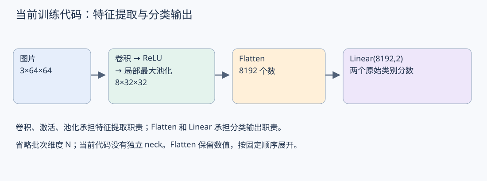

本地教学 CNN 的 MaxPool2d(2) 为局部最大池化，保留缩小后的空间网格；当前实际 head 的全局平均则为了形成每通道一个数的分类输入。这两种用途可以出现在同一网络的不同位置，不是二选一的网络类型。

### 2.8 Linear 怎样形成两个类别分数


当前 Dropout(p=0) 不丢弃数值，Linear(1280,2) 接收每张图片的 1280 个平均值 h₁～h₁₂₈₀。类别 0 的分数为 s₀=Σᵢ w₀ᵢhᵢ+b₀，类别 1 的分数为 s₁=Σᵢ w₁ᵢhᵢ+b₁。两个输出各有一套覆盖全部输入的权重；总计 2×1280=2560 个权重和 2 个偏置。这些参数在当前 head 训练中更新，池化得到的 h 是本次输入的中间结果，不是参数。

类别映射固定为 0=非窄道、1=窄道，因此输出 [s₀,s₁]。例如教学输出 [−0.4,1.8] 按当前 argmax 规则预测窄道；这两个值是 logits，可以为负、也不要求和为 1。get_loss 直接使用 cross_entropy(logits,labels)，无需在此之前手动 softmax；val 使用 softmax 后取最大值。该部分行为由用户提供的源码确认，数值例子不是运行结果。

从设计上看，最终 Linear 接口的两个输出对应既定类别任务；1280 个输入则由前面的中间宽度选择决定。要调整加工容量通常先比较中间宽度或处理方式，不因任务难度改变这份两类标签约定。全连接与特征的基础见 [03：特征与中间表示](03_特征与中间表示.md)。本节完成当前 head 的前向主线，训练目标、阈值及替代空间汇总设计尚待继续讨论。

### 2.9 一个卷积模块之后，怎样考虑结构改动

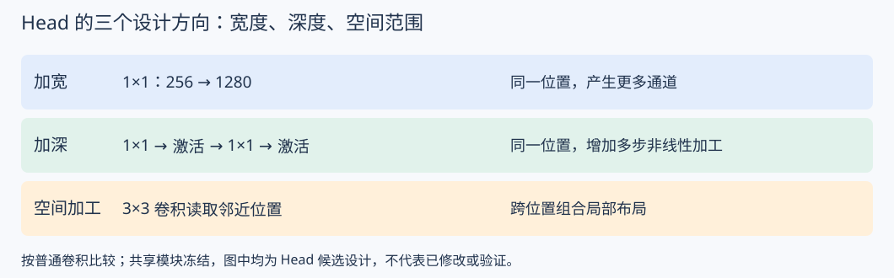

现有 head 只显式创建一次 Conv 包装模块，严格内部层数尚待核验该包装器。设计时不能仅凭“只有一个”断言能力不足。需要分别看宽度、深度和空间范围：扩大 mid_channels 增加同位置的输出通道；增加带非线性的 1×1 模块增加同位置的加工步骤，但普通连续 1×1 卷积自身仍不读取邻近空间位置；增加普通 3×3 卷积则能在本层直接组合邻近位置的信息。

对窄道判断，若假设当前特征需要进一步组合相邻边界或间隙响应，可以设计一个包含 3×3 空间卷积的 head 候选，在全局平均之前加工布局。它不要求解冻 backbone 或投影器，也不保证效果改善。输入特征本身可能已有上下文；卷积核为 1×1 不意味着整条模型路径只利用局部信息。

后续一次改变一个主要因素以理解收益。例如先固定输入与中间宽度，将一个 3×3 空间加工块加入 head，再与当前基线比较；该改动同时增加参数、深度与计算，不能仅由结果断定全部收益来自空间范围。若需区分原因，可再与增加 1×1 块的候选比较。本文仅讨论候选方向，未修改训练代码或执行实验。

### 2.10 从失败样本提出设计假设

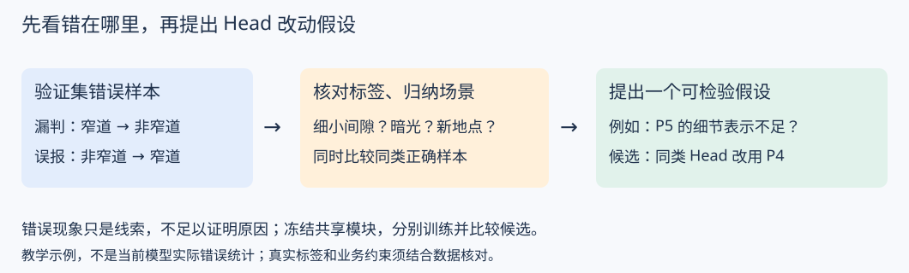

固定 DINOv3 与投影器时，设计 head 也先从验证集的错误现象开始。标签 1 为窄道，因此漏判是实际窄道而预测非窄道，误报是实际非窄道而预测窄道。先分别查看两组错误，核对标签，再按细小间隙、暗光、遮挡、地点等场景归纳。还应查看相同场景的正确样本及该场景总量；错误数量多可能仅因该场景样本多，不能只看错误数量判断其困难程度。训练样本与验证样本的错误可分别查看，不混用作独立泛化证据。

例如，假设细小间隙样本漏判较多，可以提出“P5 的表示对这些细节不够适用”的假设，先设计只用 P4 的同类 head 对照，而不立即同时增加尺度、宽度与深度。即使改用 P4 改善，也不能仅凭这一结果断言原因就是分辨率；输入表示、分布及计算成本同时可能变化。本例只是教学假设，没有实际错误数据或运行结果。

若错误集中于标签边界含糊，应先明确标签；若集中于训练覆盖不足的光照或地点，应检查数据覆盖，而不是默认加大 head。失败样本分析用于提出候选原因，随后通过对照实验及独立数据评价。当前只讨论怎样提出假设，具体对照表下一步展开。

### 2.11 怎样安排一次 Head 对照实验

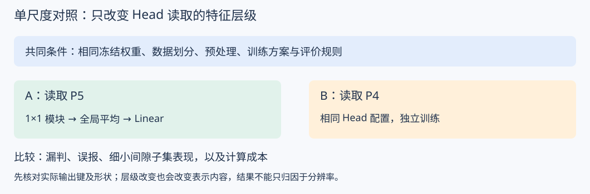

承接第 2.10 节的教学假设：细小间隙漏判可能与输入特征层级有关。先核对投影器实际输出键、通道、空间形状及顺序，再比较 A 读取 P5、B 读取 P4。两者保持相同的 head 结构配置（中间宽度、BN/激活、池化、Dropout、分类层），分别训练；不将已经训练好的 P5 head 直接接上 P4 作为公平的重新训练对照。如果输入通道均为 256，head 参数形状可以保持一致，但输入表示、空间尺寸、运行分布与计算成本仍可能不同。

两组使用相同冻结 checkpoint、数据划分、图像预处理、损失、优化器与可比训练预算，依据同一验证规则选 checkpoint。保持随机设置可比；结果接近或波动明显时，使用相同的一组多个种子重复两种方案。还需确保所谓冻结在实际实现中正确执行，BN 运行统计与 train/eval 管理保持可比，而不只看配置注释。

评价时先保持同一 argmax 规则，记录窄道召回率、非窄道误报率、总体指标、失败样本及细小间隙子集表现，并记录 head/整体推理成本的测量范围。P4 若空间更大，head 参数量可以相同，但逐位置计算量通常不同。若要在业务误报约束下比较召回，可在验证集为各方案选择阈值，再在独立测试集评估；不要根据测试集反复选阈值或结构。

结论需要对应问题：P4 如果仅提高总体准确率，却增加关键场景漏判，不应仅凭总准确率认定更优；如果效果稳定改善且成本可接受，才支持保留该改动。该实验最多支持“换输入层级是否值得”，不能单独证明提升只来自分辨率，因为特征内容也改变。此处为实验设计，未创建训练变体或运行实验；下一步可讨论怎样选择评价指标与阈值。

### 2.12 用户提供的新基线混淆统计（2026-11-11）

用户截图标为“新基线”，以窄道为正类：TP=1180、TN=1293、FP=314、FN=280，总数3067；实际窄道1460、实际非窄道1607。来源是用户训练后提供的评估截图，尚未确认是训练集、验证集还是独立测试集，也未确认该次运行的阈值、checkpoint 与具体配置。

按截图计数计算：准确率=(1180+1293)/3067=80.63%；窄道召回率=1180/1460=80.82%；窄道漏判率=280/1460=19.18%；非窄道误报率=314/1607=19.54%；窄道精确率=1180/(1180+314)=78.98%；F1=79.89%。注意误报率与1−精确率分母不同。

这些结果说明在该评估集合及预测规则下，两类样本各约五分之一出错。不能单由计数断言 head 容量不足、P5不够、应融合更多尺度，或判定过拟合。下一步先确认集合来源与独立性，再分别查看280个漏判与314个误报及相同场景正确样本。若比较阈值需保存窄道分数并查看不同阈值下的结果；单个混淆表无法判断调整阈值的完整收益。

### 2.13 新基线训练与验证曲线的阅读

用户确认第 2.12 节计数来自验证集，并提供以下曲线。横轴具体单位未标明，不将训练图约 1000 的横轴与验证图约 40 的横轴直接对齐；验证曲线早期图例遮挡部分数据，数值以日志为准。

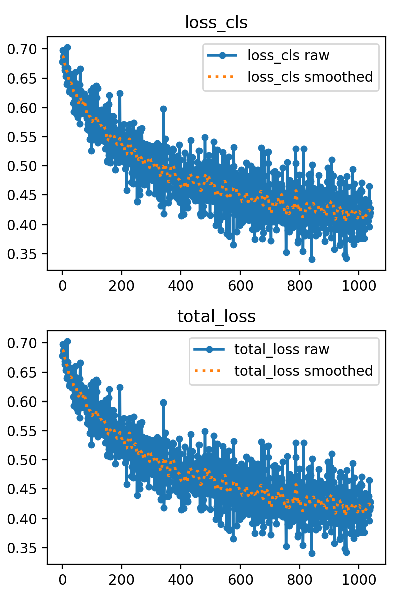

loss_cls 与 total_loss 图形近乎一致，平滑趋势约从0.68下降到0.42，后期仍缓慢下降，单批或记录间有波动。未见损失发散，但不能仅据此确认充分收敛或训练集准确率。两条损失一致与当前以分类损失为主的设置相符，实际总损失组成仍以日志为准。

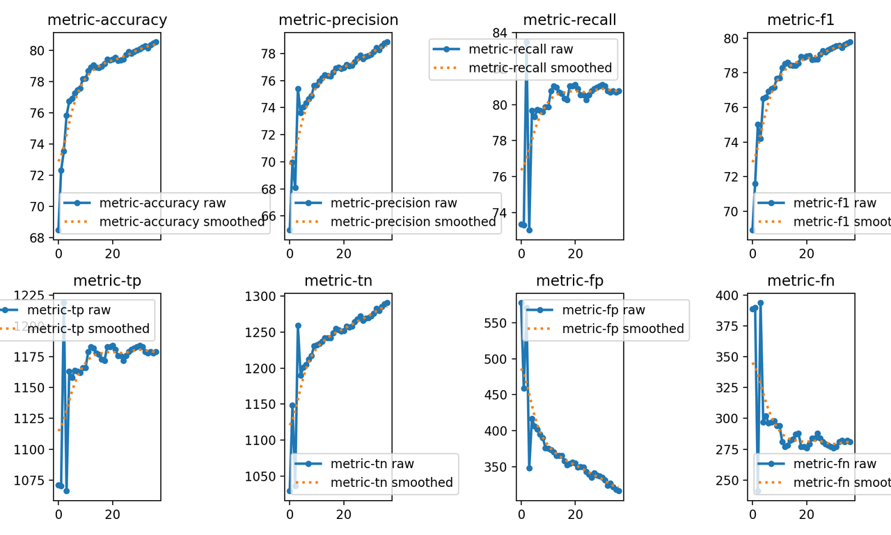

验证 accuracy、precision、F1 后期仍改善；recall 后期约在80%～81%附近波动。TP/FN 后期大致稳定于1180/280附近，TN增加、FP减少，因此近期总体改善主要来自非窄道误报减少，不是持续找回更多窄道。没有看到典型的“训练继续改善、验证整体持续恶化”的趋势，但缺少验证loss、训练准确率及重复实验，不能完全排除过拟合，也不能直接判断head容量不足。

对当前只训练head的目标，可先保留基线并分析280个漏判的场景，避免仅凭训练loss下降就预期召回继续提升。如果业务优先降低漏判，可保存每张验证图片的正类概率softmax(logits)[:,1]，进行阈值扫描，比较漏判减少与误报增加的取舍。当前val返回scores是预测类别的最大概率，不可直接当作窄道概率使用；阈值应在验证集选择，最终在独立测试集评估。此处未执行训练或阈值扫描。


<a id="head-training-checkpoints"></a>

### 2.14 Head 持续更新时，怎样理解基线

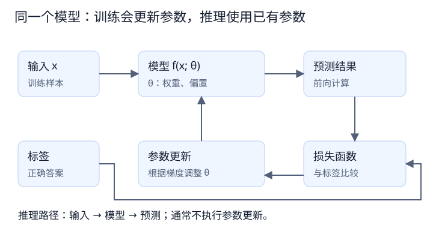

2026-11-12 用户提醒：实际训练中的 head 在持续更新迭代。固定 backbone 与 projector，并不意味着 head 固定；每次优化器更新会调整 head 的可训练参数。同一张图的预测也可能随训练改变。“固定 head 结构”只表示对照期间保持层数、宽度等配置一致，不表示停止训练参数。用户的提醒本身不代表已确认结构发生改变，当前具体结构版本仍以实际代码为准。

基线是可复现的比较起点：需要绑定结构配置、训练条件与选定 checkpoint，而不是要求训练中的 head 保持不变。同一结构在不同训练步的 checkpoint 是不同参数状态；修改结构后重新训练属于另一组方案。比较结构时，两组 head 都需要训练，并保持训练预算及 checkpoint 选择规则可比。

此前 TP=1180、TN=1293、FP=314、FN=280 仅代表当次验证结果，不能作为后续所有更新状态的固定结果。用户已明确保留两类分数 argmax 规则，暂不修改阈值。后续可对照两个 checkpoint 的逐图片预测，区分持续漏判、新增漏判和被纠正的漏判；总 FN 相同不代表错误图片相同。

参数更新与推理的基础见 [01：训练与推理](01_模型与参数.md#head-checkpoint-link)。


<a id="pooling-choice"></a>

### 2.15 实际设计中怎样选择池化

具体计算与自动划分区域的例子见 [2.16：不经过卷积，怎样得到2×2输出](#adaptive-average-example)。

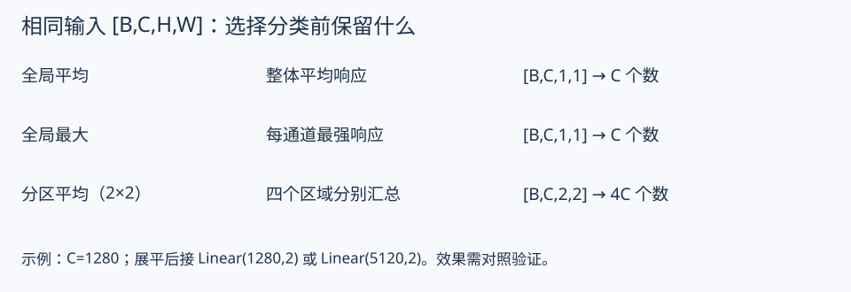

先明确池化位置与目的。backbone 中的局部池化常用于下采样；当前问题是分类 head 如何将空间特征汇总为分类输入。不要只按算子名称选择：先判断任务需要整体响应、少量强响应，还是粗略空间位置。

全局平均将每通道汇总为一个平均值，适合作为整图分类的简单起点，但少数位置的强响应可能被大量低响应稀释。全局最大保留每通道最强值，值得在少量显著响应决定类别时比较，但可能受异常强响应影响，也不保留该响应的位置、数量及布局。2×2 分区平均分别保留四个粗区域的统计，值得在粗空间布局可能有用时比较，但不保留区内精确位置或自动计算左右距离。这些都是候选假设，真实特征含义需分析，不能把特征响应直接等同于障碍物。

当前窄道任务涉及左右边界与通行空间，可提出比较全局平均与2×2分区平均的假设，但不能直接判定全局平均不适用：上游特征可能已经编码空间关系。当前冻结上游、训练head，候选head仍要分别训练，改变池化也会改变梯度流与学习结果。

若输入通道为1280，全局平均后为1280维，2×2分区平均后为5120维，分类层分别为Linear(1280,2)与Linear(5120,2)；含偏置参数分别2562与10242。因此简单对照评估的是整套汇总及分类接口方案，不能将差异全部归因于池化算子。先只比较这两种，保持其余训练条件、checkpoint选择规则与argmax预测规则可比，观察窄道漏判、非窄道误报、关键场景和成本，未执行实验。选择依据是需要保留的信息和实际验证，而不是池化方法的复杂程度。

空间布局与任务需求见 [06：整体架构与模块职责](06_整体架构与模块职责.md#pooling-choice-link)。


<a id="adaptive-average-example"></a>

### 2.16 不经过卷积，怎样得到2×2输出

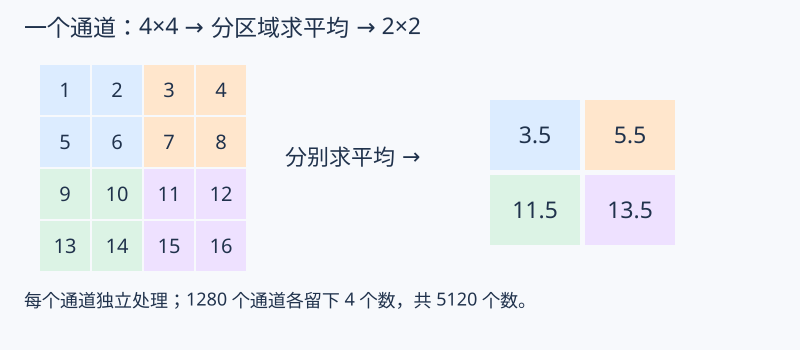

这里的1280张表是特征图，不是1280张原始照片。AdaptiveAvgPool2d((2,2))指定每个通道的输出高宽：对每个输出位置对应的输入区域直接求平均，不需要可训练卷积核。4×4例子中四个不重叠2×2区域的均值分别为3.5、5.5、11.5、13.5；1280个通道独立处理，得到[B,1280,2,2]，展平为[B,5120]。不是先全局平均成1280个数后再扩展。

#### 可以理解为自动划分四个大区域吗？

可以。对于 AdaptiveAvgPool2d((2,2))，可以先理解为每个通道按左上、右上、左下、右下四个区域分别求平均。这些区域由输入高宽和目标输出尺寸自动确定，不是通过训练学出来的，也不需要先经过卷积。上图四种颜色分别对应四个区域，右侧同色格子记录该区域的平均值。

例如输入为80×80时，行方向分为前40行、后40行，列方向分为前40列、后40列，组合为四块40×40区域。每块1600个数求一个平均值，输出2×2。1280个通道各自独立执行相同的区域划分，不将不同通道混在一起求平均，最终得到1280×2×2。

“四块”是便于理解的描述：当H或W不能被2整除时，边界位置可能被相邻区域共同使用，因此不一定是严格互不重叠的四块。具体边界规则如下。

一般自适应平均池化按输入与目标尺寸确定区域，输出索引i对应的起止位置为floor(i×输入尺寸/输出尺寸)与ceil((i+1)×输入尺寸/输出尺寸)，终点不包含在区域内，高宽分别计算。当输入尺寸不能整除输出尺寸时，区域可能重叠，不应一概描述为四块互不重叠的等大区域。AvgPool2d(kernel_size=2)指定的是窗口大小，Conv2d(kernel_size=2)指定的是卷积核空间大小，和这里指定输出2×2不同。


本节与 [2.15：实际设计中怎样选择池化](#pooling-choice) 相互参照：分区平均保留粗区域信息，但不保留区内精确排列。


<a id="head-activation-choice"></a>

### 2.17 Head中SiLU的选择依据

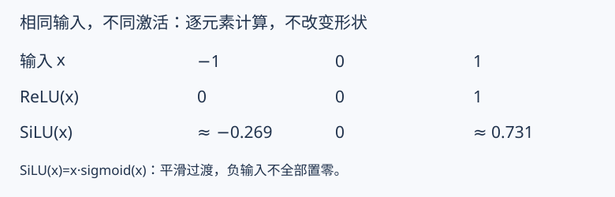

当前配置使用SiLU，但尚无本任务的激活对照结果证明它优于其他候选。性质、替代方案与重新训练对照方法见 [02：实际设计中为什么选择SiLU](02_激活函数.md#silu-choice)。不能仅由配置推断原作者选型理由。
