# 08：多层特征融合与 Neck 设计

更新日期：2026-10-29

本篇从第 06 篇拆出，集中讨论多层特征、对齐与融合、简化 neck 以及相加/拼接的设计取舍。先修：[06：整体架构与 backbone 输出](06_整体架构与模块职责.md#backbone-output)；分类输出见 [07：分类 Head 与空间汇总](07_分类Head与空间汇总.md#classification-head)。所有教学假设、配图和数值例子随正文保留。

<a id="multilevel-features"></a>

## 1. 只用最后一层，还是融合多个层级

### 1.1 特征来自同一条计算链

沿用第 10 节的三层教学网络，每层是 3×3 卷积、stride=2、padding=1，再接激活函数，省略批次维度：

```text
图片 3×640×640
        ↓
第一层 32×320×320 ── 可取出作为较浅层特征
        ↓
第二层 64×160×160 ── 可取出作为中间层特征
        ↓
第三层 128×80×80 ── 最后一层特征
```

这些不是三张不同的输入图片，也不是三次独立训练。它们是同一张图片在同一网络中依次计算得到的中间结果。虽然最后一层由前面计算而来，下采样和特征变换也可能丢失信息，不能据此认为最后一层完整保存了前面的全部内容。

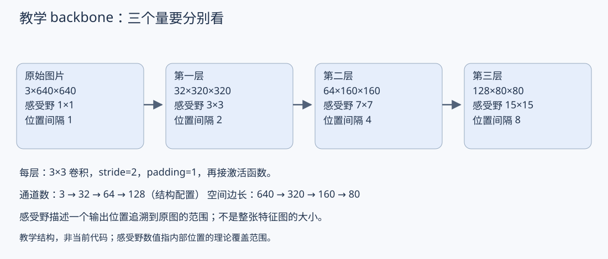

### 1.2 方案 A：只使用最后一层

```text
第三层特征 → 分类 head → 两个类别分数
```

如果最后一层已经提供了任务所需表示，这种接口简单，后续处理的空间位置也较少。它并不跳过前两层，得到第三层仍需依次计算前面所有层。

局限是 head 无法直接读取之前较高分辨率的表示。如果某些间隙细节已在这条路径中丢失，后面的 head 不一定能恢复。

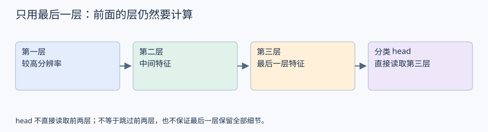

### 1.3 方案 B：取出多个层级，再融合

```text
第一层特征 ──┐
第二层特征 ──┼→ 尺寸/通道处理 → 融合计算 → 分类 head
第三层特征 ──┘
```

这种设计让后续计算可以直接利用多个层级的表示。典型的动机是结合较细的空间信息与经过更多层计算的上下文信息；这是设计意图，不保证每个浅层或深层通道都有固定语义。

Neck 常承担这些特征处理与融合工作。若同样的计算放在 head 内部，命名边界可能不同，阅读代码时仍应看实际数据流。

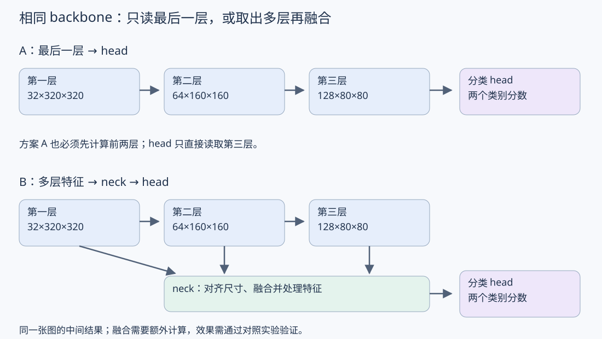

### 1.4 尺寸不同，不能直接逐位置相加

32×320×320、64×160×160、128×80×80 的空间尺寸与通道数都不同。如果要逐元素相加，必须先把对应维度处理到相同形状，并注意空间位置的对齐。如果沿通道拼接，则需让空间尺寸与位置对齐，通道数可以不同。

这里先认识接口约束；08 第 2 节再展开具体融合操作。把低分辨率特征插值放大，只增加采样位置，不会自动恢复此前已经丢失的真实细节。

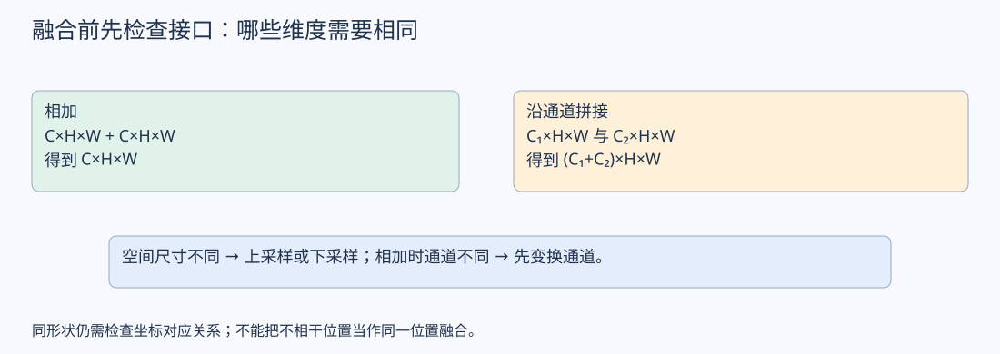

### 1.5 与旧知识联动

- [03 第 5 节：C×H×W](03_特征与中间表示.md#channels)：融合时先看每个维度代表什么。
- [04 第 9 节：步长](04_卷积与特征图.md#stride)：解释各层空间尺寸为什么不同。
- [05 第 7 节：特征图尺寸与感受野](05_感受野.md#downsample)：在这个教学网络中，空间尺寸 320→160→80，单点感受野 3→7→15。
- [07 第 1 节：分类 head](07_分类Head与空间汇总.md#classification-head) 与 [06 第 11 节：空间关系](06_整体架构与模块职责.md#spatial-relations)：特征是否满足分类需要，应结合 head 的计算方式分析。

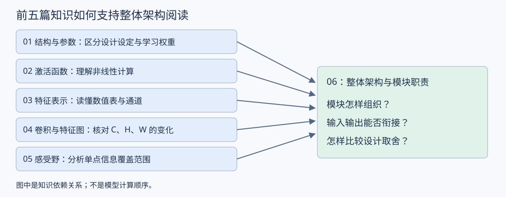

### 1.6 如何作设计判断

融合会增加额外的计算、内存使用和实现复杂度，但可能帮助利用单一层级不足以保留的信息。对窄道分类，先分析错误样本和任务需求，再比较“只用最后一层”与“多层融合”，不能只因融合使用的信息来源更多就认定它更好。

这里的三层网络只用于说明数据流，15×15 的最终感受野不代表它已经足以解决真实任务。当前 src/train.py 仍是原有单卷积学习基线，尚未实现这些对照方案，也未执行效果实验。

下一步：用具体的小尺寸数值表理解“先对齐，再相加或拼接”，明确融合到底怎样发生。

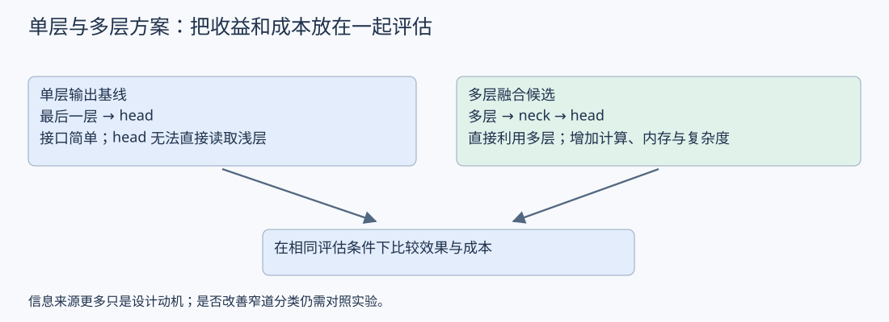

<a id="feature-fusion"></a>

## 2. 特征融合：先对齐，再相加或拼接

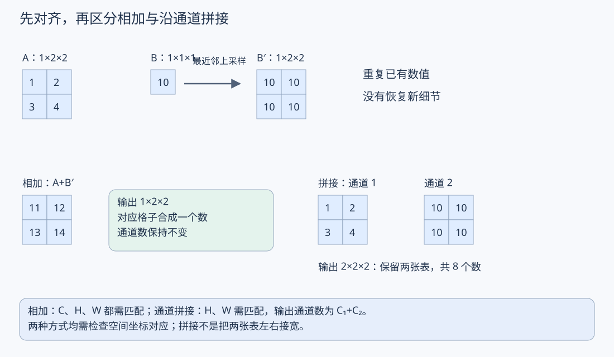


### 2.1 先把空间尺寸处理到一致

用单通道教学例子：A 为 1×2×2，B 为 1×1×1，省略批次维度。

```text
A：           B：
1  2          10
3  4
```

若选择以 A 的 2×2 空间网格为目标，可以通过上采样将 B 的 1×1 网格放大到 2×2。本例使用最近邻插值：

```text
B：10  →  B′：10  10
              10  10
```

本例只是重复已有数值，未生成四份新的观测，也未恢复原图细节。实际模型还有双线性插值等方式，结果取决于具体方法和设置。也可以选择下采样较大的特征，目标尺寸由结构设计决定。

同形状只是基本条件；不同分支还需确认它们对应的空间坐标能够对齐。不能随意把不相干位置的数值当作同一位置融合。

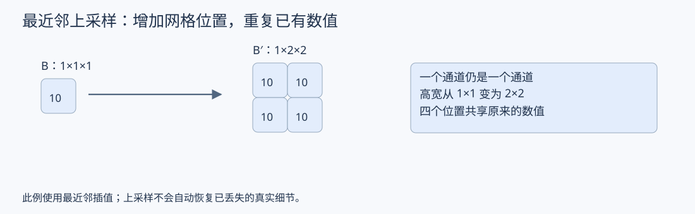

### 2.2 相加：对应格子数值相加

现在 A、B′ 都为 1×2×2：

```text
A：       B′：        A+B′：
1  2      10  10      11  12
3  4      10  10      13  14
```

输入是两张单通道表，相加后仍是一张单通道表。一般地，两份 C×H×W 特征逐元素相加，输出仍为 C×H×W。

多通道时，对应通道、对应行列相加。若通道数不同，需要先进行通道变换，例如使用普通 1×1 卷积；相加本身没有可学习参数，通道变换可以有。

相加是把两路信息合为同一个数。从和本身通常不能唯一恢复两个输入值。

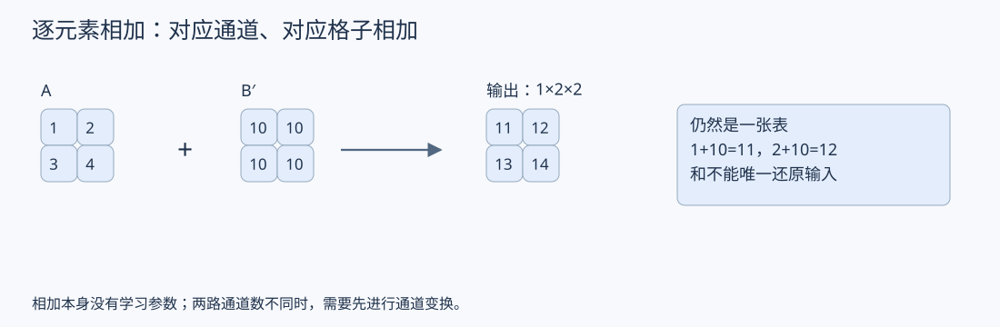

### 2.3 拼接：沿通道维度保留两组表

对同样的 A、B′，沿通道方向拼接：

```text
输出通道 1：来自 A       输出通道 2：来自 B′
1  2                    10  10
3  4                    10  10
```

输出为 2×2×2：两个通道，每个通道有 2 行、2 列，共 8 个数。不是把数值相加，也不是将图片左右拼成一张更宽的表。

一般地，C₁×H×W 与 C₂×H×W 沿通道拼接，输出为 (C₁+C₂)×H×W。拼接本身不学习参数，后续常接卷积，对这些通道进行可学习组合。

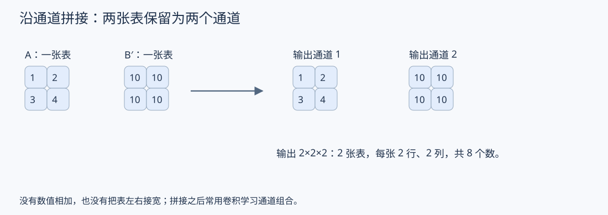

### 2.4 实际接口示例

以下只是假设接口，不对应当前训练代码：

```text
浅层：64×40×40
深层：128×20×20 → 上采样 → 128×40×40
```

- 通道拼接：得到 192×40×40，再接卷积处理。
- 逐元素相加：可先通过 1×1 卷积把一路通道数调整到与另一路一致；例如深层调整为 64×40×40，再与浅层相加，得到 64×40×40。

也可以采用不同的目标通道数或操作顺序，必须以实际结构和坐标约定为准。

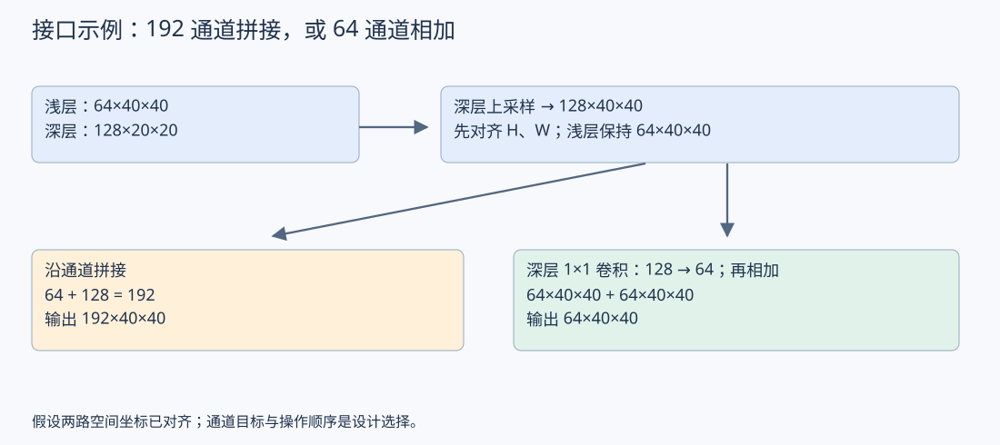

### 2.5 设计取舍与旧知识

相加不增加输出通道数，但要求通道数匹配；拼接保留两路输入的各个数值，使通道数增加，通常增加后续计算和中间特征存储。不能因此认定某种方式一定更准确。

关联阅读：[03 第 5 节：通道与空间维度](03_特征与中间表示.md#channels)、[05 第 9 节：1×1 卷积调整通道](05_感受野.md#pointwise)。08 第 1 节解释为什么需要考虑多层融合，本节解释融合的基本操作。

设计应用：[08 第 4 节](#neck-add-vs-concat) 将这两种操作放入相同输入的 neck 中比较。

本节已讨论上采样示例、相加与通道拼接；实际 neck 还可能安排多次融合与卷积。当前训练代码未修改，尚未运行融合方案的效果实验。下一步可以沿这几种基本操作，阅读一个简化 neck 的完整数据流。

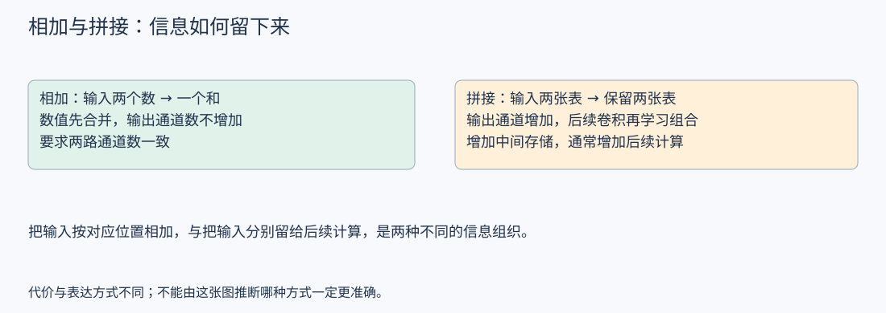

<a id="neck-flow"></a>

## 3. 把基本操作串成一个简化 neck

### 3.1 明确输入接口

以下是用于阅读数据流的假设结构，不是 YOLOv8PAFPN 的实际实现，也不是当前 src/train.py 的结构。省略批次维度，并假设两路空间坐标可按所选采样方式对齐：

```text
较浅层 A：64×40×40
较深层 B：128×20×20
```

目标是输出一份融合特征供分类 head 使用。本节选择 40×40 的融合网格和 64 个输出通道，仅为示例，不能据此认定这些设置最适合窄道任务。

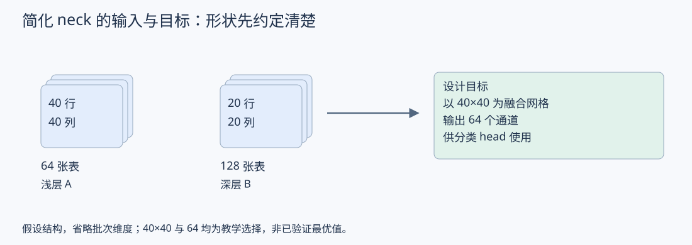

### 3.2 按顺序跟踪尺寸

```text
浅层 A：64×40×40 ────────────────────┐
                                    │
深层 B：128×20×20                    │
    ↓ 1×1 卷积，输出通道设为 64       │
       64×20×20                      │
    ↓ 上采样到 40×40                 │
       64×40×40 ────────────────────┤
                                    ↓ 沿通道拼接
                              128×40×40
                                    ↓ 3×3 卷积，输出通道设为 64
                               64×40×40
                                    ↓ 交给分类 head
```

第一步的普通 1×1 卷积设置 stride=1、padding=0；最后 3×3 卷积设置 stride=1、padding=1。这保证各自的空间尺寸不变。实际模块还可以配合归一化与激活函数，图中先聚焦形状与职责，不将这些省略项视为固定设计。

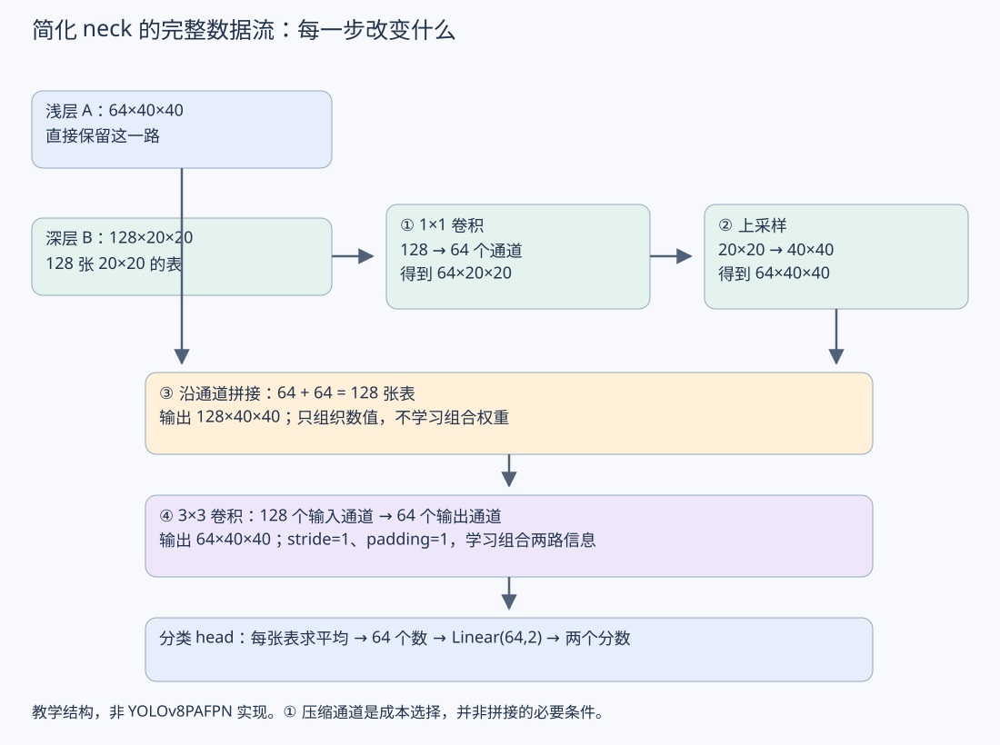

### 3.3 每一步为什么存在

1. **1×1 卷积**：在每个位置重新组合深层的 128 个通道，输出 64 个通道。这里压缩通道以控制中间表示和后续计算规模；拼接本身并不要求两路通道相同，所以这一步是设计选择，不是拼接的必要条件。
2. **上采样**：将深层特征的空间网格从 20×20 调整为 40×40，以匹配浅层。不会自动恢复已丢失的细节。
3. **拼接**：保留两路各 64 个通道，得到 128 个通道。拼接本身只是组织数据，不学习组合权重。
4. **3×3 卷积**：每套过滤器读取拼接后的全部 128 个输入通道和邻近空间位置，进行可学习组合。使用 64 套过滤器，得到 64 个输出通道。

融合计算的含义不止“形状拼到一起”；后续卷积让两路信息通过学到的权重共同参与输出。能否学到对分类有用的关系，仍由数据、训练和验证结果决定。

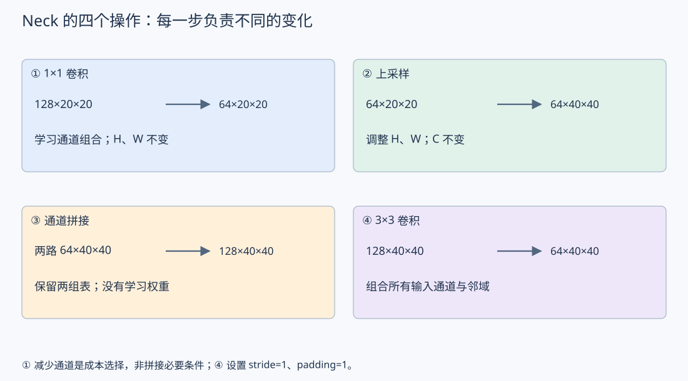

### 3.4 接上分类 head

若采用07 第 1 节的全局平均方案：

```text
neck 输出 64×40×40
       ↓ 每个通道分别求空间平均
64 个数
       ↓ Linear(64,2)
两个原始类别分数
```

neck 到这里仍输出特征，没有直接输出类别。分类 head 才把这些特征转换成两个分数。这里 Linear 含 64×2+2=130 个参数，不包含 neck 和 backbone 的参数。

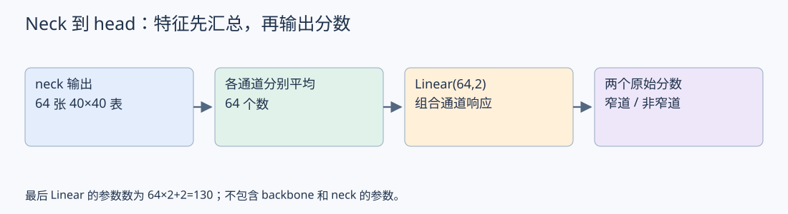

### 3.5 与旧知识的对应

- [03：通道与空间维度](03_特征与中间表示.md#channels)：逐步读懂各张量的 C、H、W。
- [04：padding 与输出尺寸](04_卷积与特征图.md#padding-design)：核对两次卷积为什么不改变空间尺寸。
- [05：1×1 卷积](05_感受野.md#pointwise)：理解 128→64 是权重组合，不是简单选取前 64 张表。
- [08 第 2 节](#feature-fusion)：回顾上采样和通道拼接。
- [07 第 1 节](07_分类Head与空间汇总.md#classification-head)：回顾如何从多张特征表得到分类分数。

本次未修改训练代码，也未执行效果实验。后续对照见 [08 第 4 节：相同输入下的相加与拼接](#neck-add-vs-concat)，先比较信息组织与接口，具体成本计算待后续讨论。


<a id="neck-add-vs-concat"></a>

## 4. 相同输入下，neck 用相加还是拼接

本节只比较一个设计选择：沿用08 第 3 节相同的两路输入与共同准备步骤，把融合操作换成相加，看信息组织和后续接口怎样变化。这是教学对照，未修改训练代码，也未执行效果实验。

### 4.1 先让比较从相同输入开始

浅层 A 为 64×40×40。深层 B 原为 128×20×20，先经过普通 1×1 卷积压缩到 64×20×20，再上采样成 B′：64×40×40。这样 A、B′ 各有 64 张 40×40 的数值表，以下假设空间坐标已对齐。

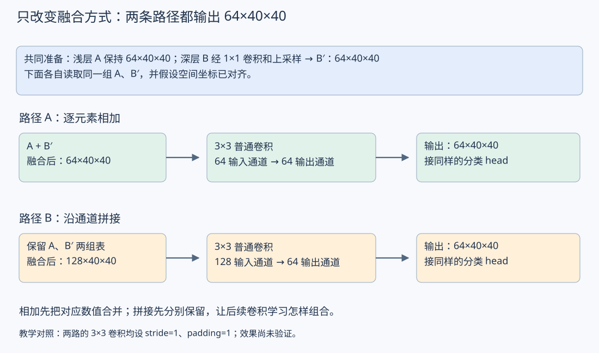

- **相加路径**：A 与 B′ 的对应通道、对应格子相加，得到 64×40×40；再接普通 3×3 卷积，64 个输入通道变为 64 个输出通道。
- **拼接路径**：沿通道方向保留两组表，得到 128×40×40；再接普通 3×3 卷积，128 个输入通道变为 64 个输出通道。

两路末尾的卷积均为 stride=1、padding=1，因此最终都是 64×40×40，可以接同样的分类 head。相同输出形状并不表示两个方案算出了相同的数值。

### 4.2 关键区别：先合并，还是先保留

固定某个对应通道、某行某列，假设 A 的数值是 2，B′ 的数值是 5。

- **相加**先得到 7。后面的卷积只能读取这个和，不能仅由 7 分辨输入是 2 与 5，还是 3 与 4。
- **拼接**分别保留 2 和 5；后面的卷积可以为来自两路的数值配置各自的权重，再学习怎样组合。


两种操作本身都没有可学习参数。在这个对照中，相加后的通道更少，因此末尾同为 64 个输出通道的普通 3×3 卷积，其卷积权重数量和乘加量更少；这不等于整个模型更快一倍，也不能据此保证分类效果更好。暂不展开具体成本计算。

还要注意：形状一致只保证逐元素相加可执行，不保证两路对应通道已经表达适合相加的内容。前面的可学习变换和整体训练会影响这种组合是否有用，最终需要实验。

本节先记住：**相加先合并对应数值；拼接先保留两组数值，交给后续计算组合。**

关联阅读：[08 第 2 节：相加与拼接的基本操作](#feature-fusion)、[08 第 3 节：共同的 neck 输入与准备步骤](#neck-flow)。下一步再用具体数字比较两路末尾卷积的参数量与计算成本，然后讨论如何验证效果。
