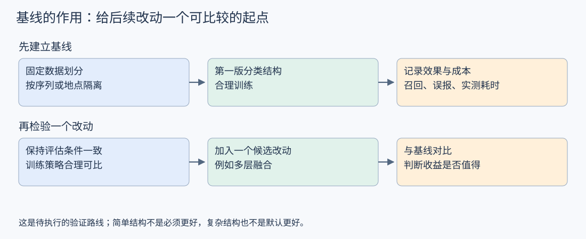
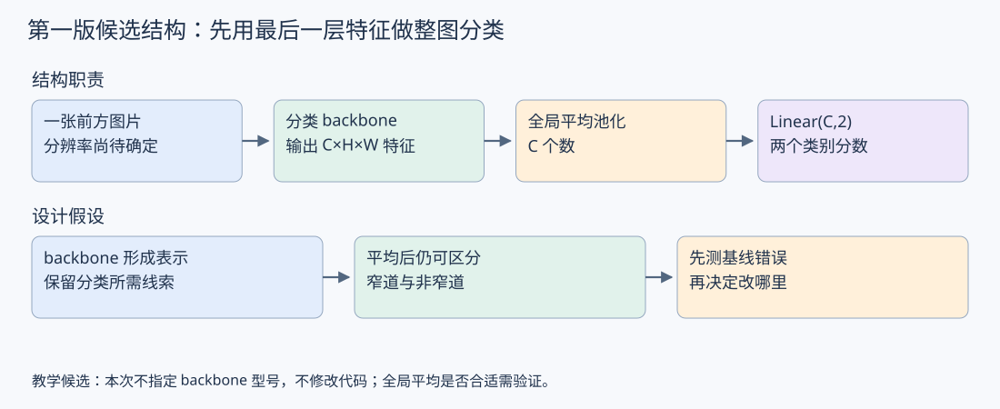
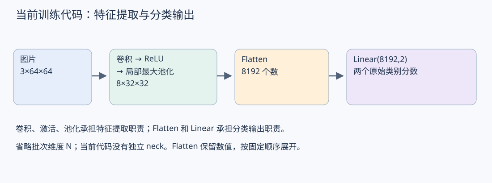

# 09：窄道分类基线与方案验证

更新日期：2026-10-30

本篇回到“怎样选择、设计和验证框架”的学习主线。先修：[06：整体模块职责](06_整体架构与模块职责.md#backbone-output)、[07：分类 head 的空间处理](07_分类Head与空间汇总.md#classification-head)。本次只确定基线的作用与第一版候选结构；不继续展开算子推导。具体任务约束、backbone 型号及实验结果尚未确定。

## 1. 基线：后续改动的比较起点

基线是固定数据、训练与评估约定后，能够重复测量效果和成本的一版方案。它的作用是回答“改动是否值得”，不是证明某种结构最优。

例如，先训练不含独立 neck 的分类结构，记录窄道召回率、误报情况、失败样本和实际推理耗时。后续若尝试多层融合，就与这个起点比较：是否减少了关心场景的漏判？是否付出了可接受的耗时和内存成本？不能只比较模型名字或单次总体准确率。

基线也不等于“能想到的最小网络”。如果结构弱到无法形成有意义的表示，它可以用于检查流程，却不一定是评价实际任务方案的合适对手。不同方案应获得合理、可比的训练，而不是机械使用同一组超参数后直接判胜负。

## 2. 第一版结构：backbone → 空间汇总 → 分类层

当前任务约定是整张图片的窄道/非窄道二分类。因此可以提出如下第一版候选结构：分类 backbone 输出最后一层特征，经过全局平均池化，再由全连接层输出两个原始类别分数，暂不设置独立 neck。

这套结构的依据是：直接围绕整图类别输出建立数据流，先让 backbone 与 head 完成分类，再判断是否需要额外的特征融合。它不是从“分类任务永远不需要 neck”推出的结论。

这里有一个必须验证的假设：backbone 形成的特征经过空间平均后，仍保留足够的分类线索。如果间隙布局的关键区别在平均后消失，就需要结合失败样本检查 backbone 的关系表示、head 的空间处理或其他因素，而不是直接宣布“加 neck 就能解决”。

回顾：[07：Flatten 与全局平均池化的取舍](07_分类Head与空间汇总.md#classification-head)。该候选选择平均池化只是一个比较起点，不是把它当作唯一正确的分类 head。

## 3. 与当前代码的区别，以及下一步

当前 src/train.py 使用单卷积、ReLU、局部最大池化、Flatten 和 Linear，输入为 64×64。它已经可以承担训练流程的学习与检查；本篇的新候选不等于已经替换了当前代码，更没有验证真实窄道效果。

是否保留当前结构作为真实任务基线，以及应选择什么 backbone 和输入分辨率，要先了解任务条件。64×64 也不是本篇推荐的部署分辨率。

下一小节先明确会影响设计的三类条件：窄道标签怎样定义、可用数据的规模与覆盖范围、部署设备与可接受延迟。当前尚缺具体值，不能虚构漏判阈值、设备预算或数据量，再据此指定网络。

本次已讨论“基线是什么”和“第一版分类候选怎样组织”。下一步在条件明确后再比较 backbone；多层融合作为候选改动参见 [08 第 4 节](08_多层特征融合与Neck设计.md#neck-add-vs-concat)。未修改训练代码，未训练或测试新方案。
