# 09：窄道分类基线与方案验证

更新日期：2026-10-30

本篇回到“怎样选择、设计和验证框架”的学习主线。先修：[06：整体模块职责](06_整体架构与模块职责.md#backbone-output)、[07：分类 head 的空间处理](07_分类Head与空间汇总.md#classification-head)。本次只确定基线的作用与第一版候选结构；不继续展开算子推导。具体任务约束、backbone 型号及实验结果尚未确定。

## 1. 基线：后续改动的比较起点

基线是固定数据、训练与评估约定后，能够重复测量效果和成本的一版方案。它的作用是回答“改动是否值得”，不是证明某种结构最优。

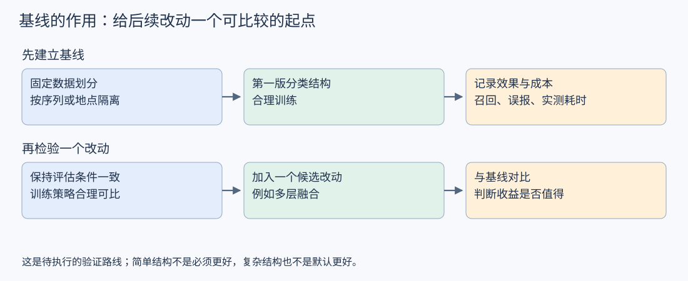

例如，先训练不含独立 neck 的分类结构，记录窄道召回率、误报情况、失败样本和实际推理耗时。后续若尝试多层融合，就与这个起点比较：是否减少了关心场景的漏判？是否付出了可接受的耗时和内存成本？不能只比较模型名字或单次总体准确率。

基线也不等于“能想到的最小网络”。如果结构弱到无法形成有意义的表示，它可以用于检查流程，却不一定是评价实际任务方案的合适对手。不同方案应获得合理、可比的训练，而不是机械使用同一组超参数后直接判胜负。

## 2. 第一版结构：backbone → 空间汇总 → 分类层

当前任务约定是整张图片的窄道/非窄道二分类。因此可以提出如下第一版候选结构：分类 backbone 输出最后一层特征，经过全局平均池化，再由全连接层输出两个原始类别分数，暂不设置独立 neck。

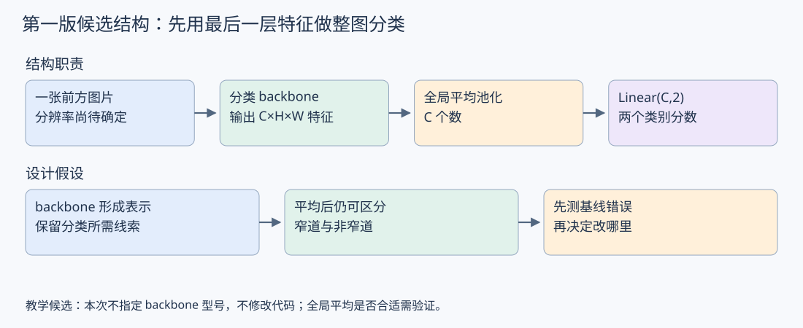

这套结构的依据是：直接围绕整图类别输出建立数据流，先让 backbone 与 head 完成分类，再判断是否需要额外的特征融合。它不是从“分类任务永远不需要 neck”推出的结论。

这里有一个必须验证的假设：backbone 形成的特征经过空间平均后，仍保留足够的分类线索。如果间隙布局的关键区别在平均后消失，就需要结合失败样本检查 backbone 的关系表示、head 的空间处理或其他因素，而不是直接宣布“加 neck 就能解决”。

回顾：[07：Flatten 与全局平均池化的取舍](07_分类Head与空间汇总.md#classification-head)。该候选选择平均池化只是一个比较起点，不是把它当作唯一正确的分类 head。

## 3. 与当前代码的区别，以及下一步

当前 src/train.py 使用单卷积、ReLU、局部最大池化、Flatten 和 Linear，输入为 64×64。它已经可以承担训练流程的学习与检查；本篇的新候选不等于已经替换了当前代码，更没有验证真实窄道效果。

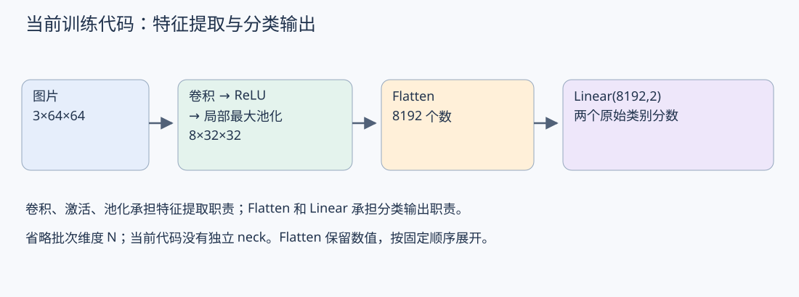

是否保留当前结构作为真实任务基线，以及应选择什么 backbone 和输入分辨率，要先了解任务条件。64×64 也不是本篇推荐的部署分辨率。

下一小节先明确会影响设计的三类条件：窄道标签怎样定义、可用数据的规模与覆盖范围、部署设备与可接受延迟。当前尚缺具体值，不能虚构漏判阈值、设备预算或数据量，再据此指定网络。

本次已讨论“基线是什么”和“第一版分类候选怎样组织”。下一步在条件明确后再比较 backbone；多层融合作为候选改动参见 [08 第 4 节](08_多层特征融合与Neck设计.md#neck-add-vs-concat)。未修改训练代码，未训练或测试新方案。

## 训练集与验证集如何共同指导head设计

从诊断到候选实验后，继续看 [改动是否值得保留](#experiment-retention)、[重复训练](#repeatable-comparison)与[checkpoint选择](#checkpoint-selection)。

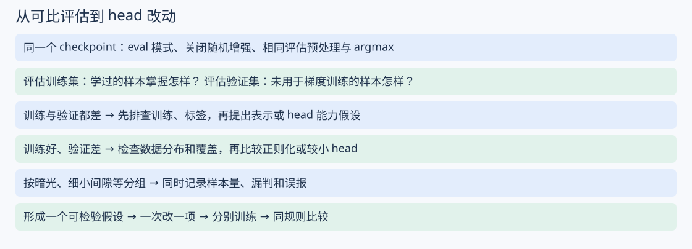

### 先做可比评估，而不是凭训练loss断言训练效果

用同一份选定checkpoint分别评估训练集与验证集。评估训练集不等于继续训练，不更新参数；两边均用eval模式、关闭梯度记录、关闭随机训练增强，并保持相同评估预处理、类别映射和argmax规则。默认情况下Dropout关闭，BN使用保存的运行统计。此处是评估方案说明，不涉及核对或修改其他模块源码。

不必等模型“训练得很好”才能评估，任意checkpoint都能检查；关键是比较同一参数状态。训练过程中的平均loss有参考价值，但因参数持续变化、随机增强及训练模式不同，不等价于固定checkpoint的训练集评估。记录loss、准确率、窄道召回率、非窄道误报率、混淆计数及样本量。训练集评估用于诊断拟合情况，不是独立泛化证据；验证集用于开发选择，独立测试集保留作最终评价。

### 如何解读训练与验证差距

以下均为教学示例，不是用户新实验结果。

| 情况 | 训练集窄道召回率 | 验证集窄道召回率 | 后续判断 |
|---|---:|---:|---|
| A | 82% | 80% | 先检查训练是否充分、学习率、标签，再提出表示或加工能力假设 |
| B | 98% | 80% | 检查数据分布与覆盖；分布可比且差距持续明显时比较正则化或较小head |
| C | 97% | 95% | 继续检查误报、关键场景和成本，不只看召回 |

训练验证都差不能直接证明head太小；训练好验证差不能直接证明加Dropout能解决。若两集合光照、地点等分布不同，应优先解释分布差异。仅召回很高也不能证明模型好，因为几乎全预测窄道也能得到高召回；必须同时比较误报等指标。根据问题选择模块的配置依据见 [07：BN与Dropout的配置](07_分类Head与空间汇总.md#bn-dropout-selection)。

### 从总体指标深入到同类场景

| 场景（教学示例） | 训练集窄道召回率 | 验证集窄道召回率 |
|---|---:|---:|
| 光照正常、边界清楚 | 98% | 96% |
| 暗光 | 95% | 65% |
| 细小间隙 | 72% | 70% |

暗光训练好、验证差时，先检查暗光样本是否少、地点是否单一及两集合覆盖差异，不能马上归因为卷积层数不足。细小间隙在两个集合都差时，先核对标签与训练充分性；排除明显问题后，可提出“当前空间汇总不适合这些布局”的假设，再比较全局平均与2×2分区平均，或另做空间加工对照。假设不是已证实原因。输入特征是否含有足够线索仍限制head可达到的效果。

子集分组应使用一致定义，并同时记录样本数量、类别数量、漏判、误报及相同场景正确样本。某子集只有正类时只能算正类召回，误报率需要该场景负类样本；错误数量多也可能仅是样本总量多。小子集指标容易波动，不因个别样本的变化就判定结构优劣。漏判分析基础见 [07：从失败样本提出设计假设](07_分类Head与空间汇总.md#error-hypothesis-link)。

### 将诊断落实为一次对照

例如A使用当前全局平均池化，B使用2×2分区平均并调整Linear输入尺寸，两组head分别训练，保持数据、训练条件、checkpoint选择与argmax规则可比。重点检查细小间隙子集的漏判是否减少、误报是否增加，同时检查总体指标和成本，不能只挑有利子集。池化与分类接口同时变化，结果不能全归因于池化单个算子。具体形状与设计取舍见 [07：池化选择](07_分类Head与空间汇总.md#pooling-choice)。

一次主要改变一项：过拟合证据支持Dropout对照，批统计不稳支持归一化对照，持续布局错误支持空间汇总或加工候选。当前只保存诊断及实验设计方法，未执行新评估、修改训练模型或运行对照。

## 怎样判断head改动是否值得保留

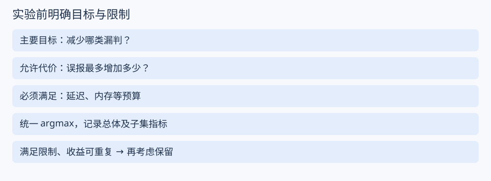

实验前确定主要改善目标、允许代价和必须满足的限制。以全局平均A与2×2分区平均B为教学例子：A全部漏判280、细小间隙漏判80、误报314；B分别为250、50、420。B减少漏判但增加误报，不能只凭漏判减少认定更好。若超过误报约束或计算预算，方案不满足要求；若代价可接受且减少关键场景漏判，才值得继续验证。数字仅为教学示例，不是新运行结果。

当前业务尚未给出误报及部署约束数值，不能虚构可接受上限。可先记录完整结果，明确取舍，待约束确定后判断。保持用户已确定的argmax规则，不将阈值调整混入此次结构比较。错误场景及候选设计见 [训练集与验证集诊断](#train-validation-diagnosis)。

## 收益能否超过训练随机波动

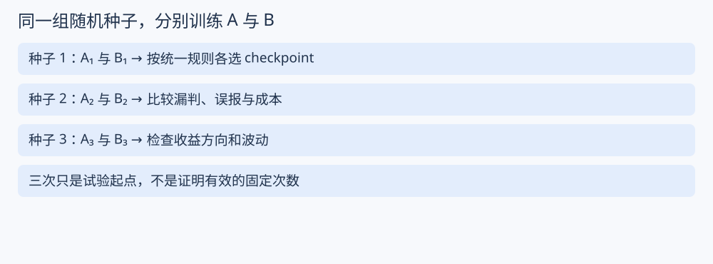

初始化、图片顺序、随机增强与Dropout均可能造成训练结果波动。先各训练一次筛选，随后对有希望或差距接近的候选，用同一组多个随机种子重复训练。三次可作实用起点，并非统计充分性的固定保证；使用相同种子也不意味着不同结构的全部随机过程完全相同。各组仍需保持训练预算、数据与checkpoint选择规则可比。

| 随机种子 | A漏判数（教学示例） | B漏判数（小差异例） | B漏判数（稳定改善例） |
|---|---:|---:|---:|
| 1 | 280 | 270 | 245 |
| 2 | 265 | 275 | 240 |
| 3 | 278 | 272 | 248 |

小差异例中收益方向不一致，证据较弱；稳定改善例中B在各次都减少漏判，证据更充分，仍需检查误报、子集及成本。记录每次结果及均值、波动，不只报告最好一次。重复训练不能修复验证集偏差，也不替代独立测试。选择模型的统一规则见 [checkpoint选择](#checkpoint-selection)。

## checkpoint：训练过程中保存的状态快照

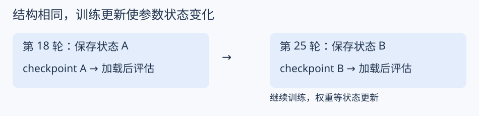

checkpoint可以理解为训练存档：把某个时刻的模型状态保存下来，以后可以加载它进行评估、预测或继续训练。对于当前head学习场景，同一个结构经过不同轮次更新，权重等状态会变化；保存第18轮和第25轮，就得到两个不同的checkpoint。轮次是训练进度，checkpoint是实际保存的状态，两者并不等同；也可以按训练步数保存。

保存内容取决于代码：用于预测的文件可能只保存模型状态（例如权重、偏置及BN运行统计）；用于完整恢复训练的存档通常还包含优化器、学习率调度器、进度等状态。只保存head时，需要同时明确其配套的固定backbone/projector版本，才能重现对应完整模型的结果。

评估“第18轮checkpoint”就是加载第18轮保存的状态，用它计算指标。因此同一条实验记录不能混合不同checkpoint的最优指标，见[实验记录](#experiment-record)。选择哪份存档用于比较，见[统一选择规则](#checkpoint-selection)。

## 公平选择用于比较的checkpoint

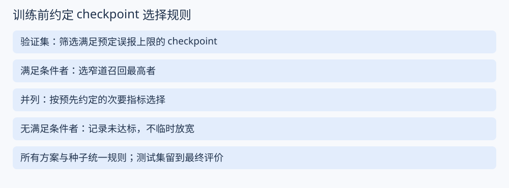

训练中的head持续更新，最后一轮不一定最好。应先约定选择规则，对所有候选及随机种子一致执行，避免看完结果再挑最有利的轮次。若目标为控制误报并减少漏判，可先筛选满足预先确定误报上限的checkpoint，再选窄道召回最高者；并列时按预定次要指标处理。若没有满足上限的checkpoint，应记录未达标，不临时放宽上限。当前没有业务给定的数值，上述是规则示例。

没有业务约束时，可暂用统一验证F1或验证loss选择，并完整报告召回、误报与成本。按F1选不保证漏判最少，按loss选也不保证argmax分类指标最好；选择指标本身需要与目标对应。模型选择使用验证集，最终确认使用未参与选择的独立测试集，不根据测试结果反复挑结构、阈值或轮次。改动取舍见 [是否保留实验方案](#experiment-retention)，训练波动见 [重复对照](#repeatable-comparison)。

实验结果记录见[一条记录对应一次训练结果](#experiment-record)。以上仅整理学习内容，尚未执行新实验或指定业务上限。

## 一条实验记录对应一次训练结果

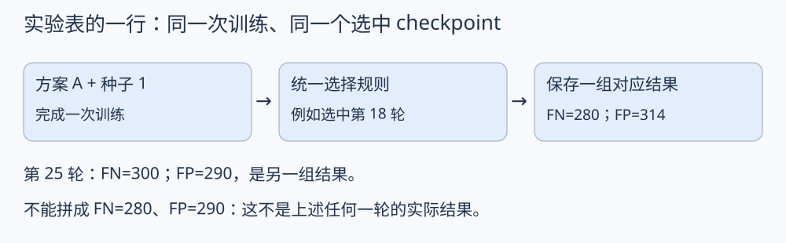

一种head方案可以训练多次。因此，实验表的一行对应“一种方案、一个随机种子、按统一规则选出的一个checkpoint”，不能把不同次训练的最优指标拼成一行。完整比较需要保留每次训练的结果，再汇总均值与波动；参见[重复对照](#repeatable-comparison)。

| 实验编号 | head方案 | 随机种子 | 选中轮次 | 窄道漏判FN | 非窄道误报FP |
|---|---|---:|---:|---:|---:|
| A-1 | 全局平均 | 1 | 18 | 280 | 314 |
| B-1 | 2×2分区平均，配套调整Linear | 1 | 21 | 250 | 420 |

表中均为教学示例，不是新实验结果。两行使用同一验证集、统一checkpoint选择规则及argmax决策。不同方案选中不同轮次可以接受，前提是训练预算可比、选择规则一致，见[checkpoint选择](#checkpoint-selection)。

同一行的FN、FP、召回率、F1等必须来自同一个checkpoint的一次对应评估。例如A在第18轮漏判280、误报314，第25轮漏判300、误报290，不能记录成“漏判280、误报290”，因为没有一个候选checkpoint取得这组结果。

本节先明确记录单位。具体填写项见[实验记录字段](#experiment-record-fields)。保持当前backbone/projector固定、仅比较head，不修改argmax规则，尚未执行训练。

## 选中的轮次不同，也可以公平比较

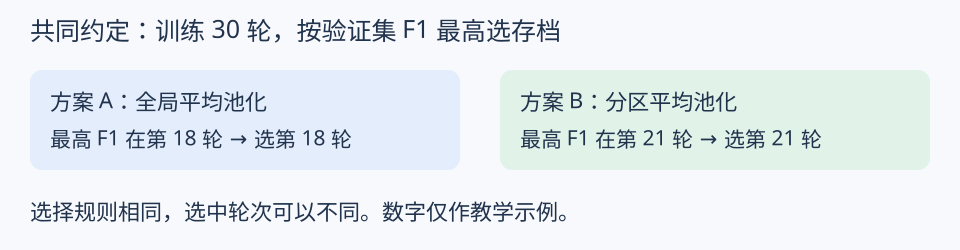

教学例子：A、B各计划训练30个epoch，都按验证集F1最高选择checkpoint。A选中第18轮，B选中第21轮，这是相同规则得到不同结果，可以用于公平对照。不同结构学习速度不同，不要求最佳状态出现在同一轮。

公平比较关注的是数据划分、评估方式、训练预算与模型选择规则是否可比，而不是强制选中轮次相同。若A按最佳F1选、B随意用最后一轮，或看到B结果后单独增加其训练机会，就改变了比较条件。训练预算可以按轮次或计算时间等定义，应按实验目标预先明确；同样30轮不代表耗时相同，仍需记录成本。具体选择见[checkpoint选择](#checkpoint-selection)，对应结果保存见[实验记录](#experiment-record)。

补充术语：一个epoch通常表示训练集遍历一遍，batch是一次处理的一批样本。1000张训练图、batch_size=100时，一轮有10批；训练30轮通常遍历训练集30遍。总轮数由训练配置决定，训练中参数持续更新、顺序和随机增强也可能变化。末尾不足一批时是否保留取决于加载设置，此处例子恰好整除。

## 实验记录先写条件，再写结果

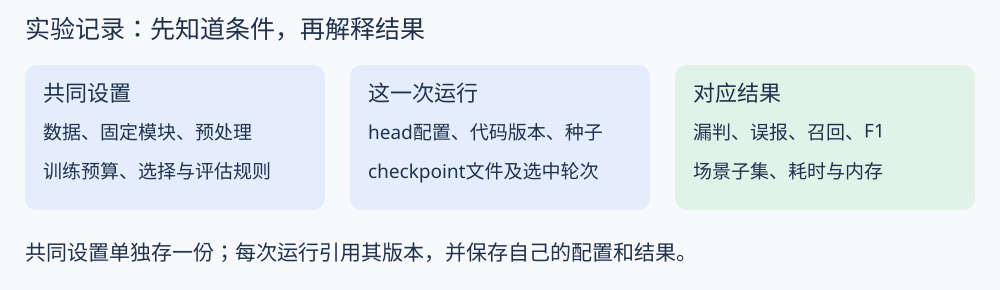

一行结果必须能够追溯到对应条件。实验记录可分为共同设置与每次运行记录：共同设置保存数据版本及划分、固定backbone/projector版本及冻结方式、输入预处理、训练配置、checkpoint选择及评估规则；每次运行记录保存实验编号、head配置及代码版本、随机种子、实际选中checkpoint及轮次、对应指标与成本。共同设置可以单独保存，再由每行引用其版本，无需反复填写。

| 类别 | 至少记录什么 | 为什么需要 |
|---|---|---|
| 数据与固定特征来源 | 数据版本和划分、固定模块版本、输入预处理 | 确认比较使用相同数据与特征来源 |
| head方案 | 结构、通道数、池化、归一化、激活、Dropout及代码版本 | 明确实际改变了什么 |
| 训练条件 | 种子、batch size、优化器、学习率及调度、轮数等预算 | 避免把训练条件差异误认作结构收益 |
| 选择与评估 | checkpoint路径及轮次、统一选择规则、argmax、评估集版本 | 追溯指标对应的实际存档和规则 |
| 结果 | TP/FN/FP/TN、召回率、误报率、F1，必要的场景子集 | 同时观察漏判与误报，保留样本量依据 |
| 成本 | 参数量、指定设备和测量设置下的耗时及内存 | 判断收益是否值得付出成本 |

例如A全局平均与B的2×2分区平均需要配套修改Linear输入，记录中应完整写出两处变化。若B同时改了学习率，就不能把收益全部归于池化方案；可以把它作为组合方案比较，但要明确实验问题已经改变。先保持其他设置一致，便于解释主要改动的效果，参见[诊断落实为对照](#train-validation-diagnosis)。

窄道召回率为TP/(TP+FN)，非窄道误报率为FP/(FP+TN)。只写“漏判减少30张”而不记录集合与样本量，无法判断不同评估之间是否可比。成本测量也应明确测head单独耗时还是完整模型耗时，不混用范围。

本节提供记录字段，尚未填写真实新实验数据。前置概念见[一条记录对应一个checkpoint](#experiment-record)，汇总方法见[多次训练结果汇总](#seed-result-summary)。

## 多次训练：同时看逐次结果、平均水平与波动

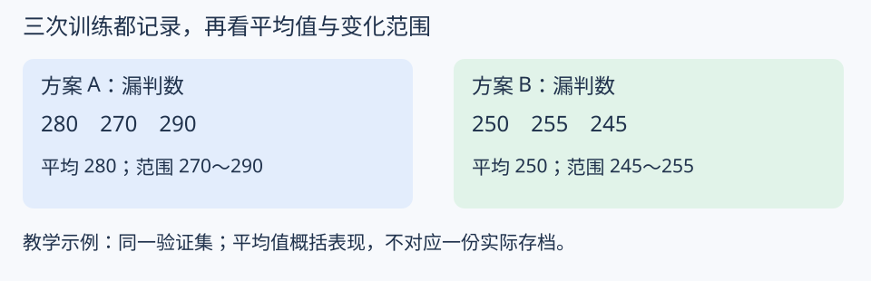

下表是同一验证集、相同选择规则下的教学结果。每行对应同一种子下分别完成的一次A训练与一次B训练，各自选出checkpoint后评估。

| 种子 | A漏判FN | B漏判FN | B比A少漏判 |
|---|---:|---:|---:|
| 1 | 280 | 250 | 30 |
| 2 | 270 | 255 | 15 |
| 3 | 290 | 245 | 45 |
| 三次平均 | 280 | 250 | 30 |

平均漏判数就是三次漏判数求和除以3。A为(280+270+290)/3=280，B为(250+255+245)/3=250。平均值用于概括多次训练的表现，不是一个实际checkpoint，也不能把平均结果作为可直接部署的模型。

同时检查逐次差值：本例B在三组中均减少漏判，比仅挑出B最好的一次245更有说服力。范围A为270～290、B为245～255，可直观看到本次观测的波动；范围不是未来运行的保证区间，三次也不足以证明所有情况下都更好。正式报告可进一步使用标准差等统计量，当前先理解平均与逐次结果。

平均漏判更少仍不能单独决定保留B，还应以相同方式检查误报、关键场景与成本，见[实验取舍](#experiment-retention)。不同验证集的漏判数不能直接这样比较；本例固定集合与样本量，故可对照。记录依据见[实验字段](#experiment-record-fields)，重复训练的适用边界见[训练随机波动](#repeatable-comparison)。后续决策见[用完整结果决定下一步](#candidate-decision)。

## 用完整结果决定下一步

下面为多次训练平均值的教学示例，各方案使用相同验证集。耗时假设是在同一设备、batch size及测量方式下测得的head单独耗时，并非真实运行结果。

| 方案 | 平均漏判FN | 平均误报FP | head耗时 |
|---|---:|---:|---:|
| A基线 | 280 | 314 | 1.0 ms |
| B候选 | 250 | 420 | 1.3 ms |
| C候选 | 255 | 300 | 1.1 ms |

B漏判最少，但误报和耗时增加；C比A漏判、误报均少，耗时稍增，值得优先继续验证，但没有业务预算仍不能宣布最终可用。B与C的平均漏判相差5张，要结合逐次波动及关键场景，不能只按该列排序。单项改善不等于总体最合适。

先检查预先约定的硬约束，超限方案记录为未达标；在达标候选中，比较主要目标的收益及重复稳定性，再检查关键子集与成本。没有明确约束时，保留完整取舍和待确认条件，不自行设定可接受误报或时延。本表只有总体平均值，不足以证明稳定性和场景收益。实验选择的前置规则见[改动是否值得保留](#experiment-retention)，波动见[多次训练汇总](#seed-result-summary)。

阶段结论可以是“优先验证C”“B需确认误报代价”“当前没有候选达标”，不必每次强行选出最终方案。独立测试集用于对已选方案作最终确认，不作为反复试结构的排行榜；模型选择边界见[checkpoint选择](#checkpoint-selection)。

## 从问题假设形成一组head候选

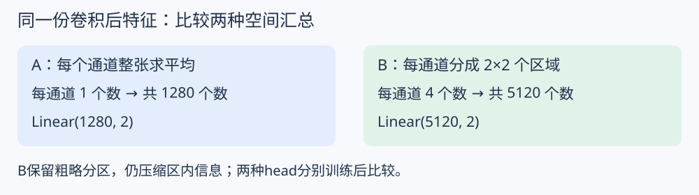

当前head基线A为最后一级特征→1×1 Conv模块→全局平均→展平→Dropout→Linear。教学候选B保留其他设置，将全局平均改为2×2自适应平均池化，并配套调整Linear输入。保持mid_channels=1280时，A池化后为[B,1280,1,1]，展平为[B,1280]；B池化后为[B,1280,2,2]，展平为[B,5120]，两者均输出[B,2]。B保留四个区域的粗略位置差异，仍丢失区内布局，不能等同于完整空间关系建模。

提出这一候选的假设是：某些漏判与当前空间汇总方式有关，保留粗略分区可能帮助分类。它不是已确认的错误原因；固定输入特征也可能缺少必要线索。候选效果需重新训练head并评估，不能把已训练A的池化直接换掉后即认为得到可比较的B。

配套Linear权重从2×1280=2560增加到2×5120=10240，若启用偏置两者均另加2。这里只是最后Linear，不是整个head参数量；分区方案的效果、过拟合及成本仍需检查。设计取舍见[07池化选择](07_分类Head与空间汇总.md#pooling-choice)。本组比较的是池化及配套分类接口的整体改动，不能把收益完全归因于池化算子。

实验问题可以写为：固定特征来源与其他训练条件，在统一argmax和checkpoint选择规则下，保留2×2粗略分区能否稳定减少目标场景漏判，且误报与成本可接受？记录方式见[实验字段](#experiment-record-fields)。当前仅形成候选，未改动模型或执行训练。

## 相同全局均值，不同空间布局

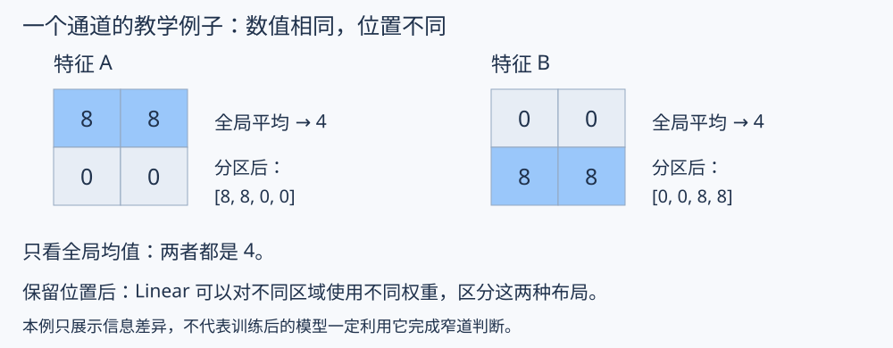

只取卷积后一个通道作教学示例。特征A为[[8,8],[0,0]]，特征B为[[0,0],[8,8]]。两者全局平均均为4，因此只凭这个通道平均后的数，后续Linear无法区分这两种输入。实际head还有其他通道，可能提供区别，不能由单通道示例推断整个模型一定分不清。

2×2自适应平均在本例2×2输入上每区恰好一个数，按行展平得到A=[8,8,0,0]、B=[0,0,8,8]。教学权重[1,1,-1,-1]、偏置0分别算出16与-16，展示Linear有能力对不同位置赋不同权重；实际权重通过训练学习，不是人工固定。真实输入更大时，各输出区汇总一片区域，仍损失区内细节；自适应池化的实际区间随尺寸确定，不能一律理解为四个等大且互不重叠的区块。

这说明分区方式保留了一种可用的区别，不保证区别就是窄道判别线索。特征值不是原图亮度，也不能直接命名为墙或通道；若依赖固定位置，视角变化也可能影响泛化。该例支持[候选假设](#head-hypothesis-experiment)，是否有效仍需真实数据对照。设计原理参见[07池化选择](07_分类Head与空间汇总.md#pooling-choice)。

## 保留位置，也要验证位置变化

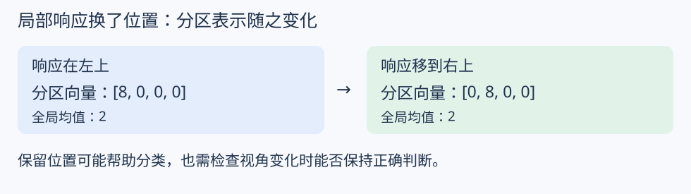

沿用单通道2×2教学例子：局部高响应从左上移动到右上，特征由[[8,0],[0,0]]变为[[0,8],[0,0]]。全局均值均为2，2×2池化展平分别为[8,0,0,0]和[0,8,0,0]。如果Linear对左右位置采用不同权重，输出可能变化。分区结构允许位置相关决策，不意味着一定学到错误依赖；全局平均也不保证整个网络对真实图像平移不变，因为上游特征与边界处理可能改变。

位置有时就是有效线索，保留它有益；但若相机偏转、安装高度、图像裁剪等使同类场景中的线索移动，过强的位置依赖可能影响泛化。相机或视角变化也可能改变真正的通行关系，不能一律认定标签不变。

验证候选时，在标签定义一致且有足够真实样本的前提下，比较常规视角和视角变化子集上的A/B漏判、误报及样本量。若B只在常规视角改善、变化视角退步，应进一步判断是否符合实际部署要求；不能只看总体平均。尚未确认模型存在该问题，本节只是待验证风险。表示差异见[同均值布局例子](#pooling-layout-example)，子集方法见[训练与验证诊断](#train-validation-diagnosis)。本次不同时改变数据增强，先明确结构实验的问题。

## 分区池化无可学习权重，Linear按通道和区域学习权重

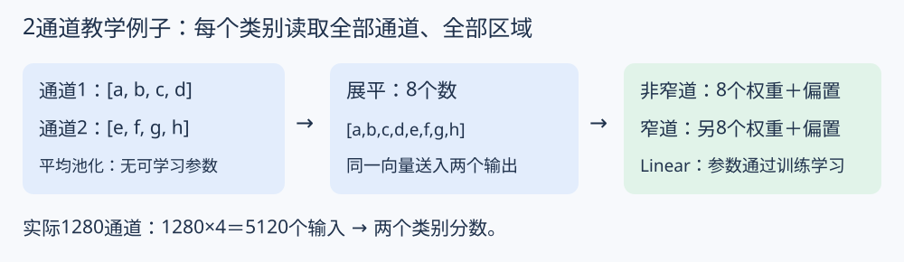

2×2自适应平均池化对每个通道生成四个区域均值。平均操作没有可学习权重；在各输出区域内部，各输入位置等权参与该区域的平均。展平后，Linear可以为每个通道的每个区域分别学习权重，不是所有通道共享四个区域权重。

用2通道教学例子：通道1输出[a,b,c,d]，通道2输出[e,f,g,h]，展平为[a,b,c,d,e,f,g,h]。Linear(8,2)为两个类别各准备8个权重及可选偏置。非窄道分数为w₀₁a+w₀₂b+…+w₀₈h+b₀，窄道分数使用另一组权重。两个类别都能读取全部8个输入，不是每个类别只读取一个通道。

实际mid_channels=1280时，2×2池化后形状[B,1280,2,2]，展平为[B,5120]，Linear(5120,2)的权重形状为[2,5120]，共10240个权重，若启用偏置另有2个。两个输出是类别原始分数，随后按既定分类规则选择类别；它们不是两个空间区域。对照候选见[head假设](#head-hypothesis-experiment)，布局差异见[数值例子](#pooling-layout-example)。

区域权重可以不同，也可能学得接近；这是模型提供的能力，不保证学到有用或稳定的位置关系。位置变化取舍见[位置依赖](#spatial-position-tradeoff)。

## 分区方案的新增参数在哪里

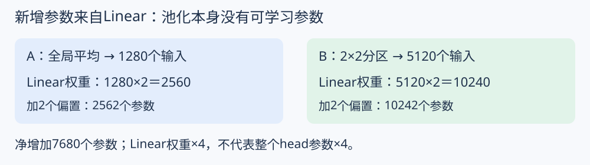

保持前面的Conv模块及1280中间通道不变，仅比较全局平均与2×2分区平均及配套Linear。池化和展平均无可学习参数。A的Linear(1280,2)有1280×2=2560个权重；B的Linear(5120,2)有5120×2=10240个权重。若都启用偏置，分别为2562和10242个参数，净增加7680。Linear权重变成4倍，但整个head的参数量不会因此变成4倍，因为前面的Conv等参数未变。

若前面的普通1×1卷积确为256→1280且groups=1，仅该卷积已有256×1280=327680个权重。新增7680相当于这部分权重的约2.34%，该比例只用于建立量级直觉，不是完整head的精确增幅；偏置、BN及包装器实际实现仍需按源码确定，当前不追查包装器。参数少量增加不保证耗时变化小，也不能保证效果改善或没有过拟合，实际需测量验证。

分区池化在本候选中主要改变空间信息的保留方式，不能仅以“参数多了”解释潜在收益。接口及权重含义见[区域与Linear权重](#region-linear-weights)，前置候选见[head对照](#head-hypothesis-experiment)。下一步讨论何种错误证据支持优先尝试分区方案。

## 什么证据支持优先试分区池化

分区候选适合检验“粗略空间布局可能有用”的假设。若错误样本与正确样本包含相似局部线索，但左右/上下分布不同，且此现象在一批有代表性的样本中重复出现，就值得把分区池化列为候选。例如两类图都有墙或障碍物，但两侧夹出通行空间与只在一侧出现障碍的布局不同；标签必须依实际窄道定义确认，不能只据物体位置指定。

原图看起来存在布局差异，并不能证明当前head输入保留了可用差异，也不能证明全局平均是漏判原因。固定特征若已经缺失线索，改池化未必能修复。2×2仅保留粗分区，区内两种布局仍可能被平均成相近结果。相关能力边界见[同均值例子](#pooling-layout-example)及[位置依赖](#spatial-position-tradeoff)。

| 观察到的问题 | 对分区候选的含义 |
|---|---|
| 相似局部线索、粗略布局不同，错误重复出现 | 支持提出布局保留假设，优先做对照 |
| 标签冲突或标注标准不一致 | 先澄清标注，不能期待结构修复矛盾监督 |
| 主要是模糊、遮挡或暗光 | 单凭现象不能支持分区池化，需继续定位 |

先收集具有相同场景定义的错误及正确对照，记录数量，再分别训练A/B，检查目标子集、总体误报及视角变化场景。候选成功标准应提前确定，不在看完结果后只选有利子集。当前仅学习提出假设与验证方法，未发现或确认新的实际错误模式，也未执行实验。候选结构见[head对照](#head-hypothesis-experiment)，结果记录见[实验字段](#experiment-record-fields)。
