# 10：Head候选设计与特征诊断

更新日期：2026-11-24

本篇承接[09：实验记录与验证方法](09_窄道分类基线与方案验证.md#experiment-record-fields)，集中讨论分区池化、MLP、候选组合及固定特征诊断。当前只设计head，backbone/projector固定；未修改模型或运行实验。

## 从问题假设形成一组head候选

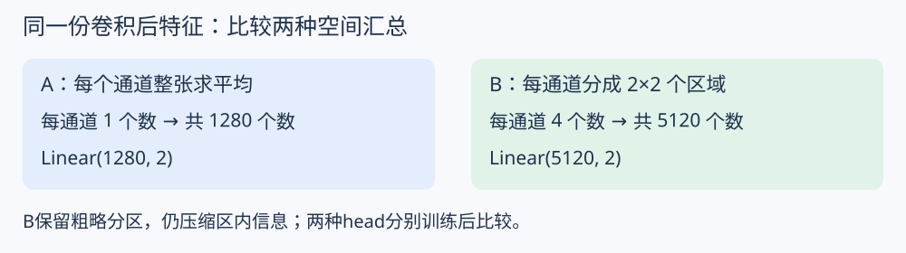

当前head基线A为最后一级特征→1×1 Conv模块→全局平均→展平→Dropout→Linear。教学候选B保留其他设置，将全局平均改为2×2自适应平均池化，并配套调整Linear输入。保持mid_channels=1280时，A池化后为[B,1280,1,1]，展平为[B,1280]；B池化后为[B,1280,2,2]，展平为[B,5120]，两者均输出[B,2]。B保留四个区域的粗略位置差异，仍丢失区内布局，不能等同于完整空间关系建模。

提出这一候选的假设是：某些漏判与当前空间汇总方式有关，保留粗略分区可能帮助分类。它不是已确认的错误原因；固定输入特征也可能缺少必要线索。候选效果需重新训练head并评估，不能把已训练A的池化直接换掉后即认为得到可比较的B。

配套Linear权重从2×1280=2560增加到2×5120=10240，若启用偏置两者均另加2。这里只是最后Linear，不是整个head参数量；分区方案的效果、过拟合及成本仍需检查。设计取舍见[07池化选择](07_分类Head与空间汇总.md#pooling-choice)。本组比较的是池化及配套分类接口的整体改动，不能把收益完全归因于池化算子。

实验问题可以写为：固定特征来源与其他训练条件，在统一argmax和checkpoint选择规则下，保留2×2粗略分区能否稳定减少目标场景漏判，且误报与成本可接受？记录方式见[实验字段](09_窄道分类基线与方案验证.md#experiment-record-fields)。当前仅形成候选，未改动模型或执行训练。

## 相同全局均值，不同空间布局

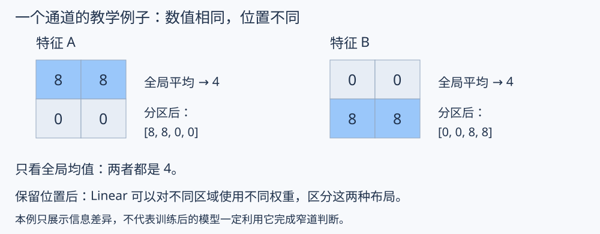

只取卷积后一个通道作教学示例。特征A为[[8,8],[0,0]]，特征B为[[0,0],[8,8]]。两者全局平均均为4，因此只凭这个通道平均后的数，后续Linear无法区分这两种输入。实际head还有其他通道，可能提供区别，不能由单通道示例推断整个模型一定分不清。

2×2自适应平均在本例2×2输入上每区恰好一个数，按行展平得到A=[8,8,0,0]、B=[0,0,8,8]。教学权重[1,1,-1,-1]、偏置0分别算出16与-16，展示Linear有能力对不同位置赋不同权重；实际权重通过训练学习，不是人工固定。真实输入更大时，各输出区汇总一片区域，仍损失区内细节；自适应池化的实际区间随尺寸确定，不能一律理解为四个等大且互不重叠的区块。

这说明分区方式保留了一种可用的区别，不保证区别就是窄道判别线索。特征值不是原图亮度，也不能直接命名为墙或通道；若依赖固定位置，视角变化也可能影响泛化。该例支持[候选假设](#head-hypothesis-experiment)，是否有效仍需真实数据对照。设计原理参见[07池化选择](07_分类Head与空间汇总.md#pooling-choice)。

## 保留位置，也要验证位置变化

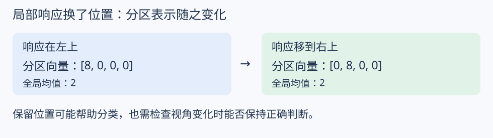

沿用单通道2×2教学例子：局部高响应从左上移动到右上，特征由[[8,0],[0,0]]变为[[0,8],[0,0]]。全局均值均为2，2×2池化展平分别为[8,0,0,0]和[0,8,0,0]。如果Linear对左右位置采用不同权重，输出可能变化。分区结构允许位置相关决策，不意味着一定学到错误依赖；全局平均也不保证整个网络对真实图像平移不变，因为上游特征与边界处理可能改变。

位置有时就是有效线索，保留它有益；但若相机偏转、安装高度、图像裁剪等使同类场景中的线索移动，过强的位置依赖可能影响泛化。相机或视角变化也可能改变真正的通行关系，不能一律认定标签不变。

验证候选时，在标签定义一致且有足够真实样本的前提下，比较常规视角和视角变化子集上的A/B漏判、误报及样本量。若B只在常规视角改善、变化视角退步，应进一步判断是否符合实际部署要求；不能只看总体平均。尚未确认模型存在该问题，本节只是待验证风险。表示差异见[同均值布局例子](#pooling-layout-example)，子集方法见[训练与验证诊断](09_窄道分类基线与方案验证.md#train-validation-diagnosis)。本次不同时改变数据增强，先明确结构实验的问题。

## 分区池化无可学习权重，Linear按通道和区域学习权重

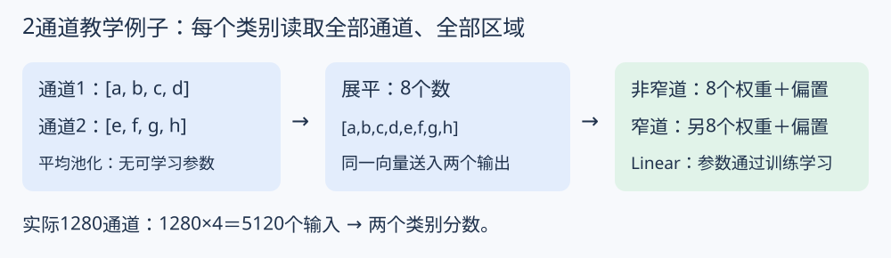

2×2自适应平均池化对每个通道生成四个区域均值。平均操作没有可学习权重；在各输出区域内部，各输入位置等权参与该区域的平均。展平后，Linear可以为每个通道的每个区域分别学习权重，不是所有通道共享四个区域权重。

用2通道教学例子：通道1输出[a,b,c,d]，通道2输出[e,f,g,h]，展平为[a,b,c,d,e,f,g,h]。Linear(8,2)为两个类别各准备8个权重及可选偏置。非窄道分数为w₀₁a+w₀₂b+…+w₀₈h+b₀，窄道分数使用另一组权重。两个类别都能读取全部8个输入，不是每个类别只读取一个通道。

实际mid_channels=1280时，2×2池化后形状[B,1280,2,2]，展平为[B,5120]，Linear(5120,2)的权重形状为[2,5120]，共10240个权重，若启用偏置另有2个。两个输出是类别原始分数，随后按既定分类规则选择类别；它们不是两个空间区域。对照候选见[head假设](#head-hypothesis-experiment)，布局差异见[数值例子](#pooling-layout-example)。

区域权重可以不同，也可能学得接近；这是模型提供的能力，不保证学到有用或稳定的位置关系。位置变化取舍见[位置依赖](#spatial-position-tradeoff)。

## 分区方案的新增参数在哪里

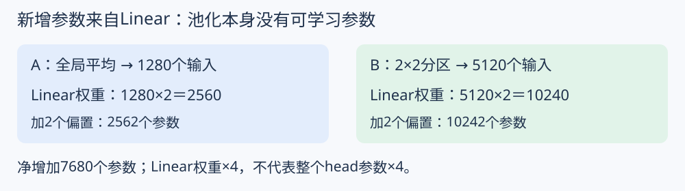

保持前面的Conv模块及1280中间通道不变，仅比较全局平均与2×2分区平均及配套Linear。池化和展平均无可学习参数。A的Linear(1280,2)有1280×2=2560个权重；B的Linear(5120,2)有5120×2=10240个权重。若都启用偏置，分别为2562和10242个参数，净增加7680。Linear权重变成4倍，但整个head的参数量不会因此变成4倍，因为前面的Conv等参数未变。

若前面的普通1×1卷积确为256→1280且groups=1，仅该卷积已有256×1280=327680个权重。新增7680相当于这部分权重的约2.34%，该比例只用于建立量级直觉，不是完整head的精确增幅；偏置、BN及包装器实际实现仍需按源码确定，当前不追查包装器。参数少量增加不保证耗时变化小，也不能保证效果改善或没有过拟合，实际需测量验证。

分区池化在本候选中主要改变空间信息的保留方式，不能仅以“参数多了”解释潜在收益。接口及权重含义见[区域与Linear权重](#region-linear-weights)，前置候选见[head对照](#head-hypothesis-experiment)。下一步讨论何种错误证据支持优先尝试分区方案。

## 什么证据支持优先试分区池化

分区候选适合检验“粗略空间布局可能有用”的假设。若错误样本与正确样本包含相似局部线索，但左右/上下分布不同，且此现象在一批有代表性的样本中重复出现，就值得把分区池化列为候选。例如两类图都有墙或障碍物，但两侧夹出通行空间与只在一侧出现障碍的布局不同；标签必须依实际窄道定义确认，不能只据物体位置指定。

原图看起来存在布局差异，并不能证明当前head输入保留了可用差异，也不能证明全局平均是漏判原因。固定特征若已经缺失线索，改池化未必能修复。2×2仅保留粗分区，区内两种布局仍可能被平均成相近结果。相关能力边界见[同均值例子](#pooling-layout-example)及[位置依赖](#spatial-position-tradeoff)。

| 观察到的问题 | 对分区候选的含义 |
|---|---|
| 相似局部线索、粗略布局不同，错误重复出现 | 支持提出布局保留假设，优先做对照 |
| 标签冲突或标注标准不一致 | 先澄清标注，不能期待结构修复矛盾监督 |
| 主要是模糊、遮挡或暗光 | 单凭现象不能支持分区池化，需继续定位 |

先收集具有相同场景定义的错误及正确对照，记录数量，再分别训练A/B，检查目标子集、总体误报及视角变化场景。候选成功标准应提前确定，不在看完结果后只选有利子集。当前仅学习提出假设与验证方法，未发现或确认新的实际错误模式，也未执行实验。候选结构见[head对照](#head-hypothesis-experiment)，结果记录见[实验字段](09_窄道分类基线与方案验证.md#experiment-record-fields)。

## 保留位置与学习组合是两个设计选择

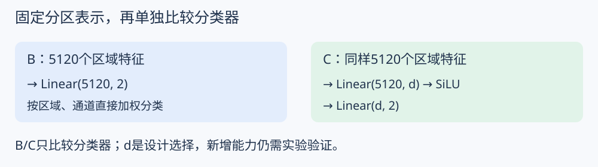

2×2池化保留粗略区域，Linear可以按通道及区域分别加权，但单个Linear对输入向量仍是仿射映射。其两个logit之差仍是仿射函数，argmax对应一条线性决策边界。原始图像到该向量的上游网络已有非线性，因此不能说整个模型是线性模型，也不能说单个Linear完全不能利用布局。

如果候选问题进一步是“输入表示中的线索需要非线性组合”，可以另设实验：固定2×2池化，将Linear(5120,2)换成Linear(5120,d)→SiLU→Linear(d,2)。d是待选择的隐藏宽度，不由类别数唯一决定。增加隐藏层及激活可增强分类器表达能力，但增加参数、计算和过拟合风险，不保证收益。只叠两层Linear而没有中间非线性，仍可合并为单个仿射映射，相关原理见[02激活函数](02_激活函数.md)。

不要把池化和分类器加深一次混在一起后，把结果归给单项。可先比较A全局平均+Linear与B分区平均+Linear；若有依据再比较B与C分区平均+非线性MLP。每组回答不同问题：A/B比较空间汇总及配套接口，B/C比较分类器表达能力。当前仅提出设计选项，未给定d、修改模型或运行实验。前置候选见[head对照](#head-hypothesis-experiment)，记录见[实验字段](09_窄道分类基线与方案验证.md#experiment-record-fields)。

## MLP的结构与参数成本

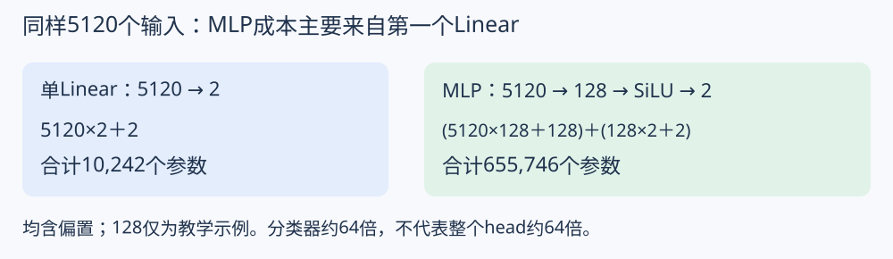

MLP（Multi-Layer Perceptron，多层感知机）通常由全连接层和隐藏层之间的非线性激活构成。本文候选为Linear(5120,128)→SiLU→Linear(128,2)，128仅作教学宽度，不是已选配置。5120→256→64→2等也属于MLP结构。两个相邻Linear若中间没有非线性操作，整体仍是仿射映射，可以合并为一个Linear，见[02激活函数](02_激活函数.md)。

固定2×2池化的5120维输入，且Linear均启用偏置：

| 结构 | 权重 | 偏置 | 总参数 |
|---|---:|---:|---:|
| Linear(5120,2) | 10240 | 2 | 10242 |
| MLP第一层Linear(5120,128) | 655360 | 128 | 655488 |
| SiLU | 0 | 0 | 0 |
| MLP第二层Linear(128,2) | 256 | 2 | 258 |
| MLP合计 | 655616 | 130 | 655746 |

该MLP比单Linear增加645504个参数，分类器总参数约64倍。这里只比较池化后的分类器，不代表整个head或整个模型增加64倍；SiLU没有可学习参数，但有计算。输出类别仍是2，128是内部表示宽度，不能仅凭“先压缩到128”就认为比直接输出2省参数。大头来自第一层5120×128的连接。

因此，隐藏宽度d属于成本和容量的设计选择，不能默认越大越好；先有分类器表达不足的假设，再做固定池化下的对照，观察训练/验证差距、目标场景、误报与成本。不得由参数增多直接推断效果更好。前置区别见[位置与组合能力](#position-versus-combination)，对照方法见[实验字段](09_窄道分类基线与方案验证.md#experiment-record-fields)。本次未选定实际MLP配置或运行实验。

## MLP隐藏宽度怎样选择

如何与池化及分类器对照衔接，见[实验顺序](#head-experiment-order)。

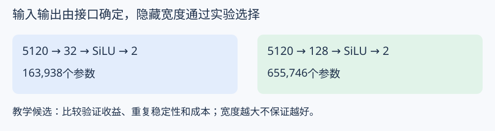

输入5120和输出2是当前接口，隐藏宽度d则是设计超参数，不能由两者算出唯一正确值。对Linear(5120,d)→SiLU→Linear(d,2)，都启用偏置时，参数总量为5120d+d+2d+2=5123d+2。教学候选d=32时163938个参数，d=128时655746个参数；数字只展示量级，不是针对当前数据验证后的推荐值。

先保留单Linear基线，若有理由检验非线性分类器，可从少量符合预算的隐藏宽度做对照。比较宽度时保持池化、激活、数据、训练和checkpoint选择规则可比，不能同时改变多处后只归因于d。先筛选，再对有希望的候选重复训练；无需遍历所有整数宽度。

| 结果证据 | 下一步判断 |
|---|---|
| 较宽方案训练表现改善、验证不改善或下降 | 增宽收益未转化为泛化收益，需检查过拟合等原因，不继续机械加宽 |
| 训练和验证均改善，收益可重复且成本达标 | 保留为候选，再检查关键场景与误报 |
| 各宽度都不改善 | 回查分类器表达能力不足这一假设，以及训练、特征和数据等可能限制，不直接判定宽度不够 |

训练集比较应使用同一checkpoint下可比的评估方式，不能直接把带增强和随机训练行为的训练指标与验证指标硬比。诊断见[训练与验证](09_窄道分类基线与方案验证.md#train-validation-diagnosis)。优先保留在任务指标上足够好、成本更低的方案；无稳定收益时，复杂方案没有充分保留依据。前置计算见[MLP成本](#mlp-parameter-cost)，结果选择见[候选决策](09_窄道分类基线与方案验证.md#candidate-decision)。本次未选定实际d或执行调参。

## 把候选组织成可解释的实验顺序

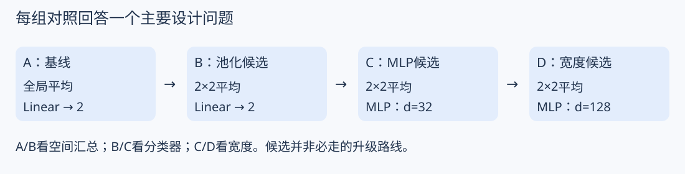

先固定backbone/projector、前面的Conv模块、中间1280通道及共同训练评估规则，以教学配置组织四个方案。A全局平均+Linear(1280,2)；B为2×2平均+Linear(5120,2)；C为2×2平均+Linear(5120,32)→SiLU→Linear(32,2)；D与C相同但隐藏宽度128。32/128仅用于说明，不是已选真实配置。

| 对照 | 回答的问题 | 解释边界 |
|---|---|---|
| A/B | 分区空间汇总及配套接口是否有收益？ | 同时改变了分类层输入数与参数量，不能完全归因于位置保留 |
| B/C | 在同样分区输入下，非线性MLP分类器是否有收益？ | 结构与参数容量都变化，不是单独测SiLU |
| C/D | 同样MLP形式下，增加隐藏宽度是否值得？ | 同时比较收益、稳定性及成本 |

先复现A并保存完整记录，再按问题和预算测试候选。这个顺序便于逐项理解，不是必须走完的升级路线，也不保证越往后越好。B无收益时可以暂停该分支、回查假设；不能由此证明全局平均+MLP或其他组合也无效。实际选项由错误证据决定，而不是默认先后结构都必须尝试。

本组属于逐步筛选，不足以完整识别池化和分类器之间的交互作用。如果后续要回答“MLP在全局平均和分区平均下的收益是否不同”，需要补充全局平均+MLP，与现有组合构成更完整的对照；进一步补齐组合的方法见[池化与分类器四种组合](#pooling-classifier-combinations)。固定配置、种子、预算及选择规则的记录见[实验字段](09_窄道分类基线与方案验证.md#experiment-record-fields)，宽度依据见[隐藏宽度](#mlp-width-selection)。本次仅安排学习中的候选对照，未修改模型或运行实验。

## 补齐池化与分类器的四种组合

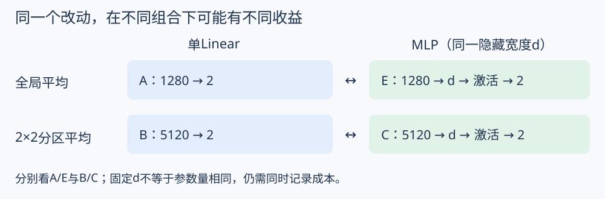

前述逐步筛选未包含全局平均+MLP。若要判断分类器收益是否依赖池化方式，可固定MLP隐藏宽度d及激活，补齐四种组合。沿用既有编号：A全局平均+Linear，B分区平均+Linear，C分区平均+MLP，E全局平均+MLP。D仍保留为先前的加宽候选，不在本组同时比较。

| 池化方式 | 单Linear | 一个隐藏层MLP |
|---|---|---|
| 全局平均 | A：Linear(1280,2) | E：Linear(1280,d)→SiLU→Linear(d,2) |
| 2×2分区平均 | B：Linear(5120,2) | C：Linear(5120,d)→SiLU→Linear(d,2) |

A/E与B/C分别回答MLP在两种输入表示下是否有收益；A/B与E/C分别比较同类分类器下的池化方案。若MLP在一种池化下改善、另一种下不改善，说明改动的效果可能依赖组合，不能把某一分支结论推广到全部情况。这是检查组合依赖的设计，实际差异还需与训练波动区分。

四种组合仍不是严格等参数量实验：分区池化导致输入维度和配套分类器参数不同；即使隐藏宽度d相同，两个MLP参数量也不同。因此本组比较的是实际组合的效果与成本，不把差异完全解释为纯位置作用或纯非线性作用。配置、预算和模型选择应可比，见[实验字段](09_窄道分类基线与方案验证.md#experiment-record-fields)。前置逐步筛选见[实验顺序](#head-experiment-order)。排序反转的解释及信息边界见[MLP不能恢复已丢失的区别](#mlp-information-boundary)。不要求立即训练四组，可按问题与预算补充；当前未修改或执行实验。

## MLP能重新组合输入，不能凭空恢复已丢失的区别

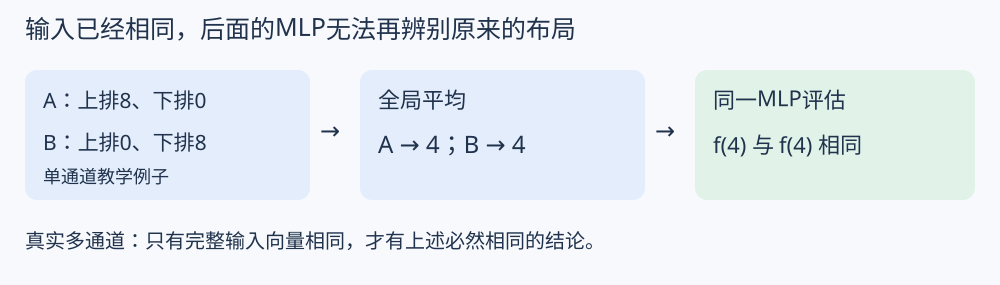

池化与分类器的排序可以反转：教学F1示例为全局+Linear80%、分区+Linear82%、全局+MLP85%、分区+MLP83%。这些不是实际实验结果。全局表示可能已保留足够可用线索，MLP提高其利用能力；分区候选还可能受无关位置、容量与训练条件影响。原因需证据确认，不能只凭结果断言。

但这不意味着MLP能恢复全局平均丢失的布局。若两张图经过上游及池化后，完整输入向量完全相同，同一确定性MLP在相同评估状态下必定给出相同输出。单通道例子[[8,8],[0,0]]和[[0,0],[8,8]]均被平均为4，后续只能计算f(4)，无法仅据4判断原先哪一行高。实际1280通道时，此结论要求全部1280个均值都相同；仅一个通道同均值，其他通道仍可能区分两图。

因此，空间汇总决定哪些区别传给分类器；Linear/MLP决定如何使用已有表示。若已有表示足够，但当前分类器难以利用，可比较MLP；若任务所需区别被汇总抹去，应检验汇总方式或汇总前加工。原图错误现象通常不能直接确定瓶颈，仍需对照验证。上游head Conv训练也会影响表示，不能把所有方案当作严格相同的固定池化前特征。联系[四组合对照](#pooling-classifier-combinations)及[布局数值例子](#pooling-layout-example)。如何检验可利用性，见[固定特征读出实验](#feature-information-probe)。本节为能力边界说明，未确认实际模型瓶颈或运行实验。

## 怎样检查需要的线索是否仍可利用

无法仅凭一次漏判、通道可视化或某个分类器失败确认线索丢失。可采用诊断性读出实验：选定同一个已训练checkpoint，冻结到待检查节点为止的全部模块（包括池化前Conv），固定评估状态及BN统计，在一致预处理下获取同一份特征；分别训练轻量分类器，用独立验证数据检查任务相关信息能否被读出。分类器仅在训练集拟合，不能用验证标签训练，也不能把同序列近重复帧泄漏到验证集。

为区分两个问题，可从同一份池化前特征构建：G向量为全局平均，S向量为2×2平均；对G先比较Linear与MLP，再比较G/S的相应读出器。若G上的MLP比Linear在目标子集稳定改善，说明G中至少有一些可被更合适读出器利用的判别信息。若S稳定改善而G未改善，支持分区信息更容易利用的假设，但参数量、优化难度等也可能造成差异，不能严格证明G已无信息。若都失败，也可能是训练、标签、样本量、读出器或固定特征等限制，不能断言任何模型都无法利用这些表示。

如何按图片查看诊断结果，见[同图结果配对](#paired-feature-diagnosis)。

本诊断与完整head方案实验目的不同：完整方案可分别训练各自Conv；诊断实验冻结同一Conv，避免特征来源同时改变，便于定位。固定BN状态是为了避免运行统计变化造成表征漂移，不要求现在追查包装器实现。此处提供方法，未获取特征或运行训练。

指标同时检查目标场景的正确与错误样本、漏判与误报及样本量，不能只把漏判重新判为窄道就算成功。探针在独立验证上的成功说明可利用性，不保证读出的就是人类设想的边界线索，还需跨场景验证。前置边界见[MLP的信息边界](#mlp-information-boundary)，可比评估见[训练与验证诊断](09_窄道分类基线与方案验证.md#train-validation-diagnosis)。

## 比较同一批图片：哪些错误被修复，哪些新出现

先明确直接的信息损失判据：若两个不同标签样本的完整池化向量完全相同，在固定评估状态下，后续仅据该向量的确定性分类器无法同时把两者分对。空间布局不同但单通道均值相同，只能证明该通道的布局区别被抹去；真实1280通道必须检查完整向量。向量近似、特征图相似或分类器失败都不构成信息不存在的证明。

实际诊断更常采用可利用性证据：冻结同一checkpoint到Conv输出，固定预处理与状态，用训练集分别拟合全局和分区读出器，在同一独立验证集逐图保存真实标签及各自预测。此处G表示全局方案、S表示分区方案，避免与既有候选编号混淆。

| 同一张图片上的预测 | 应怎样用来分析 |
|---|---|
| G错、S对 | 检查分区方案修复了什么模式 |
| G对、S错 | 检查分区方案新增了什么错误 |
| G/S都错 | 两种读出方式都未解决，不能直接归因于池化 |
| G/S都对 | 同类正确对照，判断错误模式是否具有代表性 |

例如窄道正样本中，S修复40张G漏判，却新增15张漏判，则漏判净减少25张，不能只报告找回40张。负类也应同样检查误报新增及修复。进一步查看修复组是否反复出现特定布局，并和同场景其他组比较；若在不同种子、足够样本与独立场景上重复出现，支持分区表示有用的假设。成功也可能来自参数容量等差异，不能仅凭图片看起来相符就证明空间信息丢失。

先看失败样本可提出假设，按此定义子集后应再用未参与假设形成的数据验证，避免反复根据同批错误定规则。前置固定特征方法见[线索可利用性](#feature-information-probe)，实验指标方法见[09：可比评估](09_窄道分类基线与方案验证.md#train-validation-diagnosis)。本节为方法和教学数值，未读取实际特征或运行诊断。

### 2026-11-24 学习停点

当前学到[同图结果配对诊断](#paired-feature-diagnosis)：区分修复与新增错误，使用重复、独立场景证据判断方案价值；尚未执行实际诊断。下次衔接诊断后的结构选择，不重新展开参数计算。
